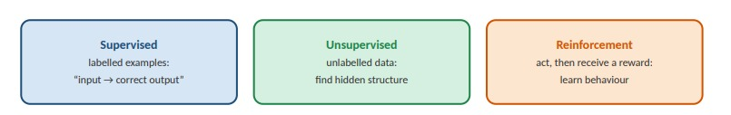
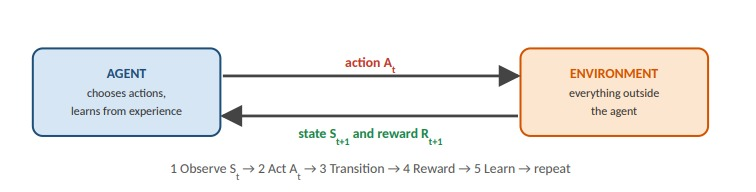
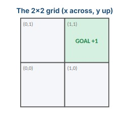
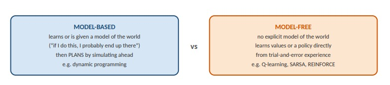
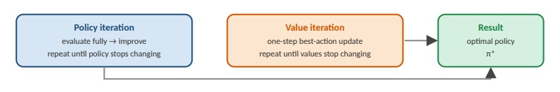
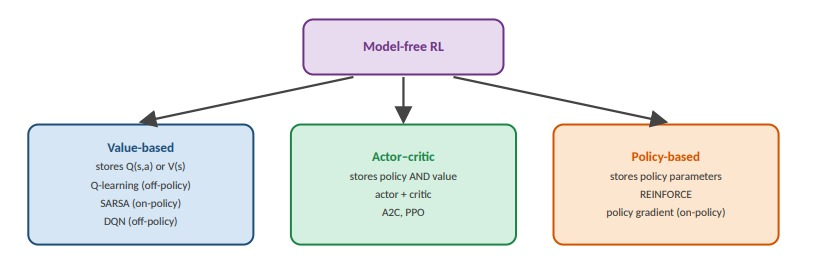
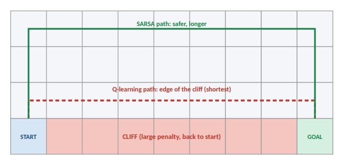
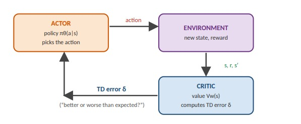
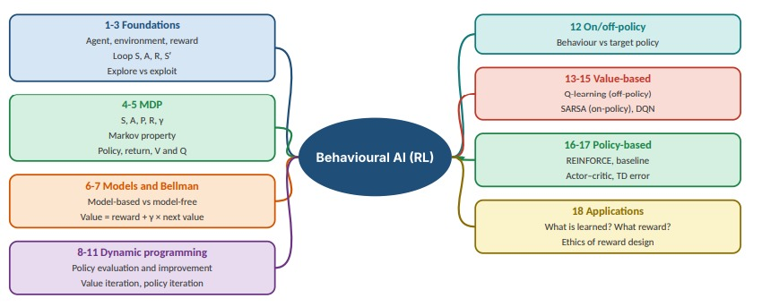

# Computer Hardware & Microarchitecture

**Module 1**

Aligned with Cambridge IGCSE Computer Science 0478 / O Level 2210 and AS & A Level 9618

Integrated with D. Watson & H. Williams, Cambridge IGCSE and O Level Computer Science and Cambridge International AS & A Level Computer Science

Part of: Hardware, Networks and Behaviourist AI

------------------------------------------------------------------------

# Contents

- Module overview and learning outcomes
- How to study this module
- 1.1 Physical parts of a computer
- 1.2 Number systems and data units
- 1.3 Binary logic
- 1.4 System architecture and the Von Neumann engine
- 1.5 The fetch–decode–execute cycle, interrupts and pipelining
- 1.6 Memory hierarchy and cache
- 1.7 RAM, ROM and storage technologies
- 1.8 Buffers and virtual memory
- 1.9 Input and output devices
- 1.10 Network hardware and cloud storage
- 1.11 Embedded systems, monitoring and control
- 1.12 Processor specialisation and CPU core types
- 1.13 Module summary and mind map
- 1.14 Case studies
- 1.15 Exam-style mixed practice with answers
- 1.16 End-of-module test with answers
- 1.17 Learning material list
- 1.18 Glossary
- 1.19 References and attribution

# Module overview and learning outcomes

This module introduces the physical components of a computer and the microarchitectural principles that let those components execute instructions. It starts with the parts you can touch, establishes the binary number system (the language all hardware speaks), and builds upward through logic gates, the Von Neumann model, the fetch–decode–execute cycle, the memory hierarchy, input/output devices, networks, embedded systems, monitoring and control, and processor specialisation.

**Prerequisite knowledge:** none beyond everyday familiarity with a computer. Binary is taught in Section 1.2 before any section that uses it, and every new term is defined before it is used.

> **By the end of this module you should be able to:**
>
> 1.  Identify the major internal components of a computer and state the role of each.
> 2.  Convert between binary, denary and hexadecimal, and explain why hexadecimal is used.
> 3.  State and use the units of data: bit, nibble, byte, KB, MB, GB, TB.
> 4.  Explain how transistors form logic gates and how gates form combinational and sequential circuits.
> 5.  Identify the registers and buses of the Von Neumann architecture and explain the role of each.
> 6.  Trace the fetch–decode–execute (FDE) cycle stage by stage, naming the registers and buses active at each step.
> 7.  Explain how interrupts and the interrupt service routine (ISR) work, and how pipelining speeds up instruction throughput.
> 8.  Explain why the memory hierarchy exists and compare DRAM and SRAM.
> 9.  Distinguish PROM, EPROM and EEPROM, and state appropriate uses for each.
> 10. Explain what buffers and virtual memory are, and why they exist.
> 11. Describe the principles of operation of common input and output devices, including sensors and actuators, and compare HDMI and VGA.
> 12. Compare local storage with cloud storage, and describe the network hardware that makes cloud storage possible.
> 13. Describe embedded systems, real-time constraints, and monitoring/control systems.
> 14. Compare CPU, GPU and TPU architectures in terms of latency and throughput.

## How to study this module

Every section follows the same rhythm, so you always know what to do next:

1.  **Read the objectives** (blue box) so you know the target.
2.  **Read the explanation** and study each figure. Redraw the figure from memory when you finish the section.
3.  **Follow the worked example** (purple box) line by line with a pencil.
4.  **Do the activity** (orange box) *before* reading the checked answer (green box).
5.  **Answer the exam-style question** (red box) in full sentences, then compare with the mark scheme.

> **Suggested study plan (about 6 weeks, 3 sessions per week)**
>
> | Week | Sections         | Focus                                               | Self-check                                               |
> |------|------------------|-----------------------------------------------------|----------------------------------------------------------|
> | 1    | 1.1, 1.2         | Components; binary, denary, hex conversions         | Convert 10 numbers each way without a calculator         |
> | 2    | 1.3, 1.4         | Logic gates, truth tables; registers and buses      | Draw the Von Neumann diagram from memory                 |
> | 3    | 1.5, 1.6         | FDE trace, interrupts, pipelining; memory hierarchy | Trace an ADD instruction register by register            |
> | 4    | 1.7, 1.8, 1.9    | RAM/ROM types; buffers, virtual memory; I/O devices | Make a one-page comparison table for DRAM/SRAM/ROM types |
> | 5    | 1.10, 1.11, 1.12 | Networks, cloud, embedded systems, CPU/GPU/TPU      | Explain a washing machine as a control system            |
> | 6    | 1.13 – 1.16      | Mind map, case studies, mixed practice, test        | Sit the end-of-module test under timed conditions        |
>
> **Learning suggestions:** (1) Use *retrieval practice*: close the book and write down everything you remember, then check. (2) Use *spaced repetition*: re-do the activities after 1 day, 1 week and 1 month. (3) Explain each concept aloud to someone else — if you cannot, you have found a gap. (4) Always show working in conversions; marks are usually awarded for method. (5) Pair each new term with a one-line everyday analogy (for example: a register is a sticky note on your desk, RAM is the desk, storage is the filing cabinet).

# Section 1.1 — Physical Parts of a Computer

> **Learning objectives**
>
> By the end of this section you should be able to name the main physical components inside a computer, state the purpose of each, and explain the difference between hardware, firmware, software and data.

## 1.1.1 What hardware actually means

**Hardware** is the set of physical parts of a computer that you can see, touch and (usually) move. It is contrasted with **software**, the instructions and data the hardware carries out and stores. Software has no physical form of its own; it exists as patterns stored in hardware.

| Term     | Meaning                                                                     | Example                              |
|----------|-----------------------------------------------------------------------------|--------------------------------------|
| Hardware | The physical parts                                                          | The CPU chip                         |
| Software | Programs and data stored as patterns in hardware                            | A web browser                        |
| Firmware | Software permanently stored in hardware, usually in ROM, and rarely changed | The BIOS/UEFI that starts a computer |
| Data     | Raw facts that programs process                                             | The numbers in a spreadsheet         |

A computer works only when all four cooperate. The hardware provides the physical capability, the firmware starts the machine, the software tells the hardware what to do, and the data is what gets processed.

## 1.1.2 The motherboard

The **motherboard** is the large circuit board that everything else plugs into. Its purpose is not to *do* computing itself but to *connect* the parts that do, and to supply them with power and communication pathways. It holds the CPU socket, the RAM slots, expansion slots for add-on cards, the **chipset** (support chips managing communication), storage connectors, input/output connectors, and the firmware chip holding the BIOS/UEFI.

Connections between components are made by **traces**: thin copper pathways printed into the board. Traces carry both electrical power and electrical signals. When a diagram shows a line between the CPU and RAM, that line represents a set of traces forming a **bus**, explained in Section 1.4.

> **Why this matters**
>
> A fast CPU connected by a slow or narrow pathway cannot perform at its full speed. The motherboard and its traces are part of the performance story.

*Figure 1 — Motherboard block diagram. Traces carry both electricity and signals between components.*

## 1.1.3 The CPU

The **Central Processing Unit (CPU)** fetches instructions, decodes them and executes them. Inside are the Control Unit (CU), the Arithmetic Logic Unit (ALU), registers, and cache memory.

## 1.1.4 RAM: the workspace

**Random Access Memory (RAM)** is the short-term workspace. Programs and data currently in use are loaded into RAM for fast access. RAM is **volatile**: its contents are lost when power is removed.

> **Why RAM exists**
>
> SSDs and hard drives are much slower than the CPU. Without RAM, the CPU would spend most of its time waiting. RAM is the intermediate workspace fast enough to keep the CPU busy. Section 1.6 explains this speed gap.

## 1.1.5 ROM: permanent start-up instructions

**Read-Only Memory (ROM)** is **non-volatile**: it keeps its contents when power is switched off. ROM stores firmware, such as the BIOS/UEFI that starts the computer and checks the hardware before loading the operating system.

## 1.1.6 Secondary storage

- **HDD (hard disk drive)**: magnetic spinning platters; large capacity, relatively cheap, slower, sensitive to movement.
- **SSD (solid-state drive)**: flash memory chips, no moving parts; faster, quieter, more shock-resistant, more expensive per gigabyte.
- **USB flash drives and memory cards**: portable flash storage.

## 1.1.7 GPU and TPU

A **GPU (Graphics Processing Unit)** contains hundreds or thousands of small arithmetic units that operate concurrently, making it effective for graphics rendering and parallel numerical work. A **TPU (Tensor Processing Unit)** is an ASIC (application-specific integrated circuit) designed to accelerate machine-learning matrix operations. Its core is a **systolic array**: a grid of processing elements through which data flows in a regular rhythm.

## 1.1.8 The system clock

The **system clock** produces timing signals measured in hertz (Hz); 1 GHz is one billion ticks per second. Clock speed is one of three IGCSE performance factors, alongside cache size and number of cores.

## 1.1.9 Other common components

- **PSU**: converts mains electricity into DC voltages.
- **Cooling system**: fans, heat sinks or liquid cooling remove heat.
- **Expansion cards**: add graphics, Wi-Fi, sound, etc.
- **Case**: protects components and supports airflow.

> **Activity 1.1 — Identify the component**
>
> | Job                                     | Component |
> |-----------------------------------------|-----------|
> | Holds the program currently running     | ?         |
> | Starts the computer before the OS loads | ?         |
> | Performs arithmetic                     | ?         |
> | Connects all components                 | ?         |
> | Keeps files when power is off           | ?         |

> **Checked answers**
>
> | Job                                     | Component         |
> |-----------------------------------------|-------------------|
> | Holds the program currently running     | RAM               |
> | Starts the computer before the OS loads | ROM / firmware    |
> | Performs arithmetic                     | ALU               |
> | Connects all components                 | Motherboard       |
> | Keeps files when power is off           | Secondary storage |

> **Exam-style practice**
>
> **Question (2 marks).** Explain why RAM is described as volatile.
>
> **Checked answer.** RAM loses its contents when power is removed **(1)**, because it relies on electrical charge that is not maintained without power **(1)**.

## 1.1.10 Motherboard form factors

A **form factor** is a standard that defines a motherboard's physical dimensions, mounting-hole positions, and the layout of expansion slots and connectors. Form factors exist so that cases, power supplies and add-on cards from different manufacturers fit together. Without a recognised form factor, every case and PSU would have to be custom-made.

| Form factor         | Typical size  | Expansion slots | Typical use                                   |
|---------------------|---------------|-----------------|-----------------------------------------------|
| EATX (Extended ATX) | ~305 x 330 mm | Up to 7         | Workstations, servers, multi-GPU builds       |
| ATX (standard)      | ~305 x 244 mm | Up to 7         | Desktop PCs, gaming builds                    |
| Micro-ATX (mATX)    | ~244 x 244 mm | Up to 4         | Smaller desktops, budget builds               |
| Mini-ITX            | ~170 x 170 mm | 1–2             | Small-form-factor PCs, home theatre, embedded |

*Figure 2 — Relative sizes of the four main motherboard form factors.*

> **Worked example — choosing a form factor**
>
> A user needs a gaming PC with two graphics cards, four RAM modules and a large air cooler. EATX or full ATX is best: more expansion slots, more RAM slots, and enough clearance for cooling. A user building a small home-theatre PC should choose Mini-ITX: it fits a compact case but limits slots and cooling options.

> **Activity 1.1.10 — Match the form factor**
>
> | Scenario                        | Best form factor | Reason |
> |---------------------------------|------------------|--------|
> | Dual-GPU scientific workstation | ?                | ?      |
> | Standard office desktop         | ?                | ?      |
> | Small home-theatre PC           | ?                | ?      |
> | Budget family PC                | ?                | ?      |

> **Checked answers**
>
> | Scenario                        | Best form factor | Reason                                                    |
> |---------------------------------|------------------|-----------------------------------------------------------|
> | Dual-GPU scientific workstation | EATX or ATX      | Most expansion slots; room for cooling and power delivery |
> | Standard office desktop         | ATX              | Standard, widely available, enough slots                  |
> | Small home-theatre PC           | Mini-ITX         | Smallest footprint, fits compact cases                    |
> | Budget family PC                | Micro-ATX        | Cheaper, smaller, enough slots for basic use              |

> **Exam-style practice**
>
> **Question (2 marks).** Explain why motherboard form factors are standardised.
>
> **Checked answer.** Standardisation ensures cases, power supplies and expansion cards fit together across manufacturers **(1)**, reducing cost and allowing upgrades **(1)**.

## 1.1.11 Power supply unit: internal mechanics

The **power supply unit (PSU)** converts the high-voltage alternating current (AC) from a wall socket into the low-voltage direct current (DC) that the computer's components need. The conversion happens in four stages.

*Figure 3 — The four stages of AC-to-DC conversion inside a PSU.*

> **Worked example — why smoothing matters**
>
> After rectification the DC output still pulses: the diodes only allow current one way, but the voltage drops to zero between peaks. A smoothing capacitor charges during the peaks and discharges between them, filling the gaps. Without smoothing, sensitive components would receive a rippled supply and could malfunction.

> **Activity 1.1.11 — Order the stages**
>
> | Stage               | Position (1–4) | What it does |
> |---------------------|----------------|--------------|
> | Voltage regulator   | ?              | ?            |
> | Transformer         | ?              | ?            |
> | Smoothing capacitor | ?              | ?            |
> | Rectifier           | ?              | ?            |

> **Checked answers**
>
> | Stage               | Position | What it does                |
> |---------------------|----------|-----------------------------|
> | Transformer         | 1        | Steps AC voltage down       |
> | Rectifier           | 2        | Converts AC to pulsating DC |
> | Smoothing capacitor | 3        | Removes ripple              |
> | Voltage regulator   | 4        | Holds stable DC output      |

> **Exam-style practice**
>
> **Question (3 marks).** Describe how a PSU converts AC to DC.
>
> **Checked answer.** Transformer steps voltage down **(1)**; rectifier converts AC to DC using diodes **(1)**; smoothing capacitors remove ripple and a regulator holds a steady output **(1)**.

## 1.1.12 PSU internal components

Opening a PSU (only safely, with the unit unplugged and discharged) reveals a circuit board with several distinct components. Each plays a role in conversion, filtering or protection.

| Component           | Function                                                                    |
|---------------------|-----------------------------------------------------------------------------|
| Transformer         | Steps the AC voltage down using magnetic induction between coils.           |
| Rectifier diodes    | Allow current to flow in one direction only, converting AC to pulsating DC. |
| Capacitors          | Store charge and smooth out voltage ripple; also filter noise.              |
| Resistors           | Limit current and divide voltage; used in sensing circuits.                 |
| Rotary switch       | On some older PSUs, selects the input voltage (110 V or 230 V).             |
| Heatsinks           | Dissipate heat from power transistors and diodes.                           |
| Fan                 | Moves air through the unit to keep components within safe temperatures.     |
| Protection circuits | Shut down the PSU on over-voltage, over-current or short-circuit.           |

> **Activity 1.1.12 — Match the component to its role**
>
> Match each component to its role: transformer, rectifier diodes, capacitors, resistors, rotary switch. Roles: (a) selects input voltage, (b) limits current, (c) smooths ripple, (d) converts AC to pulsating DC, (e) steps voltage down.

> **Checked answers**
>
> Transformer → (e). Rectifier diodes → (d). Capacitors → (c). Resistors → (b). Rotary switch → (a).

> **Exam-style practice**
>
> **Question (2 marks).** State the function of the rectifier diodes in a PSU.
>
> **Checked answer.** They allow current to flow in one direction only **(1)**, converting AC into pulsating DC **(1)**.

## 1.1.13 Graphics card (GPU) components

A graphics card is an expansion card that contains a GPU and its supporting components. It handles graphics rendering and highly parallel numerical work. A modern graphics card has seven main parts.

| Part                                   | Function                                                                                                  |
|----------------------------------------|-----------------------------------------------------------------------------------------------------------|
| 1\. GPU chip                           | The processor itself; contains thousands of shader cores that execute rendering and parallel computation. |
| 2\. VRAM                               | Dedicated video memory that stores textures, framebuffers and working data for the GPU.                   |
| 3\. PCIe interface                     | The edge connector that plugs into the motherboard and carries data between CPU and GPU.                  |
| 4\. Heatsink + fan                     | Removes heat generated by the GPU chip and VRAM.                                                          |
| 5\. 6/8-pin auxiliary power connectors | Supply extra power beyond what the PCIe slot provides; needed for high-end GPUs.                          |
| 6\. Monitor outputs                    | HDMI, DisplayPort, DVI and other connectors that send video to displays.                                  |
| 7\. Video BIOS                         | Firmware that initialises the card at start-up and controls clock speeds and voltages.                    |

*Figure 4 — The seven main parts of a graphics card.*

> **Worked example — why auxiliary power matters**
>
> A high-end GPU can draw 250 W or more, but the PCIe slot provides only 75 W. Without the 6-pin and 8-pin auxiliary connectors, the card would not receive enough power and would throttle or fail to start. The PSU's PCIe power cables plug into these connectors.

> **Activity 1.1.13 — Match the GPU part**
>
> | Function                             | Part |
> |--------------------------------------|------|
> | Stores textures and framebuffers     | ?    |
> | Connects the card to the motherboard | ?    |
> | Supplies extra power beyond the slot | ?    |
> | Initialises the card at start-up     | ?    |
> | Removes heat from the GPU            | ?    |

> **Checked answers**
>
> VRAM; PCIe interface; 6/8-pin connectors; Video BIOS; heatsink + fan.

> **Exam-style practice**
>
> **Question (2 marks).** Explain why high-end GPUs need auxiliary power connectors.
>
> **Checked answer.** They draw more power than the PCIe slot can supply **(1)**; the 6- or 8-pin connectors deliver the extra current from the PSU **(1)**.

> **💡 Did you know?**
>
> ENIAC, one of the first general-purpose electronic computers (1945), used about 17,500 vacuum tubes and weighed about 27 tonnes. The processor in a modern phone holds billions of transistors on a chip smaller than a fingernail.

# Section 1.2 — Number Systems and Data Units

> **Learning objectives**
>
> Explain what a bit is, convert between binary and denary, convert between binary and hexadecimal, and use the units bit, nibble, byte, KB, MB, GB and TB.

## 1.2.1 What is a bit?

A **bit** is a single binary digit: 0 or 1. In hardware these are two voltage levels. A bit is an abstraction for a two-state circuit; using only two widely separated voltage levels makes circuits reliable against noise, heat and manufacturing variation. **Binary** is the base-2 number system using only 0 and 1. **Denary** is the everyday base-10 system.

> **▶ Watch: Representing Numbers and Letters with Binary**
>
> Crash Course Computer Science \#4 (YouTube, about 10 min)
>
> A fast, animated walk through binary place values, bytes and how text is stored as numbers.
>
> <https://www.youtube.com/watch?v=1GSjbWt0c9M>
>

## 1.2.2 Units of data

| Unit          | Size           | Example use         |
|---------------|----------------|---------------------|
| bit           | 1 binary digit | one flag            |
| nibble        | 4 bits         | one hex digit       |
| byte          | 8 bits         | one ASCII character |
| KB (kilobyte) | 1024 bytes     | short text file     |
| MB            | 1024 KB        | photo               |
| GB            | 1024 MB        | video / RAM         |
| TB            | 1024 GB        | SSD / HDD           |

> **Convention note**
>
> In this module 1 KB = 1024 bytes because 1024 = 210. This is the convention used in Cambridge papers. Storage manufacturers sometimes use 1000 bytes per KB. The IEC names the power-of-two units kibibyte (KiB), mebibyte (MiB) and so on. Use 1024 in exams unless told otherwise.

## 1.2.3 Binary place values

Each bit position has a value that is double the one to its right. To convert binary to denary, add the place values wherever there is a 1.

*Figure 5 — Binary place-value chart: 10110101 = 181.*

> **Worked example — 1011 to denary**
>
> 10112 = 1×23 + 0×22 + 1×21 + 1×20 = 8 + 0 + 2 + 1 = 1110

> **Worked example — 45 to binary**
>
> Find the largest place value that fits and subtract: 45 = 32 + 8 + 4 + 1, so put a 1 in the 32, 8, 4 and 1 columns: 4510 = 001011012 (8 bits), or 1011012 without leading zeros.

## 1.2.4 Hexadecimal

**Hexadecimal** uses 0–9 and A–F (base 16), where A = 10, B = 11, C = 12, D = 13, E = 14, F = 15. Each hex digit represents exactly four bits (one nibble), so hex is a compact, less error-prone way to write binary. It is used for memory addresses, machine code and colour codes.

> **Worked example — B7 to denary**
>
> B716 = 11 × 16 + 7 = 176 + 7 = 18310

*Figure 6 — Binary to hex grouping: 1101 0110 = D6.*

## 1.2.5 Conversion practice

| Task                        | Answer                                 |
|-----------------------------|----------------------------------------|
| 101102 to denary | 16 + 4 + 2 = 2210           |
| 4510 to binary   | 1011012                     |
| 111011012 to hex | 1110 = E, 1101 = D, so ED16 |
| B716 to denary   | 18310                       |
| 2C16 to binary   | 0010 1100 = 001011002       |
| 3 bytes = ? bits / nibbles  | 24 bits, 6 nibbles                     |

> **Activity 1.2 — Try it yourself**
>
> Convert: (a) 110012 to denary; (b) 10010 to binary; (c) 3F16 to denary; (d) 101011112 to hex.

> **Checked answers**
>
> \(a\) 16 + 8 + 1 = 25. (b) 64 + 32 + 4 = 011001002. (c) 3 × 16 + 15 = 63. (d) 1010 = A, 1111 = F, so AF16.

> **Exam-style practice**
>
> **Question (2 marks).** Explain why hexadecimal is used for memory addresses.
>
> **Checked answer.** Each hex digit represents four binary bits **(1)**, so long binary addresses become short and less error-prone **(1)**.

> **🔧 Try it yourself: your calculator speaks binary**
>
> Open your computer’s calculator and switch to **Programmer** mode (Windows Calculator or macOS Calculator → View → Programmer). Type **200** and read off BIN = 1100 1000 and HEX = C8. Now enter your birth year and convert it by hand first, then check.

# Section 1.3 — Binary Logic

> **Learning objectives**
>
> Explain how transistors form logic gates, state the function of standard gates, complete truth tables, distinguish combinational from sequential circuits, and explain the half-adder.

## 1.3.1 From transistors to gates

A **transistor** is a tiny electronic switch. Combining transistors forms **logic gates**: circuits whose output depends on the inputs according to a fixed rule. A **truth table** lists every input combination and the corresponding output.

> **▶ Watch: Boolean Logic & Logic Gates**
>
> Crash Course Computer Science \#3 (YouTube, about 11 min)
>
> Shows how transistors become AND, OR, NOT and XOR gates, matching Section 1.3.
>
> <https://www.youtube.com/watch?v=gI-qXk7XojA>
>

*Figure 7 — Standard logic gate symbols.*

| A   | B   | AND | OR  | XOR | NAND | NOR | XNOR |
|-----|-----|-----|-----|-----|------|-----|------|
| 0   | 0   | 0   | 0   | 0   | 1    | 1   | 1    |
| 0   | 1   | 0   | 1   | 1   | 1    | 0   | 0    |
| 1   | 0   | 0   | 1   | 1   | 1    | 0   | 0    |
| 1   | 1   | 1   | 1   | 0   | 0    | 0   | 1    |

**Memory aids:** AND outputs 1 only if *both* inputs are 1. OR outputs 1 if *at least one* input is 1. XOR outputs 1 if the inputs are *different*. NOT inverts a single input. NAND, NOR and XNOR are AND, OR and XOR followed by NOT.

## 1.3.2 Combinational and sequential circuits

**Combinational circuits** depend only on the current inputs (adders, multiplexers, decoders). **Sequential circuits** depend on the current inputs *and* stored state, updated on clock ticks (flip-flops, latches). Flip-flops are the physical basis of registers and memory cells.

## 1.3.3 The half-adder

A half-adder adds two single bits, producing a **Sum** and a **Carry**.

*Figure 8 — Half-adder: XOR gives the Sum, AND gives the Carry.*

| A   | B   | Sum (XOR) | Carry (AND) |
|-----|-----|-----------|-------------|
| 0   | 0   | 0         | 0           |
| 0   | 1   | 1         | 0           |
| 1   | 0   | 1         | 0           |
| 1   | 1   | 0         | 1           |

This matches binary addition: 1 + 1 = 102 (sum 0, carry 1). A **full adder** adds three bits (A, B and a carry-in) and chaining full adders forms the adder inside the ALU.

> **Activity 1.3 — Build a half-adder**
>
> Using AND and XOR gates, draw a half-adder and complete the outputs for A = 1, B = 1. Then complete the truth table for the expression NOT (A AND B).

> **Checked answer**
>
> Sum = 1 XOR 1 = 0; Carry = 1 AND 1 = 1. NOT (A AND B) is NAND: 1, 1, 1, 0 for AB = 00, 01, 10, 11.

> **Exam-style practice**
>
> **Question (3 marks).** Complete the truth table output for XOR when A = 0, B = 1; A = 1, B = 1; and state what the XOR output means.
>
> **Checked answer.** 0 XOR 1 = 1 **(1)**; 1 XOR 1 = 0 **(1)**; output is 1 only when the inputs differ **(1)**.

# Section 1.4 — System Architecture and the Von Neumann Engine

> **Learning objectives**
>
> Explain the stored-program concept, identify the main parts of the Von Neumann architecture, explain each register, and explain the three system buses.

## 1.4.1 The stored-program concept

The **Von Neumann architecture** stores both instructions and data in the same memory. This is the **stored-program concept**, proposed in the 1940s. It made general-purpose computing possible: to change what a computer does you change the program in memory rather than rewire the machine.

> **The Von Neumann bottleneck**
>
> Because instructions and data share the same memory and buses, the CPU cannot fetch an instruction and a data value at exactly the same instant. Cache memory (Section 1.6) reduces its impact.

*Figure 9 — Von Neumann architecture. Main memory is the Immediate Access Store (IAS).*

## 1.4.2 Core subcomponents

- **Control Unit (CU)**: fetches and decodes instructions and emits control signals that coordinate the other parts.
- **ALU**: performs arithmetic and bitwise logical operations.
- **Registers and cache**: very small, very fast storage inside the CPU.
- **Immediate Access Store (IAS)**: the Cambridge term for **main memory (RAM)**, the memory the CPU can access directly. It holds the running program and its data.
- **System clock**: timing signals sent on the control bus.

## 1.4.3 Registers

| Register                           | Purpose                                                                    |
|------------------------------------|----------------------------------------------------------------------------|
| PC (Program Counter)               | Address of the next instruction                                            |
| MAR (Memory Address Register)      | Address currently being read or written                                    |
| MDR (Memory Data Register)         | Data or instruction just retrieved from (or about to be written to) memory |
| CIR (Current Instruction Register) | Instruction currently being decoded and executed                           |
| ACC (Accumulator)                  | Intermediate ALU results                                                   |
| SR (Status Register)               | Status flags: Carry, Overflow, Zero, Negative                              |

## 1.4.4 Status flags

- **Carry** = 1 if a carry out of the most significant bit (MSB) occurred.
- **Overflow** = 1 if the signed result cannot be represented.
- **Zero** = 1 if the result is zero.
- **Negative** = 1 if the result is negative (MSB = 1 in two's complement).

Flags let the CPU make decisions such as “jump if zero”.

## 1.4.5 System buses

| Bus         | Direction               | Function                                                                             |
|-------------|-------------------------|--------------------------------------------------------------------------------------|
| Address bus | CPU to memory (one-way) | Carries the memory address; its width determines the maximum addressable memory.     |
| Data bus    | Two-way                 | Carries data and instructions; its width determines the number of bits per transfer. |
| Control bus | Two-way                 | Carries clock ticks and commands (READ, WRITE, INTERRUPT).                           |

> **Worked example — address bus width**
>
> With *n* address lines the bus can carry 2*n* different addresses. An 8-bit address bus addresses 28 = 256 locations. A 32-bit bus addresses 232 = 4 294 967 296 locations, which is 4 GiB if each location holds one byte.

> **Activity 1.4 — Match the register**
>
> | Job                                       | Register |
> |-------------------------------------------|----------|
> | Holds the address of the next instruction | ?        |
> | Holds the instruction being decoded       | ?        |
> | Holds data read from memory               | ?        |
> | Holds the address being read              | ?        |
> | Holds ALU results                         | ?        |
> | Holds Zero/Carry flags                    | ?        |

> **Checked answers**
>
> PC, CIR, MDR, MAR, ACC, SR.

> **Exam-style practice**
>
> **Question (2 marks).** State the role of the Program Counter.
>
> **Checked answer.** Holds the address of the next instruction **(1)**; incremented after each fetch **(1)**.
>
> **Question (2 marks).** A computer has a 16-bit address bus. State how many memory locations it can address.
>
> **Checked answer.** 216 **(1)** = 65 536 locations **(1)**.

> **💡 Did you know?**
>
> The Intel 4004 (1971), the first commercial single-chip microprocessor, had about 2,300 transistors. Gordon Moore had predicted in 1965 that transistor counts would keep doubling regularly, an observation now called *Moore’s law*.

# Section 1.5 — The Fetch–Decode–Execute Cycle, Interrupts and Pipelining

> **Learning objectives**
>
> Describe each FDE stage, name the registers and buses used, explain interrupts and the ISR, and explain how instructions are encoded and how pipelining improves throughput.

*Figure 10 — The FDE cycle. Writeback is shown as a separate stage; some syllabi merge it into Execute.*

## 1.5.1 Step by step

### Fetch

1.  PC → MAR via the address bus.
2.  READ signal on the control bus.
3.  Memory → MDR via the data bus.
4.  MDR → CIR.
5.  PC incremented.

### Decode

The CU decodes the opcode in the CIR and generates control signals.

> **▶ Watch: The Central Processing Unit (CPU)**
>
> Crash Course Computer Science \#7 (YouTube, about 11 min)
>
> Follows a small program through fetch, decode and execute, register by register.
>
> <https://www.youtube.com/watch?v=FZGugFqdr60>
>

### Execute

The ALU performs the operation and the SR flags are updated.

### Writeback

The result is stored in the ACC or written to memory.

## 1.5.2 Worked trace — ADD

| Step | Action                                      | Registers / buses    |
|------|---------------------------------------------|----------------------|
| 1    | Copy address 200 from PC to MAR             | PC, MAR, address bus |
| 2    | Send READ                                   | Control bus          |
| 3    | Memory contents to MDR                      | Data bus, MDR        |
| 4    | MDR to CIR; PC incremented                  | CIR, PC              |
| 5    | CU decodes ADD                              | CU, CIR              |
| 6    | Fetch the operand into MDR (address in MAR) | MAR, MDR, buses      |
| 7    | ALU adds the operand to ACC                 | ALU, ACC             |
| 8    | Update flags                                | SR                   |

## 1.5.3 Interrupts

An **interrupt** is a signal that causes the processor to suspend its current task and service an event. Causes: a timing signal, I/O completion, a user action, a hardware fault or a software error. At the end of each FDE cycle the processor checks for interrupts. The **Interrupt Service Routine (ISR)** services the highest-priority interrupt: the processor saves its state, runs the ISR, restores the state and continues. An interrupt does **not** restart the computer.

*Figure 11 — Interrupt handling.*

## 1.5.4 Instruction format, assembly and pipelining

An **instruction** has two parts: an **opcode** (which operation to perform) and an **operand** (the data or the address of the data). The set of all instructions a CPU understands is its **instruction set architecture (ISA)**. **Machine code** is instructions in binary; **assembly language** uses short mnemonics (LDA, ADD, STO, JMP) that an **assembler** translates to machine code, one assembly instruction to one machine instruction.

| Addressing mode | Operand meaning                                 | Example                                              |
|-----------------|-------------------------------------------------|------------------------------------------------------|
| Immediate       | The operand is the value itself                 | ADD \#5 adds the number 5                            |
| Direct          | The operand is the address of the value         | ADD 200 adds the contents of address 200             |
| Indirect        | The operand is the address of an address        | ADD (200): address 200 holds the address of the data |
| Indexed         | Operand address + contents of an index register | Used for arrays                                      |

**Pipelining** overlaps the stages of consecutive instructions so that, while one instruction is being executed, the next is being decoded and the one after is being fetched. It raises *throughput* (instructions completed per unit time) but does not shorten the time for a single instruction. Branches can disrupt a pipeline because the CPU may have fetched the wrong instructions.

*Figure 12 — Pipelining five instructions through a three-stage pipeline.*

> **Worked example — pipeline speed-up**
>
> Five instructions, three stages, one clock cycle per stage. Without pipelining: 5 × 3 = 15 cycles. With pipelining: the first instruction finishes after 3 cycles, then one more completes every cycle, so the total is 3 + (5 − 1) = 7 cycles. Speed-up = 15 / 7 ≈ 2.1.

> **Activity 1.5 — Order the FDE stages**
>
> | Scrambled step                   | Position |
> |----------------------------------|----------|
> | Instruction decoded and executed | ?        |
> | Address copied PC → MAR          | ?        |
> | PC incremented                   | ?        |
> | Memory → MDR                     | ?        |
> | MDR → CIR                        | ?        |

> **Checked answer**
>
> PC→MAR (1), Memory→MDR (2), MDR→CIR (3), PC incremented (4), decode/execute (5). (Some textbooks increment the PC straight after PC→MAR; either is accepted if the order within the fetch is consistent.)

> **Exam-style practice**
>
> **Question (3 marks).** Explain what happens when an interrupt is received.
>
> **Checked answer.** Save the current state **(1)**; service the highest-priority interrupt via the ISR **(1)**; restore the state and continue **(1)**.
>
> **Question (2 marks).** Four instructions pass through a three-stage pipeline. Calculate the number of clock cycles needed.
>
> **Checked answer.** 3 + (4 − 1) **(1)** = 6 cycles **(1)**.

> **🔧 Try it yourself: watch your own CPU work**
>
> Open **Task Manager → Performance → CPU** (Windows: Ctrl+Shift+Esc) or **Activity Monitor → CPU** (Mac). Note the clock speed and number of cores, then open a large app or game and watch utilisation and speed change. Which core-type ideas from Section 1.12 can you see?

# Section 1.6 — Memory Hierarchy and Cache

> **Learning objectives**
>
> Explain why a hierarchy exists, compare registers, cache, RAM and storage, explain locality, and explain how cache works.

Fast memory is expensive and small; large memory is cheap and slow. Computers therefore combine several kinds of memory in layers, keeping the most-needed data in the fastest layer. This is the **memory hierarchy**.

> **▶ Watch: Registers and RAM**
>
> Crash Course Computer Science \#6 (YouTube, about 12 min)
>
> Builds memory up from a single latch to registers and RAM, the bottom layers of the memory hierarchy.
>
> <https://www.youtube.com/watch?v=fpnE6UAfbtU>
>

*Figure 13 — Memory hierarchy pyramid.*

| Tier | Type      | Technology | Capacity       | Latency    |
|------|-----------|------------|----------------|------------|
| 1    | Registers | Flip-flops | ~1–2 KB        | \< 0.5 ns  |
| 2    | Cache     | SRAM       | 32 KB – 128 MB | 1–15 ns    |
| 3    | RAM       | DRAM       | 8–128 GB       | 50–100 ns  |
| 4    | Storage   | Flash SSD  | 512 GB – 4 TB  | ~50 000 ns |

## 1.6.1 Locality

**Temporal locality:** recently used data is likely to be reused soon. **Spatial locality:** data near recently used data is likely to be used soon. Cache exploits both by keeping recent data and by fetching neighbouring data together. A **cache hit** means the data is in cache; a **cache miss** means it must be fetched from a slower tier.

> **Worked example — cache benefit**
>
> If 90% of accesses hit cache (1 ns) and 10% miss and go to RAM (80 ns):  
> Average = 0.9 × 1 + 0.1 × 80 = 0.9 + 8 = **8.9 ns**.  
> This is far better than 80 ns for every access.

> **Activity 1.6 — Rank the access**
>
> Rank register, L1 cache, RAM and SSD from fastest to slowest. Then recalculate the average access time if the hit rate falls to 80%.

> **Checked answer**
>
> register → L1 cache → RAM → SSD. At an 80% hit rate: 0.8 × 1 + 0.2 × 80 = 0.8 + 16 = 16.8 ns, almost twice as slow, which shows why hit rate matters.

> **Exam-style practice**
>
> **Question (2 marks).** Explain why cache sits between the CPU and main memory.
>
> **Checked answer.** Cache is faster and holds frequently used data close to the CPU **(1)**, reducing the average wait time **(1)**.

> **🔧 Try it yourself: find your cache**
>
> On Windows, **Task Manager → Performance → CPU** lists the L1, L2 and L3 cache sizes. Compare L3 with your RAM size: how many times bigger is RAM? This is the size-versus-speed trade-off of the memory hierarchy.

# Section 1.7 — RAM, ROM and Storage Technologies

> **Learning objectives**
>
> Compare DRAM and SRAM, explain their uses, distinguish PROM, EPROM and EEPROM, and explain flash memory.

## 1.7.1 DRAM vs SRAM

**DRAM** (dynamic RAM) uses one transistor and one capacitor per bit. The capacitor leaks charge, so each cell must be **refreshed** periodically. DRAM is dense and cheap, so it is used for main memory. **SRAM** (static RAM) uses several transistors (commonly six) per bit; it needs no refresh while powered. It is fast but expensive and bulky, so it is used for cache and registers.

*Figure 14 — DRAM versus SRAM cells (simplified).*

| Feature      | DRAM                       | SRAM                   |
|--------------|----------------------------|------------------------|
| Storage      | 1 transistor + 1 capacitor | Multi-transistor latch |
| Refresh      | Yes                        | No (while powered)     |
| Speed        | Slower                     | Faster                 |
| Cost per bit | Lower                      | Higher                 |
| Density      | High                       | Lower                  |
| Typical use  | Main memory                | Cache                  |

## 1.7.2 ROM types

| Type       | Programmed        | Erased                                  | Typical use                                   |
|------------|-------------------|-----------------------------------------|-----------------------------------------------|
| ROM (mask) | At the factory    | Never                                   | Fixed firmware in mass-produced devices       |
| PROM       | Once, by the user | Cannot be erased                        | Small production runs                         |
| EPROM      | By the user       | Ultraviolet light; chip usually removed | Prototyping                                   |
| EEPROM     | By the user       | Electrically, often in-circuit          | Firmware updated in place, e.g. BIOS settings |

**Flash memory** is EEPROM-related, erased and written in blocks. It is used in SSDs, USB drives and memory cards.

> **Activity 1.7 — Choose the memory**
>
> | Situation                   | Best choice | Reason |
> |-----------------------------|-------------|--------|
> | Main memory                 | ?           | ?      |
> | L3 cache                    | ?           | ?      |
> | Firmware updated in-circuit | ?           | ?      |
> | USB drive                   | ?           | ?      |

> **Checked answers**
>
> | Situation                   | Best choice | Reason                              |
> |-----------------------------|-------------|-------------------------------------|
> | Main memory                 | DRAM        | Dense and cheap per bit             |
> | L3 cache                    | SRAM        | Fast, no refresh                    |
> | Firmware updated in-circuit | EEPROM      | Electrically erasable in place      |
> | USB drive                   | Flash       | Non-volatile, block erase, portable |

> **Exam-style practice**
>
> **Question (2 marks).** Firmware must be updated without removing the chip. State the ROM type and justify it.
>
> **Checked answer.** EEPROM **(1)**, because it can be erased and reprogrammed electrically in-circuit **(1)**.

> **💡 Did you know?**
>
> The Apollo Guidance Computer that helped land astronauts on the Moon in 1969 had about 4 KB of erasable memory (2,048 words). A single photo on your phone is usually thousands of times larger.

# Section 1.8 — Buffers and Virtual Memory

> **Learning objectives**
>
> Define a buffer, distinguish buffers from cache, and explain virtual memory, paging and swapping.

## 1.8.1 Buffers

A **buffer** is temporary storage used during data transfer between devices with different speeds. Examples: keyboard buffer, printer buffer, video-streaming buffer and double buffering of display frames.

*Figure 15 — A buffer smoothing speed differences.*

> **Buffer vs cache**
>
> A **cache** speeds up *repeated* access to the same data. A **buffer** smooths a *speed mismatch* during a transfer; the data is usually read once, in order.

## 1.8.2 Virtual memory

**Virtual memory** uses secondary storage as extra RAM. The operating system divides memory into fixed-size **pages** and moves them between RAM and a **swap file** (page file). A **page fault** occurs when a required page is not in RAM. **Thrashing** is excessive swapping, where the system spends more time moving pages than running programs.

*Figure 16 — Virtual memory: pages swapped between RAM and the swap file.*

**How it works:** the OS checks whether a page is in RAM; if not, a page fault occurs, an unneeded page is written to the swap file, and the required page is read into RAM. This is much slower than RAM but allows programs larger than RAM to run. Adding more RAM reduces page faults.

> **Activity 1.8 — Buffer or cache?**
>
> | Scenario                       | Buffer or cache? | Why |
> |--------------------------------|------------------|-----|
> | Keyboard holds key presses     | ?                | ?   |
> | CPU holds recently used data   | ?                | ?   |
> | Video player stores data ahead | ?                | ?   |
> | L1 holds loop instructions     | ?                | ?   |

> **Checked answers**
>
> | Scenario                       | Answer | Why                                   |
> |--------------------------------|--------|---------------------------------------|
> | Keyboard holds key presses     | Buffer | Speed mismatch with the CPU           |
> | CPU holds recently used data   | Cache  | Temporal locality                     |
> | Video player stores data ahead | Buffer | Smooths network variation             |
> | L1 holds loop instructions     | Cache  | Repeated use of the same instructions |

> **Exam-style practice**
>
> **Question (3 marks).** Explain how virtual memory allows a program larger than RAM to run.
>
> **Checked answer.** The OS divides memory into pages **(1)**; unused pages are moved to secondary storage **(1)**; needed pages are swapped back into RAM **(1)**.

# Section 1.9 — Input and Output Devices

> **Learning objectives**
>
> Describe the principles of operation of common input and output devices, including sensors, actuators, printers and displays, and compare HDMI and VGA.

## 1.9.1 Input devices

An **input device** converts data from the outside world into a digital signal the computer can process.

| Device          | Principle of operation                                                                                           | Typical use                      |
|-----------------|------------------------------------------------------------------------------------------------------------------|----------------------------------|
| Keyboard        | Key presses close circuits, generating a unique code (e.g. ASCII).                                               | Text and number entry            |
| Mouse           | Movement is detected by a sensor and translated into cursor movement; buttons register clicks.                   | Pointing and selection           |
| Microphone      | Converts sound waves into electrical signals, then into digital data via an ADC (analogue-to-digital converter). | Voice input, audio recording     |
| Barcode scanner | Shines light on a barcode; the reflected light pattern is converted into a digital code.                         | Retail, inventory                |
| QR code scanner | A camera captures the QR pattern; software decodes the data.                                                     | Mobile payments, advertising     |
| Digital camera  | A lens focuses light onto a sensor (CCD/CMOS) that converts it into digital pixels.                              | Photography, video               |
| 2D / 3D scanner | 2D scans documents; 3D scans objects using lasers or structured light.                                           | Document archiving, 3D modelling |
| Touchscreen     | Detects touch via capacitive or resistive layers; position is calculated by a microprocessor.                    | Smartphones, kiosks              |
| Sensors         | Measure physical quantities (light, temperature, pressure, moisture) and output a signal.                        | Monitoring and control systems   |

## 1.9.2 Output devices

An **output device** presents processed results.

| Device                | Principle of operation                                                           | Typical use                |
|-----------------------|----------------------------------------------------------------------------------|----------------------------|
| Inkjet printer        | Sprays tiny droplets of ink onto paper.                                          | Home/office printing       |
| Laser printer         | A laser charges a drum; toner adheres to the charge and is fused onto paper.     | High-volume printing       |
| 3D printer            | Builds objects layer by layer from plastic, resin or metal.                      | Prototyping, manufacturing |
| 2D / 3D cutter        | 2D cuts flat material; 3D cuts or sculpts objects.                               | Sign-making, fabrication   |
| Speakers / headphones | Convert electrical signals into sound waves.                                     | Audio output               |
| Actuators             | Electromechanical devices (motors, valves, relays) that produce physical action. | Control systems            |
| LCD / LED display     | LCD uses liquid crystals; LED uses light-emitting diodes as backlight or pixels. | Monitors, TVs, phones      |
| LCD / DLP projector   | Projects an image onto a screen using LCD panels or DLP micromirrors.            | Presentations, cinema      |

## 1.9.3 HDMI vs VGA

| Feature     | HDMI                    | VGA                           |
|-------------|-------------------------|-------------------------------|
| Signal      | Digital                 | Analogue                      |
| Audio       | Yes (when supported)    | No                            |
| Connector   | Compact, flat           | 15-pin D-sub                  |
| Typical use | Modern displays and TVs | Older displays and projectors |

## 1.9.4 Worked example — a mouse click

> **Mouse click**
>
> Mouse → I/O controller → device driver → CPU executes → display controller updates the monitor. The CPU does not “see” the mouse directly; the device driver translates between the hardware and the operating system.

> **Activity 1.9 — Match the device**
>
> | Task                                | Most suitable device | Reason |
> |-------------------------------------|----------------------|--------|
> | Enter text into a word processor    | ?                    | ?      |
> | Read a product barcode at checkout  | ?                    | ?      |
> | Print a high-volume office document | ?                    | ?      |
> | Produce a physical prototype        | ?                    | ?      |

> **Checked answers**
>
> Keyboard (text entry); barcode scanner (fast, accurate); laser printer (high volume, low cost per page); 3D printer (layered construction).

> **Exam-style practice**
>
> **Question (2 marks).** Compare HDMI and VGA in signal type and audio support.
>
> **Checked answer.** HDMI is digital and carries audio **(1)**; VGA is analogue and does not carry audio **(1)**.

# Section 1.10 — Network Hardware and Cloud Storage

> **Learning objectives**
>
> Define LAN and WAN, identify common network hardware, explain packets, and compare local and cloud storage.

## 1.10.1 Networks

A **LAN (Local Area Network)** covers a small area such as a home, school or office. A **WAN (Wide Area Network)** covers a large area such as cities or countries; the Internet is the best-known WAN. Networks allow resource sharing, communication and central management. The *Networks* module in this series covers them in depth.

## 1.10.2 Network hardware

| Device                       | Role                                                                                           |
|------------------------------|------------------------------------------------------------------------------------------------|
| NIC (network interface card) | Connects a device to a network; converts data into signals. Each NIC has a unique MAC address. |
| Switch                       | Forwards data within a LAN to the intended device only.                                        |
| Router                       | Connects different networks and forwards packets between them.                                 |
| WAP (wireless access point)  | Provides wireless access to a wired network.                                                   |
| Modem                        | Converts signals between the service provider's line and the local network.                    |
| Firewall                     | Monitors and controls traffic for security.                                                    |

Data is broken into **packets**: small units with addressing information. Packets let many devices share a network efficiently.

## 1.10.3 Cloud storage

**Cloud storage** stores data on provider servers accessed over a network. The user's device sends data to a data centre; the provider stores it and makes it available to authorised devices.

| Feature   | Local storage         | Cloud storage                     |
|-----------|-----------------------|-----------------------------------|
| Location  | User device           | Provider servers                  |
| Access    | Direct                | Requires a network                |
| Capacity  | Limited by the device | Often scalable                    |
| Sharing   | Manual                | Easy via links                    |
| Main risk | Device loss or damage | Account security, provider outage |
| Cost      | One-off hardware      | Subscription or usage-based       |

**Advantages of cloud:** access from multiple devices, easy backup, scalable capacity, collaboration. **Disadvantages:** depends on a network, ongoing cost, privacy and security concerns, provider lock-in.

> **Activity 1.10 — Local or cloud?**
>
> | Scenario                         | Better choice | Reason |
> |----------------------------------|---------------|--------|
> | Editing a video while travelling | ?             | ?      |
> | Sharing a group project          | ?             | ?      |
> | Backing up important photos      | ?             | ?      |
> | Storing an OS for fast boot      | ?             | ?      |

> **Checked answers**
>
> Local (no reliable network, low latency); cloud (easy sharing); cloud (off-site backup); local (low latency needed).

> **Exam-style practice**
>
> **Question (2 marks).** State one advantage and one disadvantage of cloud storage.
>
> **Checked answer.** Advantage: access from multiple devices or automatic backup **(1)**. Disadvantage: depends on an internet connection or raises security concerns **(1)**.

# Section 1.11 — Embedded Systems, Monitoring and Control

> **Learning objectives**
>
> Define an embedded system, identify its components, explain real-time constraints, and distinguish monitoring from control systems.

## 1.11.1 Embedded systems

An **embedded system** is a computer dedicated to a specific function inside a larger device. Components: microcontroller/processor, memory, sensors, actuators and I/O interfaces. Examples: washing machine, car control system, smart speaker, traffic light. Unlike a general-purpose PC, its program is fixed in ROM/flash and rarely changes.

## 1.11.2 Real-time constraints

**Hard real-time:** missing the deadline is a failure (e.g. an airbag controller). **Soft real-time:** missing the deadline degrades quality but is not catastrophic (e.g. video streaming).

## 1.11.3 Monitoring and control

A **monitoring system** observes and reports. A **control system** observes and acts automatically. **Sensors** measure, **actuators** act, and **feedback** uses the measured result to adjust future action.

| System type | Job                     | Example                       |
|-------------|-------------------------|-------------------------------|
| Monitoring  | Observe and report      | Temperature display           |
| Control     | Observe and act         | Thermostat switching a heater |
| Combined    | Observe, report and act | Smart thermostat              |

## 1.11.4 Worked example — greenhouse

Temperature sensor → microcontroller compares with the target → heater actuator switched on if too cold → vent/fan switched on if too warm → repeat (feedback). Note that the sensor produces an analogue signal, so an ADC converts it to digital before the microcontroller can use it.

*Figure 17 — A monitoring-and-control feedback loop.*

> **Activity 1.11 — Identify sensors and actuators**
>
> | System           | Sensor | Actuator |
> |------------------|--------|----------|
> | Washing machine  | ?      | ?        |
> | Greenhouse       | ?      | ?        |
> | Anti-lock brakes | ?      | ?        |
> | Smart speaker    | ?      | ?        |

> **Checked answers**
>
> | System           | Sensor                    | Actuator                 |
> |------------------|---------------------------|--------------------------|
> | Washing machine  | Water level / temperature | Motor / valve            |
> | Greenhouse       | Temperature               | Heater / vent            |
> | Anti-lock brakes | Wheel speed               | Brake-pressure modulator |
> | Smart speaker    | Microphone                | Speaker                  |

> **Exam-style practice**
>
> **Question (3 marks).** Describe three components of an embedded washing-machine system and their roles.
>
> **Checked answer.** Microcontroller executes the program **(1)**; sensor monitors water level/temperature **(1)**; actuator drives the motor/valve **(1)**.

# Section 1.12 — Processor Specialisation and CPU Core Types

> **Learning objectives**
>
> Compare CPU, GPU and TPU in latency and throughput, and distinguish P-cores from E-cores.

## 1.12.1 CPU, GPU, TPU

**Latency** is the delay before a result is available; **throughput** is the amount of work completed per unit time. A processor can be designed to favour one or the other.

| Processor       | Design goal                           | Best at                                                                        | Limitation                      |
|-----------------|---------------------------------------|--------------------------------------------------------------------------------|---------------------------------|
| CPU             | Low latency                           | Sequential, branchy code (operating system, general programs)                  | Lower parallel throughput       |
| GPU             | High throughput                       | Graphics, parallel numerical work (SIMT: single instruction, multiple threads) | Weak on branchy sequential code |
| TPU             | Very high throughput for tensor maths | Matrix multiplication for machine learning                                     | Narrow specialisation           |
| Microcontroller | Predictable, low power                | Dedicated control tasks with hard real-time deadlines                          | Small memory, limited speed     |

## 1.12.2 P-cores and E-cores

**P-cores** (performance cores) prioritise speed on demanding tasks. **E-cores** (efficiency cores) prioritise power efficiency on background tasks. More cores help only if the workload can be split to use them.

> **Activity 1.12 — Choose the processor**
>
> For each scenario choose from: CPU, GPU, TPU, microcontroller.
>
> | Scenario                  | Best choice | Reason |
> |---------------------------|-------------|--------|
> | Running a word processor  | ?           | ?      |
> | Rendering 3D game frames  | ?           | ?      |
> | Training a neural network | ?           | ?      |
> | Anti-lock braking control | ?           | ?      |

> **Checked answers**
>
> CPU (sequential, general purpose); GPU (parallel pixels); TPU (matrix maths); microcontroller (hard real-time, dedicated control).

> **Exam-style practice**
>
> **Question (4 marks).** Compare CPU, GPU and TPU for running an OS, rendering graphics and training a neural network.
>
> **Checked answer.** CPU for the OS (sequential) **(1)**; GPU for graphics (parallel pixels) **(1)**; TPU for training (matrix multiplication) **(1)**; each balances latency and throughput differently **(1)**.

# Section 1.13 — Module Summary and Mind Map

*Figure 18 — Mind map of Module 1: Computer Hardware and Microarchitecture.*

| Topic                        | Core comparison                                            |
|------------------------------|------------------------------------------------------------|
| 1.2 Binary / denary / hex    | Base and bit grouping; units bit to TB                     |
| 1.3 Logic                    | Gates, truth tables, half-adder                            |
| 1.4 Von Neumann              | Registers and three buses; IAS = main memory               |
| 1.5 FDE                      | Stage order; interrupts/ISR; pipelining                    |
| 1.6 Memory hierarchy         | Speed vs capacity vs cost; locality                        |
| 1.7 RAM/ROM                  | DRAM vs SRAM; PROM/EPROM/EEPROM; flash                     |
| 1.8 Buffers / virtual memory | Transfer storage; RAM + secondary storage                  |
| 1.9 I/O devices              | Input principles; output principles; HDMI vs VGA           |
| 1.10 Networks / cloud        | Network hardware; local vs cloud                           |
| 1.11 Embedded / control      | Specific function; real-time; sensors, actuators, feedback |
| 1.12 Processors              | Latency vs throughput; P-core vs E-core                    |

# Section 1.14 — Case Studies

Case studies apply several sections at once. Attempt each in writing before reading the model answer.

> **Case study 1 — “Why is my laptop so slow?”**
>
> A student's laptop has 4 GB of RAM and a hard disk drive. With 20 browser tabs and a video call open, the machine freezes and the disk light stays on.
>
> **Task:** explain the cause and suggest two upgrades.

> **Model answer**
>
> RAM is full, so the OS uses **virtual memory**: pages are swapped between RAM and the swap file on the slow HDD. Constant swapping is **thrashing**; the CPU waits for the disk. Upgrade 1: add RAM, so fewer page faults occur. Upgrade 2: replace the HDD with an SSD (flash, no moving parts, far lower latency), so swapping is faster. Also relevant: the CPU cache cannot help because the working set is too large.

> **Case study 2 — a smart greenhouse controller**
>
> A school builds a greenhouse that keeps temperature between 18 °C and 26 °C and waters plants when soil moisture falls below a threshold.
>
> **Task:** identify the sensors, actuators and the type of system; state whether the real-time constraint is hard or soft.

> **Model answer**
>
> Sensors: temperature and soil-moisture. Actuators: heater, vent/fan motor, water valve. It is a **control system** (it acts as well as observes) built on an **embedded** microcontroller using a **feedback** loop; because it can also display and log readings it is a combined system. Deadlines are **soft** real-time: a few seconds' delay does not cause failure. An ADC converts the analogue sensor signals to digital.

> **Case study 3 — specifying a video-editing PC**
>
> A student wants a PC for 4K video editing with two monitors and room to upgrade later.
>
> **Task:** recommend a motherboard form factor, memory, storage and processing hardware, and justify each choice.

> **Model answer**
>
> **ATX** motherboard: enough expansion slots and RAM slots for upgrades. **32 GB+ DRAM**: large video files live in RAM while editing. **NVMe SSD** for the project (low latency) plus a large HDD or cloud storage for archive. A **GPU** with plenty of VRAM accelerates rendering and effects through parallel processing, and needs auxiliary power connectors, so the **PSU** must have enough wattage and the right PCIe power cables. A multi-core CPU with several **P-cores** for encoding. Good cooling because sustained load generates heat.

# Section 1.15 — Exam-Style Mixed Practice with Full Answers

| \#  | Marks | Question                                                                  | Mark-scheme answer                                                                                          |
|-----|-------|---------------------------------------------------------------------------|-------------------------------------------------------------------------------------------------------------|
| 1   | 2     | Explain why hexadecimal is used for memory addresses.                     | Each hex digit = 4 bits; compact and less error-prone.                                                      |
| 2   | 4     | Describe the fetch stage of the FDE cycle.                                | PC→MAR via address bus; READ on control bus; memory→MDR via data bus; MDR→CIR; PC incremented.              |
| 3   | 3     | Explain what happens when an interrupt is received.                       | Save state; service the highest-priority interrupt with its ISR; restore state and continue.                |
| 4   | 2     | Explain why cache sits between the CPU and main memory.                   | Faster; holds frequently used data close to the CPU; reduces wait time.                                     |
| 5   | 3     | Explain how virtual memory allows a larger program to run.                | Pages moved to secondary storage and swapped back when needed.                                              |
| 6   | 2     | State one advantage and one disadvantage of cloud storage.                | Access from multiple devices; depends on network / security risk.                                           |
| 7   | 3     | Describe three components of an embedded washing-machine system.          | Microcontroller executes the program; sensor monitors water/temperature; actuator drives motor/valve.       |
| 8   | 2     | Compare HDMI and VGA in signal type and audio support.                    | HDMI digital + audio; VGA analogue, no audio.                                                               |
| 9   | 4     | Compare CPU, GPU and TPU for an OS, graphics and neural-network training. | CPU (sequential OS), GPU (parallel graphics), TPU (matrix training); different latency/throughput balances. |
| 10  | 2     | State the difference between a P-core and an E-core.                      | P-core: high performance; E-core: lower power for background work.                                          |

# Section 1.16 — End-of-Module Test

Total: 50 marks. Suggested time: 50 minutes. Attempt without notes, then mark yourself with the answers below.

## Questions

1.  Convert 110101102 to denary and to hexadecimal. \[2\]
2.  Convert 4B16 to binary. \[1\]
3.  A file is 3 MB. How many bytes is this (use 1024)? \[2\]
4.  State the output of NAND when A = 1 and B = 1, and of XOR when A = 1 and B = 1. \[2\]
5.  Complete the half-adder outputs for A = 1, B = 0. \[2\]
6.  State what the MAR and MDR hold. \[2\]
7.  A computer has a 20-bit address bus. How many locations can it address? \[2\]
8.  Which bus is one-way, and in which direction? \[2\]
9.  Six instructions run through a three-stage pipeline. How many cycles are needed? \[2\]
10. Calculate average access time: 95% cache hits at 2 ns, 5% misses at 100 ns. \[2\]
11. Give two differences between DRAM and SRAM. \[2\]
12. State which ROM type allows in-circuit electrical reprogramming. \[1\]
13. Distinguish a buffer from a cache. \[2\]
14. Describe thrashing. \[2\]
15. Name two input devices and their principle of operation. \[4\]
16. Explain the role of the rectifier in a PSU. \[2\]
17. Give two reasons a GPU needs auxiliary power connectors. \[2\]
18. Distinguish hard and soft real-time with an example of each. \[4\]
19. Explain why the Von Neumann bottleneck occurs and one way to reduce it. \[3\]
20. Explain the difference between latency and throughput. \[2\]

## Mark scheme

| \#  | Answer                                                                                                                      |
|-----|-----------------------------------------------------------------------------------------------------------------------------|
| 1   | 214; D6.                                                                                                                    |
| 2   | 0100 1011.                                                                                                                  |
| 3   | 3 × 1024 × 1024 = 3 145 728 bytes.                                                                                          |
| 4   | NAND = 0; XOR = 0.                                                                                                          |
| 5   | Sum = 1; Carry = 0.                                                                                                         |
| 6   | MAR: address being accessed; MDR: data/instruction transferred to or from memory.                                           |
| 7   | 220 = 1 048 576.                                                                                                 |
| 8   | Address bus, CPU to memory.                                                                                                 |
| 9   | 3 + (6 − 1) = 8 cycles.                                                                                                     |
| 10  | 0.95 × 2 + 0.05 × 100 = 1.9 + 5 = 6.9 ns.                                                                                   |
| 11  | DRAM needs refresh, slower, cheaper, main memory; SRAM no refresh, faster, dearer, cache.                                   |
| 12  | EEPROM.                                                                                                                     |
| 13  | Buffer smooths speed mismatch during transfer; cache speeds repeated access to frequently used data.                        |
| 14  | Excessive swapping of pages between RAM and storage; performance collapses as time is spent swapping.                       |
| 15  | e.g. Keyboard: key press closes a circuit, generating a code. Barcode scanner: reflected light pattern converted to a code. |
| 16  | Diodes let current flow one way, converting AC to pulsating DC.                                                             |
| 17  | Draws more than the 75 W the PCIe slot supplies; extra current delivered from the PSU.                                      |
| 18  | Hard: missing the deadline is failure, e.g. airbag. Soft: missing degrades quality, e.g. video streaming.                   |
| 19  | Instructions and data share one memory and bus so they cannot be fetched at the same instant; cache reduces the impact.     |
| 20  | Latency: delay for one result; throughput: work completed per unit time.                                                    |

Scoring: 45–50 outstanding; 40–44 excellent; 32–39 good; 25–31 fair; below 25 revisit the sections above.

# Section 1.17 — Learning Material List

Suggested resources for further study. Titles are given so you can search for them; check that each is current before relying on it.

| Resource                                                                            | Type     | Use it for                                                                   |
|-------------------------------------------------------------------------------------|----------|------------------------------------------------------------------------------|
| Watson & Williams, *Cambridge IGCSE and O Level Computer Science* (Hodder)          | Textbook | Core reading for Sections 1.1–1.12 at IGCSE level                            |
| Watson & Williams, *Cambridge International AS & A Level Computer Science* (Hodder) | Textbook | Processor fundamentals, pipelining and system software at A Level            |
| Cambridge syllabuses 0478 / 2210 / 9618                                             | Syllabus | Checking exactly what may be asked                                           |
| Crash Course Computer Science (YouTube series)                                      | Video    | Short animated explanations of logic gates, the CPU, memory and instructions |
| Ben Eater, 8-bit computer series (YouTube)                                          | Video    | Seeing registers, buses and the FDE cycle built from simple parts            |
| Nand2Tetris (nand2tetris.org)                                                       | Course   | Building a computer from NAND gates upward                                   |
| Khan Academy, Computer Science and Computing                                        | Course   | Binary, logic and how computers work, with practice questions                |
| Computerphile (YouTube)                                                             | Video    | Short talks on memory, caches and processors                                 |

# Section 1.18 — Glossary

| Term                  | Definition                                                        |
|-----------------------|-------------------------------------------------------------------|
| **Actuator**          | Output device producing physical action.                          |
| **Address bus**       | One-way bus carrying memory addresses.                            |
| **ALU**               | Arithmetic Logic Unit; performs arithmetic and logic.             |
| **ASIC**              | Application-specific integrated circuit.                          |
| **Bit**               | A single binary digit.                                            |
| **Buffer**            | Temporary storage during data transfer.                           |
| **Bus**               | Set of parallel wires carrying signals.                           |
| **Cache**             | Small fast memory holding frequently used data.                   |
| **Cloud storage**     | Data stored on remote servers accessed over a network.            |
| **Control bus**       | Bus carrying timing and command signals.                          |
| **Control system**    | System that observes and acts automatically.                      |
| **CPU**               | Central Processing Unit.                                          |
| **CU**                | Control Unit.                                                     |
| **Data bus**          | Two-way bus carrying data and instructions.                       |
| **Denary**            | Base-10 number system.                                            |
| **DRAM**              | Dynamic RAM; needs refresh.                                       |
| **EEPROM**            | Electrically erasable programmable ROM.                           |
| **Embedded system**   | Computer dedicated to a specific function.                        |
| **EPROM**             | Erasable programmable ROM (UV light).                             |
| **Feedback**          | Using a measured output to adjust action.                         |
| **Firmware**          | Software stored permanently in hardware.                          |
| **Flash memory**      | Non-volatile memory erased in blocks.                             |
| **FDE cycle**         | Fetch–Decode–Execute cycle.                                       |
| **GPU**               | Graphics Processing Unit.                                         |
| **HDMI**              | Digital video and audio connection.                               |
| **Hexadecimal**       | Base-16 number system.                                            |
| **IAS**               | Immediate Access Store: main memory (RAM).                        |
| **ISA**               | Instruction set architecture: the instructions a CPU understands. |
| **Interrupt**         | Signal causing the processor to suspend its current task.         |
| **ISR**               | Interrupt Service Routine.                                        |
| **LAN**               | Local Area Network.                                               |
| **Latency**           | Delay before data is available.                                   |
| **Logic gate**        | Circuit implementing a logical operation.                         |
| **MAR**               | Memory Address Register.                                          |
| **MDR**               | Memory Data Register.                                             |
| **Monitoring system** | System that observes and reports.                                 |
| **Motherboard**       | Main circuit board connecting components.                         |
| **Nibble**            | 4 bits.                                                           |
| **NIC**               | Network Interface Card.                                           |
| **Opcode**            | Part of an instruction specifying the operation.                  |
| **Operand**           | Data, or the address of data, used by an instruction.             |
| **Packet**            | Small unit of network data.                                       |
| **Page**              | Fixed-size block moved between RAM and storage.                   |
| **Pipelining**        | Overlapping the stages of consecutive instructions.               |
| **PC**                | Program Counter.                                                  |
| **P-core / E-core**   | Performance core / efficiency core.                               |
| **PROM**              | Programmable ROM (usually once).                                  |
| **RAM**               | Volatile working memory.                                          |
| **Register**          | Fast storage inside the CPU.                                      |
| **ROM**               | Non-volatile memory for firmware.                                 |
| **Router**            | Connects different networks.                                      |
| **SIMT**              | Single Instruction, Multiple Threads.                             |
| **SRAM**              | Static RAM; no refresh while powered.                             |
| **Status Register**   | Holds condition flags.                                            |
| **Swap file**         | Storage area used for virtual memory.                             |
| **Switch**            | Connects devices in a LAN.                                        |
| **Systolic array**    | Grid of processing elements for matrix operations.                |
| **Thrashing**         | Excessive swapping.                                               |
| **Throughput**        | Tasks completed per unit time.                                    |
| **TPU**               | Tensor Processing Unit.                                           |
| **Transistor**        | Tiny electronic switch.                                           |
| **Virtual memory**    | Using secondary storage as extra RAM.                             |
| **VGA**               | Older analogue video connection.                                  |
| **Volatile**          | Loses contents when power is removed.                             |
| **WAN**               | Wide Area Network.                                                |

## Section 1.19 — References and attribution

1.  Watson, D. and Williams, H. *Cambridge IGCSE and O Level Computer Science*. Hodder Education. Chapters on binary systems, logic gates, computer architecture, input/output devices, and memory and data storage.
2.  Watson, D. and Williams, H. *Cambridge International AS & A Level Computer Science*. Hodder Education. Chapters on hardware, processor fundamentals and system software.
3.  Cambridge IGCSE Computer Science 0478 / O Level Computer Science 2210 syllabus.
4.  Cambridge International AS & A Level Computer Science 9618 syllabus.

Revision notes (v3.0): corrected the definition of the IAS (main memory, not registers and cache); added pipelining, instruction format and addressing modes; made figure numbering sequential; replaced unrendered LaTeX with plain notation; replaced the Activity 1.12 option set so every answer is available; fixed table widths; removed a dangling reference to a conversion helper; added learning suggestions, mind map, case studies, end-of-module test and learning material list. All conversion calculations, truth tables and latency figures were recomputed.

---

# Networks

**Module 2**

Part of: Hardware, Networks and Behaviourist AI

Aligned with Cambridge IGCSE / O Level / AS & A Level Computer Science networking content

------------------------------------------------------------------------

# Contents

- Module overview and learning outcomes
- How to study this module
- 1\. What a network is
- 2\. Components of a network
- 3\. Packets and packet switching
- 4\. Protocols, layers and addressing
- 5\. Network topologies
- 6\. Data flow and transmission
- 7\. Network architecture
- 8\. Network threats and security
- 9\. Worked examples
- 10\. Structured learner activities
- 11\. Mind map and summary
- 12\. Case studies
- 13\. Review questions with answers
- 14\. End-of-module test
- 15\. Learning material list
- 16\. Glossary
- 17\. References

# Module overview and learning outcomes

Almost everything you do on a computer or phone involves a network. This module explains what networks are made of, how data is cut into packets and delivered, the rules (protocols) and addresses that make delivery possible, how devices can be arranged, how data flows over a link, how networks are classified, and how they are attacked and defended.

> **By the end of this module you should be able to:**
>
> 1.  Define a computer network and identify its key components (nodes, links, routers, switches).
> 2.  Explain how packets carry data, including the roles of the header, payload and trailer.
> 3.  Distinguish between TCP and IP, and explain why both are needed.
> 4.  Explain MAC addresses and IP addresses, and state the difference between them.
> 5.  Describe the structure of a URL and how DNS translates domain names into IP addresses.
> 6.  Compare common network topologies (bus, point-to-point, star, mesh, ring, hybrid, tree) and choose an appropriate topology for a scenario.
> 7.  Explain simplex, half-duplex and full-duplex data flow.
> 8.  Compare serial and parallel transmission, and synchronous and asynchronous transmission and communication.
> 9.  Compare LAN, WAN and MAN, and compare client–server and peer-to-peer models.
> 10. Identify common malware and cyberattacks, and match them to appropriate countermeasures.

## How to study this module

1.  Read the learning objectives, then the explanation, studying each diagram.
2.  Cover the answer in each **Quick review** and write your own first.
3.  Do every worked example with pencil and paper.
4.  Finish with the activities, case studies and the end-of-module test.

> **Suggested study plan (about 4 weeks)**
>
> | Week | Sections | Focus                                                      |
> |------|----------|------------------------------------------------------------|
> | 1    | 1–3      | Network basics, components, packets                        |
> | 2    | 4–5      | Protocols, addressing, topologies                          |
> | 3    | 6–7      | Data flow, transmission, LAN/WAN/MAN, client–server vs P2P |
> | 4    | 8–14     | Security, activities, case studies, test                   |
>
> **Learning suggestions:** (1) Draw each topology from memory and list one advantage and one disadvantage. (2) Use an analogy for every protocol (post office, phone book, language). (3) Use a real tool: on your own computer, run `ping` and `tracert`/`traceroute` to see packets cross routers. (4) Teach the packet-switching puzzle analogy to a friend. (5) Revisit the threat–countermeasure table until you can reproduce it.

# 1. What a Network Is

A network is like a group of friends sharing ideas. A **computer network** is two or more devices, such as phones, laptops or printers, connected so they can share information and resources. Devices talk over physical cables or wireless signals such as Wi-Fi. Networks can be small, like the one in your home, or huge, connecting devices across countries. Every time you send a message, share a photo or browse the web you are using a network. Networks save time and resources by letting devices share one internet connection, a printer or files.

A more formal definition: a computer network is a collection of computing devices connected by communication links that allow the exchange of data and the sharing of resources. A network is defined by three things:

1.  The **hardware** that forms its nodes: computers, routers, switches and access points.
2.  The **physical or wireless media** that carry signals: cables or radio.
3.  The **protocols** that govern how data is formatted, addressed, transmitted and received.

> **Quick review 1 — What is a computer network and what are its key components?**
>
> A computer network is two or more devices connected so they can share information and resources. Key components: **nodes** (devices), **links** (wired or wireless pathways), **routers** (connect different networks and forward data between them) and **switches** (direct data to the intended device within a LAN).

> **💡 Did you know?**
>
> The first message on the ARPANET, the ancestor of the internet, was sent from UCLA to Stanford on 29 October 1969. The system crashed after the first two letters, “LO”, of “LOGIN”.

# 2. Components of a Network

*Figure 1 — Components of a small network. Links join nodes to a switch; the router connects the LAN to other networks.*

## 2.1 Nodes (devices)

A **node** is any device connected to a network that can send, receive or process data (laptops, phones, printers, servers). *Example:* in a home Wi-Fi setup the phone, laptop and printer are all nodes.

> **▶ Watch: Computer Networks**
>
> Crash Course Computer Science \#28 (YouTube, about 12 min)
>
> Explains LANs, MAC addresses, switches and how shared links are managed.
>
> <https://www.youtube.com/watch?v=3QhU9jd03a0>
>

## 2.2 Links (connections)

Links connect devices so they can communicate. **Wired links** use physical cables such as Ethernet (copper) or fibre-optic cable. **Wireless links** use radio signals such as Wi-Fi or Bluetooth. Without links, devices would be isolated. *Example:* a laptop plugged into a router by Ethernet uses a wired link; a phone on the same router over Wi-Fi uses a wireless link.

## 2.3 Routers

A **router** connects different networks and forwards data between them. It examines the destination **IP address** in each packet to decide where to send it next and selects an appropriate path. *Example:* when you open a website your home router forwards your request toward the internet and delivers the reply back to your device.

## 2.4 Switches

A **switch** connects multiple devices within a local area network (LAN). It learns which **MAC address** is on which port and sends data only to the intended device, instead of to every device as an older hub does. *Example:* in a school computer lab a document sent to a network printer on the same switch is forwarded directly to the printer.

| Device                | Works with               | Connects                            | Sends data to                       |
|-----------------------|--------------------------|-------------------------------------|-------------------------------------|
| Hub (older)           | Nothing: repeats signals | Devices in one LAN                  | Every port                          |
| Switch                | MAC addresses            | Devices in one LAN                  | Only the intended port              |
| Router                | IP addresses             | Different networks                  | The next hop toward the destination |
| Wireless access point | Radio signals            | Wireless devices to a wired network | Wireless clients                    |

> **Quick review 2 — Router or switch?**
>
> \(a\) A device sending your request from your home to the internet is a **router**. (b) A device that sends a file only to one printer in the same lab is a **switch**. The difference: a switch uses MAC addresses inside one LAN; a router uses IP addresses between networks.

# 3. Packets and Packet Switching

## 3.1 What is a packet?

A **packet** is a small part of a larger piece of data sent over a network. Each packet has a **header**, a **payload** and a **trailer**.

> **▶ Watch: The Internet**
>
> Crash Course Computer Science \#29 (YouTube, about 12 min)
>
> Packets, routers, IP, TCP, UDP and DNS in one animated story: Sections 3 and 4 together.
>
> <https://www.youtube.com/watch?v=AEaKrq3SpW8>
>

*Figure 2 — The three parts of a packet.*

- **Header:** stores where the packet must go and who sent it, plus a sequence number that helps the receiver reassemble the data.
- **Payload:** the actual data being carried.
- **Trailer:** marks the end of the packet and holds error-detection bits so the receiver can check that it arrived intact.

> **A note on real protocols**
>
> The header/payload/trailer model is the standard teaching model. In real protocols the layout varies: an IPv4 packet has a header but no trailer (its error check, the checksum, is inside the header), while an Ethernet frame has a header and a trailer (the frame check sequence). The model is still correct as a general description of how data is wrapped for transmission.

## 3.2 Packet switching

When a photo, video or message is sent, the data is divided into packets. They travel through routers until they reach the destination, where the receiving device puts them back together, like building a puzzle whose pieces were posted separately. Because many devices can send packets at the same time over shared links, the network is used efficiently: one connection does not hog the whole network. This method is called **packet switching**.

*Figure 3 — Packets can take different routes. If a router or link fails, packets are rerouted around the problem.*

## 3.3 Worked example — sending a photo

**Scenario:** you send a 3 MB photo to a friend.

| Step | What happens                                                                                                                        |
|------|-------------------------------------------------------------------------------------------------------------------------------------|
| 1    | The photo is divided into small chunks. Each chunk becomes the payload of a packet.                                                 |
| 2    | A header is added to each packet: destination, source and a sequence number (1, 2, 3, ...) so the packets can be put back in order. |
| 3    | A trailer is added to mark the end and help check for errors.                                                                       |
| 4    | The packets are sent. Routers forward each packet along a suitable path; packets may take different routes.                         |
| 5    | The packets arrive, possibly out of order. The receiver reads the sequence numbers and reassembles the payloads in order.           |
| 6    | The photo is displayed. If a packet is missing or damaged, the receiver asks for it to be sent again.                               |

**Why this works:** if the network sent the whole photo as one piece, a single problem could stop everything. With packets, only a small piece is affected and the rest still arrive.

> **Quick review 3 — What are the three parts of a packet and what does each do?**
>
> **Header:** source address, destination address and sequence number. **Payload:** the data being carried. **Trailer:** end marker and error-detection bits.

> **🔧 Try it yourself: trace your own packets**
>
> Open a terminal and run `tracert bbc.co.uk` (Windows) or `traceroute bbc.co.uk` (Mac/Linux). Each line is one router (hop). How many hops does it take? Try a website in another country and compare.

# 4. Protocols, Layers and Addressing

## 4.1 Protocols

**Protocols** are the rules and standards that devices follow to communicate over a network. They define how data is formatted, transmitted, received and understood. Because devices use different hardware and software, they need common rules: protocols work like a shared language.

| Protocol                            | Purpose                                                                                |
|-------------------------------------|----------------------------------------------------------------------------------------|
| TCP (Transmission Control Protocol) | Reliable, ordered delivery of data between two programs.                               |
| UDP (User Datagram Protocol)        | Fast, connectionless delivery with no guarantee; used for live video, voice and games. |
| IP (Internet Protocol)              | Addressing and routing of packets across networks.                                     |
| HTTP / HTTPS                        | Transfer web pages between browsers and servers; HTTPS adds encryption.                |
| FTP                                 | Transfer files between computers.                                                      |
| SMTP, POP3, IMAP                    | Send (SMTP) and receive (POP3, IMAP) email.                                            |
| DHCP                                | Automatically gives a device an IP address when it joins a network.                    |
| DNS                                 | Translates domain names into IP addresses.                                             |
| Ethernet / Wi-Fi                    | Deliver frames between devices on a local network.                                     |

## 4.2 TCP and IP: why both?

> **The difference**
>
> **IP** is *connectionless*: it addresses each packet and routers send it toward its destination, like a postal address on a letter. It does not guarantee delivery or order, so packets can be lost, duplicated or arrive in a different order. **TCP** is *connection-oriented*: it sets up a connection before sending data, numbers the data, detects missing or out-of-order packets, asks for retransmission and puts the data back in order. TCP is layered on top of IP to provide the reliability IP lacks. IP does not cause the jumbling; it simply does not prevent it.

## 4.3 The layered model

Network software is organised in layers, each doing one job and using the layer below. When you send data, each layer adds its own header (the model in Section 3); the receiver removes them in reverse order.

*Figure 4 — The TCP/IP model. A switch works mainly at the link layer; a router at the internet layer.*

> **Quick review 4 — Why do we need both TCP and IP?**
>
> IP gets packets across networks using addresses but makes no promises. TCP adds reliable, ordered delivery on top. Without IP packets would not find their destination; without TCP the data might arrive incomplete or jumbled.

## 4.4 Identification of devices

### MAC address (Media Access Control)

A **MAC address** is a 48-bit physical identifier assigned by the manufacturer to a Network Interface Card (NIC) and normally fixed for the life of the card (it can be overridden in software). It is usually written as six hexadecimal pairs, for example `00:1A:2B:3C:4D:5E`. It identifies a specific hardware interface so devices on the *same local network* can send data directly to each other.

### IP address (Internet Protocol address)

An **IP address** is a logical address given to a device when it joins a network; it can change when the device joins a different network. It lets data be routed across many interconnected networks.

| Version | Length   | Written as                                                   | Example                                   | Notes                                                 |
|---------|----------|--------------------------------------------------------------|-------------------------------------------|-------------------------------------------------------|
| IPv4    | 32 bits  | Four denary numbers 0–255 separated by dots (dotted decimal) | `93.184.216.34`                           | About 4.3 billion addresses: running out              |
| IPv6    | 128 bits | Eight groups of four hexadecimal digits                      | `2001:0db8:85a3:0000:0000:8a2e:0370:7334` | Vastly larger address space; replacing IPv4 gradually |

|             | MAC address               | IP address                        |
|-------------|---------------------------|-----------------------------------|
| Assigned by | Manufacturer (hardware)   | Network / software (e.g. DHCP)    |
| Size        | 48 bits                   | 32 bits (IPv4) or 128 bits (IPv6) |
| Permanence  | Normally fixed to the NIC | Can change with the network       |
| Used by     | Switches, within one LAN  | Routers, between networks         |
| Analogy     | Your name                 | Your current postal address       |

> **Quick review 5 — MAC vs IP address**
>
> A MAC address is a 48-bit hardware identifier set by the manufacturer and used within a LAN. An IP address is a logical address given to a device by the network and used for routing between networks; it can change when the device moves.

### 4.5 URL and DNS

A **URL (Uniform Resource Locator)** is the address of a resource on the internet. It is divided into: **protocol** (how data is transferred, e.g. HTTP or HTTPS), **subdomain** (an area of a site, `www` being the most common), **domain name** (the human-readable name of the site), **top-level domain** (purpose or country, e.g. .com, .org, .edu, .uk) and optionally a **path** to a page.

*Figure 5 — Anatomy of the URL https://www.bbc.co.uk/news.*

| Part                            | Value | Explanation                             |
|---------------------------------|-------|-----------------------------------------|
| Protocol                        | https | Secure web protocol                     |
| Subdomain                       | www   | World Wide Web                          |
| Domain name                     | bbc   | The organisation                        |
| Second-level domain             | co    | Commercial organisation (UK convention) |
| Top-level domain (country code) | uk    | United Kingdom                          |
| Path                            | /news | The page on the site                    |

Computers route by IP address, not by name, so the **Domain Name System (DNS)** acts as a phone book: your device asks a DNS server for the IP address of the domain, then connects to that address.

> **How DNS works, step by step**
>
> 1\. You type `www.example.com`. 2. Your device checks its own cache; if it has no answer it asks the DNS resolver (usually run by your ISP). 3. The resolver asks other DNS servers until it finds the address. 4. The resolver returns the IP address, e.g. `93.184.216.34`. 5. Your browser opens a connection to that IP address and requests the page.

> **Quick review 6 — How does DNS work?**
>
> DNS translates human-readable domain names into IP addresses. When you type a domain name, a DNS server looks up the matching IP address so your device can contact the right web server.

> **🔧 Try it yourself: find your addresses**
>
> Run `ipconfig /all` (Windows) or open System Settings → Network → Details (Mac). Find your **IP address**, **MAC address** (“physical address”), **default gateway** (your router) and **DNS server**. Then run `nslookup example.com` and see DNS answer with an IP address.

> **💡 Did you know?**
>
> The ARPANET switched over to TCP/IP on 1 January 1983, a date often called the birthday of the internet. The same protocols still carry your data today.

# 5. Network Topologies

**Network topology** is the physical or logical arrangement of nodes and links in a network. The choice affects performance, scalability, reliability and cost. *Physical* topology is how cables are laid out; *logical* topology is how data actually flows.

*Figure 6 — Six basic topologies (a hybrid is a combination of these).*

## 5.1 Bus topology

All devices share a single backbone cable. Collisions are managed by protocols such as **CSMA/CD** (Carrier Sense Multiple Access with Collision Detection): a device listens first, and if two devices transmit together they detect the collision, stop, and retry after a random delay.

> **Advantages**
>
> - Cheapest: least cabling
> - Simple to set up and extend for small networks
> - No central hub or switch needed

> **Disadvantages**
>
> - Backbone break takes the whole network down
> - Performance falls as devices are added (collisions)
> - Hard to locate faults
> - Low security: every device can see all traffic

## 5.2 Point-to-point topology

A dedicated link connects exactly two devices, with no intermediate switches.

> **Advantages**
>
> - Simple to set up and manage
> - All the link's capacity is reserved for the two devices
> - Low latency; private channel, harder to intercept

> **Disadvantages**
>
> - Poor scalability: each extra device needs its own link
> - Single point of failure
> - Cost grows quickly when many sites must be linked

## 5.3 Star topology

Every device connects independently to a central hub, switch or router. This is the most common wired LAN layout today.

> **Advantages**
>
> - A failed cable affects only one device
> - Easy to add or remove devices
> - Easy troubleshooting and central management
> - A switch sends data only to the intended device

> **Disadvantages**
>
> - The central device is a single point of failure
> - More cable than a bus
> - The central device can become a bottleneck

## 5.4 Mesh topology

Each device connects directly to several others. In a **full mesh** of *N* nodes there are N(N−1)/2 links; a **partial mesh** connects only some pairs.

> **Advantages**
>
> - Very fault tolerant: traffic reroutes around a failure
> - No single point of failure
> - High capacity; hard to intercept

> **Disadvantages**
>
> - Expensive: many cables and ports (10 nodes need 45 links)
> - Complex to set up and maintain
> - High power use

## 5.5 Ring topology

Each device connects to exactly two others, forming a closed loop. Data travels one way round, often controlled by a **token** that gives the holder permission to transmit.

> **Advantages**
>
> - No collisions with token passing
> - Every device gets a fair turn
> - Predictable performance; less cable than a star

> **Disadvantages**
>
> - A single break or failed node can stop the ring (unless it is dual-ring)
> - Harder troubleshooting
> - Higher latency as data passes through every node
> - Adding a device can disrupt the network

## 5.6 Hybrid topology

Combines two or more basic topologies, such as stars joined in a ring or a mesh. Most large real networks are hybrids.

> **Advantages**
>
> - Flexible and customisable
> - Faults contained to one segment
> - Redundancy where it matters most
> - Scales by adding segments

> **Disadvantages**
>
> - Expensive hardware
> - Complex design and setup
> - Hard to diagnose across different layouts

*Figure 7 — A hybrid topology.*

## 5.7 Tree topology

A hierarchy of root, branch and leaf nodes combining star and bus ideas, like a company or school structure.

> **Advantages**
>
> - Scales by adding branches
> - Faults in one branch stay local
> - Structured and easy to manage in groups

> **Disadvantages**
>
> - Root or top-level failure affects large parts
> - Expensive backbone cabling
> - Higher levels can become bottlenecks

## 5.8 Topology comparison table

| Topology       | Cost            | Reliability       | Scalability              | Key weakness                 |
|----------------|-----------------|-------------------|--------------------------|------------------------------|
| Bus            | Low             | Low               | Low                      | Backbone failure; collisions |
| Point-to-point | Low (2 devices) | Low               | Low                      | Only two devices             |
| Star           | Medium          | High (per device) | High                     | Central device               |
| Ring           | Medium          | Medium            | Medium                   | One break can stop the ring  |
| Mesh           | High            | Very high         | Medium (links grow fast) | Cost and complexity          |
| Tree           | Medium          | Medium            | High                     | Root failure                 |
| Hybrid         | High            | Very high         | Very high                | Complexity                   |

## 5.9 Choosing a topology

> **Worked example**
>
> **Scenario:** a school builds a new computer lab with 30 computers.
>
> **Recommended:** star topology. Each computer connects to a central switch, so one failed cable or computer affects only that device, and computers are easy to add or remove.
>
> For a small business with 10 staff and a limited budget the same reasoning applies: a star costs a little more cable than a bus but is reliable and easy to extend.

> **Quick review 7 — What is network topology and what are the common types?**
>
> The physical or logical arrangement of nodes and links. Common types: bus, point-to-point, star, mesh, ring, hybrid and tree, each trading off cost, complexity, fault tolerance and scalability.

# 6. Data Flow and Transmission

## 6.1 Types of data flow

### Simplex

Data travels in one direction only. *Examples:* traditional TV broadcast; a keyboard sending input to a computer.

### Half-duplex

Both directions, but not at the same time; the devices take turns. *Example:* walkie-talkies.

### Full-duplex

Both directions at the same time. *Examples:* a telephone conversation; a video call; a switched Ethernet link.

## 6.2 Methods of data transmission

*Figure 8 — Serial and parallel transmission.*

**Serial transmission** sends data one bit at a time along a single channel. It is slower per channel but works well over longer distances and needs less cabling. *Examples:* USB, SATA, Ethernet and most modern cables. **Parallel transmission** sends many bits at the same time along multiple channels. It is faster over short distances and matches how computers work inside. An old printer port used a 25-pin connector: 8 data lines, 4 control lines, 5 status lines and 8 grounds.

**Why parallel is not used for long distances:** **skew** (bits arriving at slightly different times because wires differ in length) and **crosstalk** (interference between adjacent wires) make it unreliable. This is why modern fast links are serial.

## 6.3 Synchronous and asynchronous: two related meanings

The words *synchronous* and *asynchronous* are used at two levels. Do not mix them up.

### (a) At the transmission level: how sender and receiver agree on timing

|                  | Synchronous transmission                                                                               | Asynchronous transmission                                                 |
|------------------|--------------------------------------------------------------------------------------------------------|---------------------------------------------------------------------------|
| Timing           | Sender and receiver share a **clock signal** (or the clock is recovered from the data)                 | No shared clock                                                           |
| How data is sent | A continuous stream in **blocks / frames**, with synchronisation characters at the start of each block | One **byte at a time**, each framed by a **start bit** and a **stop bit** |
| Gaps             | None within a block                                                                                    | Random gaps between bytes are allowed                                     |
| Overhead         | Low                                                                                                    | Higher (2 extra bits per byte)                                            |
| Speed            | Fast                                                                                                   | Slower                                                                    |
| Typical use      | High-speed links, large transfers                                                                      | Keyboards, serial ports, simple devices                                   |

*Figure 9 — An asynchronous frame carrying one byte.*

### (b) At the communication / processing level: whether the caller waits

In **synchronous communication** (blocking), a client sends a request to a server and waits for the response before continuing; both sides must be active at the same time, like a phone call. In **asynchronous communication** (non-blocking), the client sends the request and carries on with other work; the reply is dealt with when it arrives, like sending a text message that the other person answers whenever they are ready. Asynchronous designs scale better because more work can be done in the same time.

> **Quick review 8 — Synchronous or asynchronous?**
>
> \(a\) Sending a byte with start and stop bits: asynchronous transmission. (b) Two devices sharing a clock and sending a block of data: synchronous transmission. (c) Placing an online order and carrying on browsing while it is processed: asynchronous communication. (d) A phone call where both people must be on the line: synchronous communication.

## 6.4 Bandwidth and latency

**Bandwidth** is the maximum amount of data a link can carry per second (e.g. 100 Mbit/s). **Latency** is the delay for data to travel from sender to receiver (e.g. 20 ms). A link can have high bandwidth but high latency, like a wide road that is very long. Video streaming needs bandwidth; online gaming needs low latency.

> **Worked example — download time**
>
> A 600 MB file is downloaded over a 100 Mbit/s link. 600 MB = 600 × 8 = 4800 Mbit. Time = 4800 / 100 = 48 seconds (ignoring overheads and latency).

> **Quick review 9 — Serial vs parallel; the three types of flow**
>
> **Serial** sends one bit at a time on a single channel, suiting longer distances with less cabling; **parallel** sends many bits at once on multiple channels, faster over short distances only. Flow types: **simplex** (one way), **half-duplex** (both ways, alternating), **full-duplex** (both ways at once).

# 7. Network Architecture

## 7.1 Types of network by size

*Figure 10 — Networks classified by the area they cover.*

### LAN (Local Area Network)

A collection of connected devices in one physical location such as a home or office, covering a single, limited area. A LAN can range from one user at home to thousands of users and devices in an enterprise, and can include wired and wireless devices. Modern wired LANs are **most often built as a star** around a switch, because a failed cable or computer affects only that device and new devices are simply plugged in without taking the network offline.

### WAN (Wide Area Network)

Connects computers and smaller networks over large geographical areas such as different cities, countries or continents. WANs usually rely on telecommunications companies and ISPs to carry data over long distances. Because they need **redundant paths**, WAN backbones are typically a **partial mesh or hybrid**: if an undersea cable is cut, traffic reroutes another way. *Example:* a company with offices in Tokyo, Singapore and London joins them with a WAN. The internet is the best-known WAN, a “network of networks”. Compared with a LAN a WAN usually has more complex infrastructure and is more expensive to maintain.

### MAN (Metropolitan Area Network)

Connects multiple LANs across a city, town or large campus; larger than a LAN but smaller than a WAN. It often uses high-speed fibre-optic links and is commonly laid out as a **fibre ring or a tree** (a central root branching to departments, schools or stations). *Example:* a university with several buildings across a city linking the networks of its library, laboratories and administration.

> **Be careful with “uses”**
>
> The topologies above are what each network type *commonly* uses, not rules. Large networks are almost always hybrids of several topologies. In exams, give the reason with the topology (for example “WAN: mesh, because redundant paths let traffic reroute”).

|                     | LAN                        | MAN                            | WAN                           |
|---------------------|----------------------------|--------------------------------|-------------------------------|
| Area                | Single site                | City or campus                 | Cities, countries, continents |
| Typical owner       | Individual or organisation | Organisation or city authority | Telecoms companies, ISPs      |
| Common topology     | Star                       | Ring / tree                    | Partial mesh / hybrid         |
| Speed               | Very high                  | High                           | Lower, varies                 |
| Cost and complexity | Low                        | Medium                         | High                          |

## 7.2 Network service models

*Figure 11 — Client–server and peer-to-peer models.*

### Client–server

A centralised architecture in which a dedicated computer (the **server**) stores data, manages resources and processes requests, while other devices (the **clients**) request and use those services. Roles are fixed. *Examples:* websites (web browser to a web server over HTTP/HTTPS), email (Gmail or Outlook to mail servers), streaming (Netflix to user devices), cloud storage. *Used for:* managing heavy traffic, centralised security and backups, enterprise databases.

### Peer-to-peer (P2P)

A decentralised architecture in which every participant (a **peer**) has equal status and acts as both client and server. Peers share resources directly with each other without a central authority. *Examples:* BitTorrent file sharing, where you download fragments from many other users while uploading fragments to others; two laptops on a home network sharing a file directly.

|                     | Client–server                   | Peer-to-peer                     |
|---------------------|---------------------------------|----------------------------------|
| Control             | Centralised                     | Decentralised                    |
| Roles               | Fixed: client or server         | Every peer is both               |
| Security and backup | Easy to manage centrally        | Harder: each peer is responsible |
| Cost                | Server hardware and admin       | Low                              |
| Failure             | Server failure affects everyone | No single point of failure       |
| Scales with users   | Needs server capacity           | More peers can add capacity      |

> **Quick review 10 — LAN vs WAN; client–server vs P2P**
>
> A LAN covers a single limited area (often a star, cheaper and simpler); a WAN covers large areas (often mesh or hybrid, more complex and costly). In client–server, roles are fixed and a server provides services to clients; in P2P every node is both client and server and no central authority is needed.

> **💡 Did you know?**
>
> Undersea fibre-optic cables, not satellites, carry the vast majority of data travelling between continents. That is why WAN backbones are planned with redundant routes: if one cable is cut, traffic is rerouted.

# 8. Network Threats and Security

## 8.1 Malware

**Malware** is malicious software designed to infiltrate, damage or gain unauthorised access to systems.

> **▶ Watch: Cybersecurity**
>
> Crash Course Computer Science \#31 (YouTube, about 12 min)
>
> Authentication, access control and the security mindset behind the countermeasures in this section.
>
> <https://www.youtube.com/watch?v=bPVaOlJ6ln0>
>

| Malware      | What it is                                                                                   | How it spreads                                          | Countermeasure                                      |
|--------------|----------------------------------------------------------------------------------------------|---------------------------------------------------------|-----------------------------------------------------|
| Virus        | Attaches itself to a host file or program and replicates; corrupts, modifies or deletes data | Needs user action (opening the infected file)           | Antivirus / anti-malware; do not open unknown files |
| Worm         | Standalone program that self-replicates across networks without a host file                  | Exploits network vulnerabilities; no user action needed | Firewall, patches, antivirus                        |
| Trojan horse | Malicious code disguised as useful software; creates backdoors                               | User is tricked into installing it                      | Antivirus, install only trusted software            |
| Spyware      | Secretly monitors activity (keystrokes, screenshots, browsing) and reports it                | Bundled with other software or from malicious sites     | Anti-malware, firewall                              |
| Adware       | Shows unwanted pop-up adverts and may redirect the browser                                   | Bundled with free software                              | Anti-malware, careful installation                  |
| Ransomware   | Encrypts files or locks the drive and demands a ransom for the key                           | Phishing e-mails, malicious downloads                   | Regular offline backups, antivirus, patching        |

## 8.2 Cyberattacks

| Attack                              | Description                                                                                                                             | Defence                                                              |
|-------------------------------------|-----------------------------------------------------------------------------------------------------------------------------------------|----------------------------------------------------------------------|
| Brute-force / dictionary            | Trying every possible password or a list of common words until one works                                                                | Strong passwords, multi-factor authentication (MFA), account lockout |
| Data interception (packet sniffing) | Eavesdropping on data as it travels, using sniffers                                                                                     | Encryption (HTTPS, VPN)                                              |
| DoS / DDoS                          | Flooding a server with requests from one source (DoS) or from a **botnet** of infected computers (DDoS) so it crashes or is unavailable | IDS/IPS, firewalls and rate-limiting, traffic filtering              |
| Hacking / unauthorised access       | Gaining illegal entry to view, delete or change data                                                                                    | Authentication, firewalls, access rights, patching                   |
| Phishing                            | Fraudulent e-mails, SMS (smishing) or calls (vishing) that mimic real organisations to steal data                                       | User awareness training, spam filters, MFA                           |
| Pharming                            | Malicious code or DNS manipulation silently redirects users from a real site to a fake copy                                             | Anti-malware, checking the HTTPS padlock and URL, secure DNS         |
| Social engineering                  | Manipulating trust, fear, curiosity or authority so people break procedures or reveal secrets                                           | Training, verification procedures                                    |

## 8.3 System and network vulnerabilities

| Vulnerability                 | Why it is dangerous                     | Countermeasure                                |
|-------------------------------|-----------------------------------------|-----------------------------------------------|
| Weak or default passwords     | Easily guessed (e.g. 123456, admin)     | Robust password policy, password manager, MFA |
| Unpatched / outdated software | Known flaws remain open                 | Automated patch management                    |
| Misconfigured access rights   | Users have more privilege than needed   | Least-privilege access, regular audits        |
| Removable media               | Infected USB drives bypass the firewall | Disable auto-run, scan media, restrict ports  |

## 8.4 Common types of network security

1.  **Firewall:** monitors and controls incoming and outgoing traffic against rules; blocks unauthorised connections. It also blocks malware from sending data out.
2.  **Encryption:** converts readable *plaintext* into *ciphertext* so unauthorised people cannot understand it; HTTPS uses it to protect web traffic.
3.  **Antivirus / anti-malware:** detects, quarantines and removes malicious programs using signatures and behaviour analysis.
4.  **Authentication:** verifies identity before granting access: passwords, fingerprints, multi-factor authentication.
5.  **VPN (Virtual Private Network):** an encrypted tunnel between a device and a VPN endpoint, protecting data across untrusted networks.
6.  **IDS / IPS:** an intrusion detection system detects and reports suspicious traffic; an intrusion prevention system can also block it.

## 8.5 How encryption works

**Symmetric encryption** uses the same key to encrypt and decrypt: it is fast but the key must be shared securely. **Asymmetric encryption** uses a pair of keys: a **public key** (shared openly) encrypts and the matching **private key** (kept secret) decrypts; it solves the key-sharing problem but is slower. **HTTPS** uses both: the browser and server use asymmetric encryption to agree a symmetric *session key*, then switch to the faster symmetric encryption for the data (this is part of the TLS protocol).

> **Worked example — a Caesar cipher (symmetric)**
>
> Key = shift by 3. Plaintext `NETWORK` becomes ciphertext `QHWZRUN` (N→Q, E→H, T→W, W→Z, O→R, R→U, K→N). The same key (3) is used backwards to decrypt. Real encryption such as AES works the same way in principle but is vastly stronger.

## 8.6 Threat–countermeasure mapping

| Threat                       | Countermeasure                             | How it works                                                               |
|------------------------------|--------------------------------------------|----------------------------------------------------------------------------|
| Virus, worm, Trojan, spyware | Antivirus / anti-malware                   | Scans files and memory to detect, quarantine and remove malicious software |
| Ransomware                   | Regular backups (and antivirus)            | Allows recovery of encrypted files without paying                          |
| Brute-force attack           | MFA and account lockout                    | Requires a second check; locks the account after repeated failures         |
| Data interception            | Encryption (HTTPS) and VPN                 | Eavesdroppers see only unreadable ciphertext                               |
| DoS / DDoS                   | IDS/IPS and firewall rate-limiting         | Detects abnormal floods and filters or limits them                         |
| Phishing / pharming          | User awareness training and authentication | Teaches users to recognise fakes; verifies identity                        |
| Weak or default passwords    | Robust password policy                     | Minimum length, complexity, no factory defaults                            |
| Unpatched software           | Automated patch management                 | Updates fix known vulnerabilities before attackers exploit them            |

> **Quick review 11 — Malware and attacks**
>
> Three malware types with a countermeasure: virus (antivirus), worm (firewall and antivirus), ransomware (backups and antivirus). Two attacks with a defence: brute force (MFA and lockout), packet sniffing (encryption, VPN). Also: DDoS (IDS/IPS), phishing (awareness training and authentication).

> **🔧 Try it yourself: inspect a padlock**
>
> Open any HTTPS website and click the padlock (or “site information”) icon next to the address. Find who issued the certificate and when it expires. This certificate is how your browser checks it is talking to the real site before encryption starts.

# 9. Worked Examples

> **Worked example 1 — tracing a packet**
>
> **Scenario:** a 1 MB message is sent from your laptop to a web server and the network splits it into 100 packets.
>
> | Step | What happens                                                                                                                   | Key concept       |
> |------|--------------------------------------------------------------------------------------------------------------------------------|-------------------|
> | 1    | The message is divided into 100 packets; each header holds source IP, destination IP and sequence number (1–100)               | Packetisation     |
> | 2    | A trailer is added to each packet for error checking                                                                           | Error detection   |
> | 3    | The laptop sends the packets to your router, which reads the destination IP in each header and forwards it toward the internet | Routing           |
> | 4    | Packets cross several routers; some take faster routes and arrive out of order                                                 | Packet switching  |
> | 5    | The server uses the sequence numbers to reassemble the data in order                                                           | Reassembly        |
> | 6    | If a packet is lost, TCP detects the gap and requests retransmission                                                           | Reliability (TCP) |

> **Worked example 2 — choosing a topology**
>
> **Scenario:** a small business with 10 employees and a limited budget needs a network where one broken cable does not stop everyone working.
>
> | Consideration  | Analysis                                  | Decision                                                       |
> |----------------|-------------------------------------------|----------------------------------------------------------------|
> | Budget         | Limited                                   | Star uses more cable than bus but is affordable for 10 devices |
> | Reliability    | One broken cable must not affect everyone | Star isolates failures to individual devices                   |
> | Scalability    | More staff may join                       | Star makes it easy to add devices                              |
> | Recommendation | Star topology                             | Best balance of cost, reliability and scalability              |

> **Worked example 3 — breaking down a URL**
>
> URL: `https://www.bbc.co.uk/news`. Protocol: https. Subdomain: www. Domain name: bbc. Second-level domain: co. Top-level (country) domain: uk. Path: /news.

> **Worked example 4 — how many links in a full mesh?**
>
> A company wants to link 8 offices in a full mesh. Links = N(N−1)/2 = 8 × 7 / 2 = **28 links**. Adding a ninth office needs 8 more, giving 36. This rapid growth is why full meshes are only used for small, critical networks.

> **Worked example 5 — an asynchronous byte**
>
> Sending the ASCII letter A (01000001) asynchronously: start bit 0, then the 8 data bits, then stop bit 1: 0 01000001 1 = 10 bits. Efficiency = 8 / 10 = 80%.

# 10. Structured Learner Activities

> **Activity 1 — Label the parts of a packet**
>
> Draw or describe a packet with three parts. Label each part and write one sentence explaining its purpose.

> **Expected outcome**
>
> Header: source address, destination address, sequence number; helps the packet reach the right device and be reassembled in order. Payload: the data. Trailer: end marker and error-detection bits.

> **Activity 2 — Choose a topology**
>
> A university is building a campus network connecting five buildings across a city. If one building's connection fails, the others must keep working. Which topology would you recommend and why?

> **Expected outcome**
>
> Mesh or hybrid. A mesh gives multiple redundant paths so traffic reroutes around a failure. A hybrid could use a star inside each building (devices to a local switch) with a mesh between buildings. Bus or ring would be unsuitable because one failure could affect the whole network.

> **Activity 3 — Match the threat to the countermeasure**
>
> Match: virus, brute-force attack, packet sniffing, DDoS, ransomware, phishing.

> **Expected outcome**
>
> Virus → antivirus. Brute force → MFA and lockout. Packet sniffing → encryption/VPN. DDoS → IDS/IPS. Ransomware → backups. Phishing → user awareness training.

> **Activity 4 — Break down a URL**
>
> For `https://store.example.co.uk/product/123`, identify each part.

> **Expected outcome**
>
> Protocol https; subdomain store; domain name example; second-level domain co; top-level domain uk; path /product/123.

> **Activity 5 — Classify the data flow**
>
> State simplex, half-duplex or full-duplex: (1) a TV broadcast, (2) a telephone conversation, (3) a walkie-talkie, (4) a keyboard sending input, (5) a video call.

> **Expected outcome**
>
> \(1\) Simplex. (2) Full-duplex. (3) Half-duplex. (4) Simplex. (5) Full-duplex.

> **Activity 6 — Choose the transmission method**
>
> State serial or parallel and why: (1) a keyboard on a 2 m USB cable, (2) data between two buildings 500 m apart, (3) an older printer on a 25-pin cable.

> **Expected outcome**
>
> \(1\) Serial: USB is serial and works well with fewer wires. (2) Serial: parallel suffers skew and crosstalk over long distances. (3) Parallel: older printer cables used parallel over short distances.

> **Activity 7 — Synchronous or asynchronous?**
>
> Decide the type and give a reason: (1) a keyboard sending a byte with a start and stop bit, (2) a high-speed link sending a block of data with a shared clock, (3) a web page that loads comments in the background while you keep reading.

> **Expected outcome**
>
> \(1\) Asynchronous transmission: start and stop bits, no shared clock. (2) Synchronous transmission: shared clock, block of data. (3) Asynchronous communication: the browser does not wait (non-blocking).

> **Activity 8 — Spot the errors**
>
> A student writes: “IP guarantees that packets arrive in order. A switch sends data using IP addresses. A MAC address changes every time you join Wi-Fi.” Correct all three statements.

> **Expected outcome**
>
> IP does not guarantee order; TCP provides ordered, reliable delivery. A switch uses MAC addresses; a router uses IP addresses. A MAC address is normally fixed to the NIC; the IP address changes when you join a network.

# 11. Mind Map and Summary

*Figure 12 — Mind map of the Networks module.*

| Section         | Key idea to remember                                                     |
|-----------------|--------------------------------------------------------------------------|
| Network         | Devices + links + protocols that exchange data and share resources       |
| Packet          | Header (who, where, order) + payload (data) + trailer (end, error check) |
| TCP / IP        | IP routes packets; TCP makes delivery reliable and ordered               |
| MAC / IP        | MAC = hardware, used in a LAN; IP = logical, used between networks       |
| Topology        | Arrangement of nodes and links; star is the default for LANs             |
| Data flow       | Simplex, half-duplex, full-duplex                                        |
| Transmission    | Serial vs parallel; synchronous vs asynchronous                          |
| LAN / MAN / WAN | Area covered: single site, city, wide area                               |
| Security        | Know each threat and its matching countermeasure                         |

# 12. Case Studies

> **Case study 1 — “The school Wi-Fi is down”**
>
> A school has a star network: 40 classroom computers connect to a switch in each of four corridors; the four switches connect to one central switch, which connects to a router and the internet. On Monday the whole of corridor B loses access, but the other corridors work.
>
> **Tasks:** (a) name the topology of the whole school network, (b) say where the fault probably lies, (c) say what would happen if the central switch failed, and (d) suggest an improvement.

> **Model answer**
>
> \(a\) A **tree/hybrid** of stars (star within each corridor, stars joined to a central switch). (b) Corridor B's switch, or its link to the central switch, because only that branch is affected. (c) Everything would lose connection to each other and to the internet: the central switch is a single point of failure. (d) Add a second link or a second central switch (redundancy), moving toward a partial mesh between the switches.

> **Case study 2 — a phishing e-mail**
>
> An employee receives an e-mail that appears to come from the company's bank, asking her to click a link and confirm her password. The link text shows the real bank name, but hovering shows `http://secure-bank-login.example-site.com`.
>
> **Tasks:** identify the attack, three warning signs and the countermeasures.

> **Model answer**
>
> **Phishing** (a social-engineering attack). Warning signs: the real link does not match the displayed name; it uses http rather than https; urgent request for credentials; unexpected message. Countermeasures: user awareness training, never entering passwords from e-mail links, spam filters, and multi-factor authentication so a stolen password alone is not enough. If the link redirected through altered DNS to a fake site without any e-mail, that would be **pharming**.

> **Case study 3 — streaming a live match**
>
> A sports club streams a live match to thousands of viewers. Viewers complain of buffering and delays.
>
> **Tasks:** explain which of bandwidth and latency matters, whether TCP or UDP suits live video, and which architecture the stream uses.

> **Model answer**
>
> Both matter, but streaming needs enough **bandwidth** for the video bitrate and low, steady latency for liveness. **UDP** is often used for live video because a slightly late packet is better dropped than waiting for TCP retransmission, though many services use TCP-based protocols with buffering. The stream is **client–server**: a few servers (often many copies spread around the world) serve thousands of clients. A DDoS attack would be a serious risk, so IDS/IPS and traffic filtering are important.

# 13. Review Questions with Answers

Question 1. What is the difference between TCP and IP?

> **Answer:** TCP is a connection-oriented protocol that ensures reliable, in-order delivery. IP is a connectionless protocol that handles addressing and routing. TCP is layered on top of IP to provide the reliability IP lacks.

Question 2. What is the difference between a router and a switch?

> **Answer:** A router connects different networks and forwards data between them using destination IP addresses. A switch connects devices within a LAN and forwards data to the intended device using MAC addresses.

Question 3. What is the difference between a virus and a worm?

> **Answer:** A virus attaches to a host file and needs user action to spread. A worm is standalone, self-replicates and spreads across networks without a host file or user action.

Question 4. What is the difference between phishing and pharming?

> **Answer:** Phishing sends fraudulent messages that trick users into revealing information; it relies on user action. Pharming silently redirects users from legitimate websites to fake copies, for example by manipulating DNS.

Question 5. Which topology would you recommend for a school computer lab, and why?

> **Answer:** Star: each computer connects to a central switch, so one failed cable or computer only affects that node, and computers are easy to add or remove.

Question 6. Why is packet switching efficient?

> **Answer:** Data is split into small packets that can use any available route; many devices can send at the same time; if a router or link fails, packets reroute.

Question 7. What is the difference between symmetric and asymmetric encryption?

> **Answer:** Symmetric uses one shared key for encryption and decryption (fast). Asymmetric uses a public key to encrypt and a private key to decrypt (solves key sharing but slower). HTTPS uses asymmetric encryption to exchange a symmetric session key, then symmetric encryption for the data.

Question 8. What is the difference between a LAN and a WAN?

> **Answer:** A LAN connects devices in a single limited area such as a home or office. A WAN connects networks over large geographical areas such as cities or countries.

Question 9. What is the difference between client–server and peer-to-peer?

> **Answer:** In client–server, a server provides resources and clients use them (fixed roles, centralised). In P2P every node has equal status and acts as both client and server (decentralised).

Question 10. Name the three network types and the topology each commonly uses, with a reason.

> **Answer:** LAN: star (isolates failures, easy to expand). WAN: mesh or hybrid (redundant paths so traffic reroutes). MAN: ring or tree (a fibre ring or a hierarchy from a central root to departments across a city).

Question 11. What are the three parts of a packet?

> **Answer:** Header (source, destination, sequence number), payload (the data), trailer (end marker and error-check bits).

Question 12. What is the difference between a MAC address and an IP address?

> **Answer:** A MAC address is a 48-bit hardware identifier assigned by the manufacturer, normally fixed. An IP address is a logical address given by the network that can change.

Question 13. What is a URL and what are its main parts?

> **Answer:** The address of a resource on the internet: protocol, subdomain, domain name, top-level domain and path.

Question 14. What are the three types of data flow?

> **Answer:** Simplex (one direction), half-duplex (both directions, alternating), full-duplex (both directions at once).

Question 15. What is the difference between serial and parallel transmission?

> **Answer:** Serial: one bit at a time on one channel; suits long distances and needs less cabling. Parallel: many bits at once on many channels; faster but only for short distances because of skew and crosstalk.

Question 16. Distinguish synchronous and asynchronous transmission.

> **Answer:** Synchronous: sender and receiver share a clock and data is sent in continuous blocks. Asynchronous: no shared clock; each byte is framed by a start bit and a stop bit, with gaps allowed.

Question 17. What is a DDoS attack and how can it be defended against?

> **Answer:** A flood of requests from a botnet of infected computers overwhelms a server so it crashes or becomes unavailable. Defence: IDS/IPS and firewalls that identify abnormal floods and filter or rate-limit them.

Question 18. What is social engineering?

> **Answer:** Manipulating human psychology (trust, fear, curiosity, authority) to persuade people to break security procedures or reveal confidential information. It targets people, not technical systems.

Question 19. Why is encryption important for network security?

> **Answer:** It converts readable data into ciphertext so eavesdroppers who capture packets see only unreadable data; HTTPS and VPNs use it to protect data in transit.

Question 20. Name three topologies with one advantage and one disadvantage of each.

> **Answer:** Star: isolated failures / central device is a single point of failure. Bus: cheap, least cabling / backbone break stops everything. Mesh: fault tolerant / expensive and complex.

# 14. End-of-Module Test

Total: 49 marks. Suggested time: 45 minutes. Attempt without notes, then mark yourself against the answers.

## Questions

1.  Define a computer network and name its three defining elements. \[3\]
2.  State the function of a switch and the address it uses. \[2\]
3.  A 2.4 MB file is split into packets carrying 1200 bytes of payload each. Using 1 MB = 1 000 000 bytes, how many packets are needed? \[2\]
4.  State two items stored in a packet header. \[2\]
5.  Explain why TCP is used on top of IP. \[2\]
6.  Give the number of bits in a MAC address, an IPv4 address and an IPv6 address. \[3\]
7.  Explain the role of DNS. \[2\]
8.  Identify the protocol, domain name and path in `https://learn.example.edu/course/net`. \[3\]
9.  A full mesh connects 12 nodes. How many links does it need? \[2\]
10. Give one advantage and one disadvantage of a bus topology. \[2\]
11. State the type of data flow for: (a) radio broadcast, (b) walkie-talkie, (c) video call. \[3\]
12. Why is parallel transmission unsuitable over long distances? \[2\]
13. An asynchronous system sends 8-bit characters with 1 start bit and 1 stop bit. Calculate the efficiency. \[2\]
14. Distinguish a LAN from a WAN. \[2\]
15. State two differences between client–server and peer-to-peer networks. \[2\]
16. Describe how ransomware works and one countermeasure. \[3\]
17. Explain how a firewall protects a network. \[2\]
18. Explain how HTTPS uses both symmetric and asymmetric encryption. \[3\]
19. Download time: a 450 MB file on a 90 Mbit/s link. Calculate in seconds. \[3\]
20. Recommend a topology for a hospital linking 6 critical buildings so that no single failure isolates a building. Justify. \[4\]

## Mark scheme

| \#  | Answer                                                                                                                                       |
|-----|----------------------------------------------------------------------------------------------------------------------------------------------|
| 1   | Two or more devices connected to share data and resources; hardware (nodes), media/links, protocols.                                         |
| 2   | Forwards data only to the intended device within a LAN; MAC address.                                                                         |
| 3   | 2 400 000 / 1200 = 2000 packets.                                                                                                             |
| 4   | Any two of source address, destination address, sequence number.                                                                             |
| 5   | IP gives no guarantee of delivery or order; TCP adds retransmission and reordering for reliable delivery.                                    |
| 6   | 48; 32; 128.                                                                                                                                 |
| 7   | Translates a domain name into the IP address of the server so a connection can be made.                                                      |
| 8   | https; example (with learn as subdomain, .edu TLD); /course/net.                                                                             |
| 9   | 12 × 11 / 2 = 66.                                                                                                                            |
| 10  | Advantage: cheap/least cabling. Disadvantage: one backbone break stops the network (or collisions).                                          |
| 11  | Simplex; half-duplex; full-duplex.                                                                                                           |
| 12  | Skew and crosstalk make bits arrive at different times and corrupt each other.                                                               |
| 13  | 8 / 10 = 80%.                                                                                                                                |
| 14  | LAN: single limited area such as a building; WAN: large geographical areas such as countries.                                                |
| 15  | Any two: centralised vs decentralised; fixed vs equal roles; server cost vs low cost; central security vs per-peer.                          |
| 16  | Encrypts or locks files and demands payment; countermeasure: regular offline backups (or antivirus).                                         |
| 17  | Monitors incoming and outgoing traffic against rules and blocks unauthorised connections.                                                    |
| 18  | Asymmetric encryption exchanges a session key securely; symmetric encryption with that key protects the data because it is faster.           |
| 19  | 450 × 8 = 3600 Mbit; 3600 / 90 = 40 s.                                                                                                       |
| 20  | Mesh (or partial mesh/hybrid): multiple paths mean traffic reroutes after a failure; no single point of failure (accept cost as a drawback). |

# 15. Learning Material List

Suggested resources. Titles are given so you can find them; check each is current before relying on it.

| Resource                                                                                      | Type         | Use it for                                                |
|-----------------------------------------------------------------------------------------------|--------------|-----------------------------------------------------------|
| Watson & Williams, *Cambridge IGCSE and O Level Computer Science* (Hodder Education)          | Textbook     | Core network content: protocols, topologies, security     |
| Watson & Williams, *Cambridge International AS & A Level Computer Science* (Hodder Education) | Textbook     | Protocols, packet switching, security at A Level          |
| Kurose & Ross, *Computer Networking: A Top-Down Approach*                                     | Textbook     | Deeper treatment of layers, TCP/IP, DNS (beyond syllabus) |
| Cloudflare Learning Center (cloudflare.com/learning)                                          | Web articles | Short explainers on DNS, DDoS, HTTPS, firewalls           |
| Cisco Networking Academy, *Networking Basics*                                                 | Course       | Hands-on introduction to LANs, switches and routers       |
| Computerphile (YouTube)                                                                       | Video        | Short talks on TCP, encryption and the internet           |
| Cisco Packet Tracer (free simulator)                                                          | Software     | Build and test a star or hybrid network without hardware  |
| Wireshark (free packet analyser)                                                              | Software     | See real packet headers; compare with the teaching model  |
| RFC 791 (IP), RFC 793 (TCP), RFC 1035 (DNS)                                                   | Standards    | Primary sources on the protocols                          |

# 16. Glossary

| Term                          | Definition                                                                                                         |
|-------------------------------|--------------------------------------------------------------------------------------------------------------------|
| **Asynchronous transmission** | Data sent one byte at a time, each framed by a start and stop bit, with no shared clock.                           |
| **Bandwidth**                 | Maximum data a link can carry per second.                                                                          |
| **Botnet**                    | A network of compromised computers controlled remotely by an attacker.                                             |
| **Ciphertext**                | Encrypted data, unreadable without the key.                                                                        |
| **Client–server**             | A centralised model where a server provides resources and clients use them.                                        |
| **Crosstalk**                 | Interference between adjacent wires in parallel transmission.                                                      |
| **CSMA/CD**                   | Carrier Sense Multiple Access with Collision Detection: a method used on bus/shared Ethernet to manage collisions. |
| **DHCP**                      | Protocol that automatically assigns IP addresses.                                                                  |
| **DNS**                       | System that translates domain names into IP addresses.                                                             |
| **Encryption**                | Converting plaintext into ciphertext so unauthorised users cannot understand it.                                   |
| **Header**                    | Part of a packet holding control information such as source, destination and sequence number.                      |
| **IP address**                | Logical address given to a device when it joins a network.                                                         |
| **Latency**                   | Delay for data to travel from sender to receiver.                                                                  |
| **LAN**                       | Local Area Network: devices in a single limited area.                                                              |
| **Link**                      | The wired or wireless pathway connecting nodes.                                                                    |
| **MAC address**               | Unique 48-bit hardware identifier of a NIC.                                                                        |
| **MAN**                       | Metropolitan Area Network: LANs across a city or large campus.                                                     |
| **Malware**                   | Malicious software designed to infiltrate, damage or gain unauthorised access.                                     |
| **NIC**                       | Network Interface Card: connects a device to a network.                                                            |
| **Node**                      | Any device connected to a network.                                                                                 |
| **Packet**                    | A small chunk of data with a header, payload and (in the teaching model) a trailer.                                |
| **Packet switching**          | Breaking data into packets, sending them along available routes and reassembling them.                             |
| **Payload**                   | The actual data carried by a packet.                                                                               |
| **Peer-to-peer**              | A decentralised model where each node is both client and server.                                                   |
| **Pharming**                  | Redirecting users from legitimate sites to fake copies.                                                            |
| **Phishing**                  | Social-engineering attack tricking users into revealing sensitive information.                                     |
| **Protocol**                  | Rules and standards that devices follow to communicate.                                                            |
| **Router**                    | Connects different networks and forwards data using IP addresses.                                                  |
| **Skew**                      | Bits arriving at different times in parallel transmission.                                                         |
| **Switch**                    | Connects devices within a LAN and forwards data using MAC addresses.                                               |
| **Synchronous transmission**  | Sender and receiver share a clock; data sent in continuous blocks.                                                 |
| **TCP**                       | Connection-oriented protocol giving reliable, in-order delivery.                                                   |
| **Topology**                  | Physical or logical arrangement of nodes and links.                                                                |
| **Trailer**                   | Part of a packet marking its end and carrying error-check bits. (IPv4 has no trailer; Ethernet frames do.)         |
| **UDP**                       | Connectionless, fast transport protocol with no delivery guarantee.                                                |
| **Unicast**                   | Data sent from one device to one specific destination device.                                                      |
| **URL**                       | The address of a resource on the internet.                                                                         |
| **WAN**                       | Wide Area Network: networks over large geographical areas.                                                         |

## 17. References

1.  Watson, D. and Williams, H. *Cambridge IGCSE and O Level Computer Science*. Hodder Education.
2.  Watson, D. and Williams, H. *Cambridge International AS & A Level Computer Science*. Hodder Education.
3.  Kurose, J. F. and Ross, K. W. *Computer Networking: A Top-Down Approach*. Pearson.
4.  Postel, J. (1981). RFC 791: Internet Protocol. IETF.
5.  Postel, J. (1981). RFC 793: Transmission Control Protocol. IETF.
6.  Mockapetris, P. (1987). RFC 1035: Domain Names – Implementation and Specification. IETF.
7.  Cloudflare Learning Center, articles on DNS, DDoS attacks and HTTPS. cloudflare.com/learning.
8.  Cisco Networking Academy, *Networking Basics* course materials.

Revision notes (v2.0): removed project-management sections and inline citation tags from the learner text; replaced missing diagrams with drawn figures; made every quick-review box distinct; corrected the glossary note on trailers; clarified TCP versus IP; described LAN/WAN/MAN topologies as “commonly” used; rewrote synchronous versus asynchronous at both the transmission and communication levels; added UDP, DHCP, the TCP/IP layers, bandwidth and latency; added mind map, case studies, end-of-module test and learning material list; replaced patent and generic-website references with textbooks and standards. Please check the reference list against your assignment's citation requirements before submission.

---

# Behavioural AI

From the agent–environment loop and Markov Decision Processes, through the Bellman equation and dynamic programming,

to Q-learning, SARSA, DQN, REINFORCE, actor–critic and real-world applications.

Part of: Hardware, Networks and Behavioural AI

------------------------------------------------------------------------

# Contents

- Module overview and learning outcomes
- How to study this module
- Reading the notation (read first)
- 1\. Definition
- 2\. Basic process and example
- 3\. Reinforcement learning
- 4\. MDP: states, actions, rewards
- 5\. MDP: probabilities, policy, value function
- 6\. Model-based vs model-free
- 7\. Bellman equation
- 8\. Dynamic programming (1): policy evaluation
- 9\. Dynamic programming (2): policy improvement
- 10\. Value iteration
- 11\. Policy iteration
- 12\. On-policy and off-policy
- 13\. Algorithms overview
- 14\. Q-learning
- 15\. DQN and SARSA
- 16\. REINFORCE and policy gradient
- 17\. Actor–critic
- 18\. Real-world applications
- 19\. Mind map and summary
- 20\. Case studies
- 21\. Mixed practice
- 22\. End-of-module test
- 23\. Learning material list
- 24\. Master glossary
- 25\. References and revision notes

Learning path: Overview → Notation box → 18 topics in an order where no term is used before it is taught → mind map → case studies → mixed practice → test → learning materials → glossary.

# Module Overview and Learning Outcomes

This module develops a beginner’s understanding of Behavioural AI in the reinforcement-learning sense: AI that learns what to do by interacting with an environment and receiving reward feedback. It moves from the definition and the agent–environment loop, through Markov Decision Processes and the Bellman equation, through dynamic programming and the two classical iteration algorithms, into the on-/off-policy distinction, and then into the model-free families (Q-learning, SARSA, DQN, REINFORCE, actor–critic). It closes with real-world applications, a mind map, case studies and a test.

| \#  | Outcome: by the end of this module you can…                                                                                                                         | Assessed in                              |
|-----|---------------------------------------------------------------------------------------------------------------------------------------------------------------------|------------------------------------------|
| LO1 | Explain what Behavioural AI is and distinguish it from supervised and unsupervised learning.                                                                        | S1; Activity 1.1; Q1.1                   |
| LO2 | Describe the agent–environment loop and identify its five components, using correct notation (St, At, Rt+1, St+1).      | S2; Activity 2.1                         |
| LO3 | Write down a small Markov Decision Process (states, actions, rewards, transition probabilities) and explain the Markov property.                                    | S4–5; Activities 4.1, 5.2                |
| LO4 | State the Bellman equation in expectation and optimality forms and compute a one-step update by hand.                                                               | S7; Activity 7.1                         |
| LO5 | Distinguish model-based from model-free learning; trace policy evaluation, value iteration and policy iteration on a small grid.                                    | S6, S8–11; Activities 8.1, 10.1, 11.1    |
| LO6 | Describe the three model-free families in terms of what each stores, updates and learns from; explain on-/off-policy learning and predict the cliff-walk behaviour. | S12–17; Activities 12.1, 15.1            |
| LO7 | Design a reward function for an application and critique it, naming an unintended behaviour and an ethical consequence.                                             | S18; Activities 18.1, 18.2; case studies |

**Traceability.** Every outcome has at least one worked example (a skill demonstrated), one activity (a skill performed, with an answer) and one check question (a quick confirmation). The end-of-module test samples all seven.

**Prerequisites.** Basic arithmetic and the idea of an average. No programming and no prior machine-learning knowledge are needed.

## How to study this module

> **Important: read the explanation before the equation**
>
> Do not look at an equation first. Read the plain-English explanation that follows it, then come back to the symbols. Every symbol is defined in the notation box on the next page.

| Week | Sections | Focus                                           | Do this                                             |
|------|----------|-------------------------------------------------|-----------------------------------------------------|
| 1    | 1–3      | What RL is; the loop; exploration               | Do Activities 1.1–3.1; explain the loop to a friend |
| 2    | 4–6      | MDPs; policy and value; models                  | Write an MDP for a board game you know              |
| 3    | 7–9      | Bellman; policy evaluation and improvement      | Redo the 2×2 tables by hand without looking         |
| 4    | 10–12    | Value and policy iteration; on/off-policy       | Do the corridor exercise; classify four algorithms  |
| 5    | 13–17    | Q-learning, SARSA, DQN, REINFORCE, actor–critic | Trace one update of each by hand                    |
| 6    | 18–22    | Applications, case studies, test                | Take the test closed-book, then mark it             |

> **Learning suggestions**
>
> \(1\) Keep one 2×2 grid sketch on paper and re-use it for every section. (2) Always compute before you read the answer. (3) Teach each section to someone in two minutes: if you cannot, re-read it. (4) Reproduce the algorithm table in Section 13.2 from memory. (5) After Section 15, run a small Q-learning example in Gymnasium (see the learning material list) and watch the values change. (6) Keep a running list of every symbol you forget; the list is your personal glossary.

# Reading the Notation — Read This First

Every symbol is defined here once. You do not need to memorise this box; flip back whenever you need it.

| Symbol                                        | Meaning                                                                                                                    |
|-----------------------------------------------|----------------------------------------------------------------------------------------------------------------------------|
| St, At, Rt+1 | The state, action and reward at time step t. Subscript t means “at this step”; t+1 means “the next step”.                  |
| Σ (sigma)                                     | Sum over all values. Σa sums over all actions; Σs′ over all next states.                             |
| π(a \| s)                                     | Probability of choosing action a in state s. The bar “\|” means “given”.                                                   |
| P(s′ \| s, a)                                 | Probability of landing in state s′ after taking action a in state s.                                                       |
| R(s, a, s′)                                   | The reward for moving from s to s′ by action a.                                                                            |
| Gt (return)                        | Total discounted reward from step t onward: Gt = Rt+1 + γRt+2 + γ²Rt+3 + …     |
| E\[·\]                                        | Expected value: the long-run average if the process were repeated many times.                                              |
| maxa                               | The largest value over all choices of a.                                                                                   |
| argmaxa                            | The action a that makes the expression largest (the action, not its value). If Q(Left)=2 and Q(Right)=5, argmax Q = Right. |
| ←                                             | “Update to”: x ← x + 1 means increase x by 1.                                                                              |
| ∇ (nabla)                                     | Gradient: the direction in which a quantity increases fastest.                                                             |
| γ (gamma)                                     | Discount factor: how much future rewards count compared with immediate ones.                                               |
| α (alpha)                                     | Learning rate: how far each update moves the estimate.                                                                     |
| δ (delta)                                     | TD error: the “surprise” (target minus current estimate).                                                                  |
| θ (theta)                                     | Policy parameters: the adjustable numbers that define the policy.                                                          |
| w                                             | Critic parameters: the adjustable numbers that define the value function in actor–critic methods.                          |

# 1. Definition

## 1.1 What Behavioural AI means here

Behavioural AI in this module means AI that learns **what to do** by interacting with an environment and receiving reward feedback. It is not given the correct answer for each situation, and it is not asked to find hidden structure in unlabelled data. It is told, after the fact, how good the outcome was — and it adjusts its behaviour to get more reward.

The name comes from **behaviourism**, the psychology tradition of Pavlov, Thorndike and Skinner. Its core claim is that behaviour is shaped by its consequences: actions followed by reward become more frequent; actions followed by punishment become less frequent. **Reinforcement learning (RL)** is the computational version of that idea.

*Figure 1 — Three families of machine learning. This module is about the third.*

> **Three families of machine learning — one line each**
>
> **Supervised** learning is given labelled examples. **Unsupervised** learning is given unlabelled data and looks for structure. **Reinforcement** learning is given neither labels nor structure — only a reward signal after acting.

## 1.2 Key terms

| Term           | Definition                                                                                 |
|----------------|--------------------------------------------------------------------------------------------|
| Agent          | The learner or decision-maker (a robot, a program, a game character).                      |
| Environment    | Everything outside the agent that it interacts with.                                       |
| State (s)      | A description of the current situation, sufficient to decide what to do next.              |
| Action (a)     | A choice the agent can make.                                                               |
| Reward (r)     | A number the environment gives after an action; higher is better.                          |
| Policy (π)     | The agent’s rule for choosing actions in each state.                                       |
| Value function | A prediction of how much total future reward to expect (formal definition in Section 5.4). |
| Episode        | A run of interaction from a start state to a terminal state (e.g. one game).               |

> **Check Q1.1. A chess program is given millions of positions with the “correct” move. Is that behavioural AI?**
>
> **Answer.** No — that is supervised learning. A behavioural-AI chess program would play games and receive only win/loss/draw as feedback, then work out which moves contributed to the outcome.

> **Activity 1.1 — Identify the components**
>
> A robot vacuum learns to clean a room. It can move forward, turn left, turn right or stop. It receives +1 when it covers a dirty patch, −5 when it bumps into furniture and 0 otherwise. Identify the agent, environment, actions, rewards and one possible state.

> **Answer**
>
> Agent = the vacuum’s control program. Environment = the room, furniture, dirt. Actions = forward, left, right, stop. Rewards = +1, −5, 0. One possible state = “current position, heading and dirt-sensor reading”.

> **💡 Did you know?**
>
> Around 1898 the psychologist Edward Thorndike put cats in “puzzle boxes” and found that actions followed by a reward (escaping to food) became faster and more frequent. His *law of effect* is the behaviourist idea that reinforcement learning turns into code.

# 2. Basic Process and Example

## 2.1 The agent–environment loop

Every RL system follows the same five-step cycle. Read the subscripts using the notation box.

*Figure 2 — The agent–environment loop.*

1.  **Observe** — the agent receives the current state St.
2.  **Act** — it selects an action At according to its current policy.
3.  **Transition** — the environment moves to a new state St+1.
4.  **Reward** — the environment emits a reward Rt+1.
5.  **Learn** — the agent updates its policy or value estimates from the experience.

## 2.2 Worked example: the 2×2 grid world

We use this tiny environment throughout the module so every later concept can be checked against the same picture.

*Figure 3 — The 2×2 grid world. The goal (1,1) is terminal.*

| Component      | Definition in this world                                                 |
|----------------|--------------------------------------------------------------------------|
| States         | Four cells: (0,0), (1,0), (0,1), (1,1).                                  |
| Actions        | Right (x+1) and Up (y+1). A move off the grid leaves the agent in place. |
| Rewards        | +1 on entering (1,1); 0 otherwise.                                       |
| Terminal state | (1,1): the episode ends on arrival.                                      |
| Discount       | γ = 0.9.                                                                 |

> **Worked example — one episode**
>
> Start (0,0). Action Right → state (1,0), reward 0. Action Up → state (1,1), reward +1. Episode ends. The transition tuple (St, At, Rt+1, St+1) for each step: Step 1: ((0,0), Right, 0, (1,0)). Step 2: ((1,0), Up, +1, (1,1)).

> **Check Q2.1. The agent is at (1,0) and chooses Up. What is the next state and reward?**
>
> **Answer.** Next state (1,1); reward +1; the episode ends.

> **Activity 2.1 — Trace an episode**
>
> Starting at (0,0), the agent follows Right, Right, Up. (a) List the state after each action. (b) List the reward after each action. (c) What is the total undiscounted reward?

> **Answer**
>
> \(a\) Start (0,0) → Right → (1,0) → Right → (1,0) (blocked, stays) → Up → (1,1). (b) Rewards 0, 0, +1. (c) Total = 1. The second Right was wasted — exactly why learning is needed.

# 3. Reinforcement Learning

## 3.1 What makes RL different

1.  **Trial and error.** The agent is not told the correct action; it must try actions and observe consequences.
2.  **Delayed reward.** The reward for a good action may arrive many steps later. The agent must solve the **credit assignment problem**: which earlier actions deserve credit for the final outcome?
3.  **The environment responds to the agent.** The agent’s choices change future states, so the data it collects depends on its own behaviour.

> **Common misconception**
>
> “RL is supervised learning with rewards as labels.” No. A supervised label tells you the correct output for this input. A reward tells you how good the outcome was, not which action was correct. If a chess agent wins, every move gets some credit, even the bad ones.

## 3.2 Exploration vs exploitation

**Exploitation** means choosing the action currently believed to be best (the highest estimated value). **Exploration** means trying other actions, because one might be better. The standard compromise is **ε-greedy**: with probability ε (e.g. 0.1) choose a random action; otherwise choose the best-known action. ε is often reduced over time so the agent explores early and exploits later.

> **▶ Watch: Reinforcement Learning**
>
> Crash Course AI \#9 (YouTube, about 12 min)
>
> A friendly introduction to agents, rewards, exploration and exploitation.
>
> <https://www.youtube.com/watch?v=nIgIv4IfJ6s>
>

> **Worked example — a two-slot-machine agent**
>
> Machine A paid out 1 on the first pull, so its estimate is 1. Machine B has never been tried (estimate 0). A purely greedy agent pulls A forever. Suppose B actually pays 5 on average. The greedy agent never finds out. With ε = 0.1, about one pull in ten is random, so B is tried, its estimate rises, and the agent switches.

> **Check Q3.1. Why is pure exploitation dangerous?**
>
> **Answer.** The agent may never discover a better action. If it always takes the first action that looked good, it can get stuck in a mediocre policy forever.

> **Activity 3.1 — Predict the outcome prediction**
>
> A learner sets ε = 0 from the very start. Predict what happens to learning, then propose one fix.

> **Answer**
>
> With ε = 0 the agent never explores. If all value estimates start equal (e.g. zero) it picks one arbitrary action forever; if that action happens to be poor it never finds the good one, so the learned policy depends on tie-breaking and the first reward. Fix: keep ε \> 0 for a period, or use optimistic initialisation (start estimates high so unexplored actions look attractive).

> **🔧 Try it yourself: explore or exploit with a die**
>
> Two “slot machines”: machine A pays 1 point if a die shows 1–3; machine B pays 1 point if it shows 1–4. Play 30 turns. Before each turn roll once to decide: a **6** means explore (pick a machine at random), anything else means exploit (pick the machine with the higher average so far). Keep a running average for each machine. Did you discover that B is better? How long did it take?

# 4. Markov Decision Process: States, Actions, Rewards

## 4.1 Why a formal framework?

The grid world is easy to describe in words, but to compute values and policies we need a precise mathematical object. The **Markov Decision Process (MDP)** is that object. Every algorithm in this module operates on an MDP (or learns without knowing it).

## 4.2 The components

| Symbol        | Meaning                                   |
|---------------|-------------------------------------------|
| S             | The set of all states.                    |
| A             | The set of all actions.                   |
| P(s′ \| s, a) | Transition probabilities (Section 5.1).   |
| R(s, a, s′)   | The reward for moving from s to s′ via a. |
| γ             | Discount factor (Section 5.3).            |

An MDP is therefore the tuple (S, A, P, R, γ). In the 2×2 grid: S = {(0,0), (1,0), (0,1), (1,1)}; A = {Right, Up}; R = +1 for any transition into (1,1) and 0 otherwise; P is deterministic (every move succeeds, or is blocked at the edge).

## 4.3 The Markov property

The **Markov property** says: the current state contains all the information needed to predict the future. The past adds nothing beyond the present state.

> **Why this matters**
>
> Choosing the state representation is a design decision. In the grid, the coordinate is a perfect state. For a robot with only a forward camera, one image may not satisfy the Markov property because the robot cannot see behind it. If the state is insufficient, learning becomes much harder.

> **Check Q4.1. In a card game, is “the cards in my hand” a sufficient state?**
>
> **Answer.** Not by itself — you also need to know which cards have been played, because that affects what can still be drawn. A sufficient state includes that history or a summary of it.

> **Activity 4.1 — Write down an MDP**
>
> A 1×3 corridor has cells 1, 2, 3. Cell 3 is the goal (+1, terminal). Actions: Left, Right. Moving into a wall leaves you in place (reward 0). (a) State set. (b) Action set. (c) Two transition probabilities: one successful move, one blocked move. (d) Reward for moving from cell 2 to cell 3 via Right.

> **Answer**
>
> \(a\) S = {1, 2, 3}. (b) A = {Left, Right}. (c) P(2 \| 1, Right) = 1 (successful); P(1 \| 1, Left) = 1 (blocked, stays). (d) R(2, Right, 3) = +1.

# 5. Markov Decision Process: Probabilities, Policy, Value Function

## 5.1 Transition probabilities

Real environments are rarely deterministic. A robot’s wheels may slip; a user may click or not. Uncertainty is captured by transition probabilities P(s′ \| s, a): the probability of landing in s′ after action a in state s.

> **▶ Watch: Introduction to Reinforcement Learning (Lecture 1)**
>
> David Silver, UCL / DeepMind RL course (YouTube, about 1 h 30 min)
>
> A university-level lecture covering agents, states, rewards and MDPs. Watch the first 40 minutes after Section 5.
>
> <https://www.youtube.com/watch?v=2pWv7GOvuf0>
>

> **Worked example — a slippery grid**
>
> Modify the grid so Right succeeds with probability 0.8, and with probability 0.2 the agent slips and stays in place. Then P((1,0) \| (0,0), Right) = 0.8 and P((0,0) \| (0,0), Right) = 0.2. The probabilities for one (state, action) pair always sum to 1.

## 5.2 Policy

A policy π(a \| s) is a probability distribution over actions given a state. A **deterministic** policy always picks the same action in a state; a **stochastic** policy assigns probabilities. An **optimal policy** π\* maximises expected return from every state.

## 5.3 Discount factor γ

The discount factor γ ∈ \[0, 1) makes future rewards worth less than immediate ones, for three reasons: **uncertainty** (a far-off reward is less certain), **mathematical convenience** (with γ \< 1 the infinite sum of rewards is finite) and **preference for sooner** (reaching the goal sooner is often genuinely better). With γ = 0.9, +1 received two steps in the future is worth 0.9² = 0.81 now.

## 5.4 Return and value functions

The **return** Gt is the total discounted reward from time t onward:

> Gt = Rt+1 + γRt+2 + γ²Rt+3 + …

A **value function** is the expected return. Because the future is uncertain, we take an average:

> State value: Vπ(s) = Eπ\[ Gt \| St = s \]

> Action value: Qπ(s, a) = Eπ\[ Gt \| St = s, At = a \]

**Symbols.** Eπ = expected value when following π; Gt as defined above. **Plain English.** V(s) is the average total discounted reward the agent expects starting from s under π. Q(s, a) is the average total discounted reward from taking a in s and then following π.

> **Worked example — computing a value by hand**
>
> In the deterministic 2×2 grid, policy: “in (0,0) go Right; in (1,0) go Up.” Path (0,0) → (1,0) → (1,1) with rewards 0 then +1. So Vπ((0,0)) = 0 + 0.9 × 1 = **0.9**. Also Vπ((1,0)) = 1 (the next move earns +1 immediately) and Vπ((1,1)) = 0 (terminal: nothing more is collected).
>
> **Teaching note:** the reward for entering the goal is counted in the value of the *previous* state, not the goal state. This is the most common beginner trap in this module.

> **Check Q5.1. Under a policy that goes Right from (0,1), what is V π ((0,1))?**
>
> **Answer.** Right enters (1,1) and earns +1, so V = 1 + 0.9 × 0 = 1.

> **Activity 5.1 — Change the discount**
>
> With the policy from the worked example, what is Vπ((0,0)) if γ = 0.5? Explain the change in one sentence.

> **Answer**
>
> Vπ((0,0)) = 0 + 0.5 × 1 = 0.5. The reward is one step in the future, so a smaller γ shrinks its present value more.

> **Activity 5.2 — Find the error find the error**
>
> A student defines an MDP for a card game. The state is “the cards in the player’s hand.” A second student says: “This violates the Markov property.” Find the error and fix the state definition.

> **Answer**
>
> The state is insufficient: the hand does not include which cards were played, the discard pile or the opponent’s visible cards. Two situations with identical hands but different histories need different optimal actions. Fix: extend the state to include played cards, the discard pile and the opponent’s visible information.

# 6. Model-Based vs Model-Free

## 6.1 The distinction

A **model** is the agent’s estimate of how the environment behaves: “if I am in state s and take action a, I will probably end up in s′ and get reward r.” Formally, it is the pair P(s′ \| s, a) and R(s, a, s′) from Sections 4.2 and 5.1.

*Figure 4 — Model-based versus model-free learning.*

**Model-based** learning: the agent learns (or is given) this model, then uses it to plan by simulating ahead. **Model-free** learning: the agent learns values or a policy directly, without an explicit model.

## 6.2 An analogy

A model-based learner is like someone who builds a mental *map* of a new city: “this street connects to that one.” Once the map is good, new routes can be planned without walking them. A model-free learner learns by repetition: “when I leave home and turn left, I get to work.” No map, but the habit works — until a road closes, and then it must discover the detour by trial.

> **Check Q6.1. A robot vacuum has a stored floor plan and computes a route from it. Model-based or model-free?**
>
> **Answer.** Model-based. The floor plan is an explicit model and the route is planned over it.

> **Activity 6.1 — Compare approaches comparison**
>
> Robot A works in a fixed warehouse with a stored, accurate floor plan. Robot B works in a new building every week with no map. For each, decide model-based or model-free and justify in one sentence each.

> **Answer**
>
> Robot A: model-based; the model is already available, so planning over it is efficient. Robot B: model-free; no model exists and learning one from scratch every week is expensive, so it learns values or a policy from experience. The deciding question is whether a reliable model exists.

# 7. Bellman Equation

## 7.1 The idea in one sentence

> **Bellman, in words**
>
> The value of where you are now equals the reward you get for the next step plus the discounted value of where you land. Everything else is notation.

## 7.2 The expectation form (fixed policy)

> Vπ(s) = Σa π(a \| s) Σs′ P(s′ \| s, a) \[ R(s, a, s′) + γ Vπ(s′) \]

Read it left to right. The value of s under π = the average over actions the policy might take (weighted by π(a \| s)) of the average over next states (weighted by P) of \[immediate reward + discounted value of the next state\]. For a terminal state, V = 0.

## 7.3 The optimality form

> V\*(s) = maxa Σs′ P(s′ \| s, a) \[ R(s, a, s′) + γ V\*(s′) \]

The only change: maxa instead of averaging over actions. The agent picks the best action rather than following a fixed policy. The same idea for action values is Q\*(s, a) = Σs′ P(s′ \| s, a)\[ R + γ maxa′ Q\*(s′, a′) \], which Q-learning (Section 14) approximates from samples.

## 7.4 Worked example

> **One Bellman update**
>
> In the 2×2 grid suppose V\*((1,0)) = 1 and V\*((0,1)) = 1. What is V\*((0,0))? Right gives Q = 0 + 0.9 × 1 = 0.9. Up gives Q = 0 + 0.9 × 1 = 0.9. So V\*((0,0)) = max(0.9, 0.9) = **0.9**. Both actions are optimal: optimal policies need not be unique.

## 7.5 Why it is powerful

The Bellman equation turns an infinite-horizon problem (“maximise reward over all future steps”) into a recursive one-step problem (“what is the best immediate action, given the value of the next state?”). Every algorithm in this module is a way of solving or approximating this recursion.

> **Check Q7.1. Suppose V\*((1,0)) = 1 but V\*((0,1)) = 0. What is the optimal action from (0,0) and V\*((0,0))?**
>
> **Answer.** Right gives 0 + 0.9 × 1 = 0.9; Up gives 0 + 0.9 × 0 = 0. Right is optimal and V\*((0,0)) = 0.9.

> **Activity 7.1 — Break the equation find the error**
>
> A classmate writes V(s) = R(s,a,s′) + V(s′). Identify three things wrong or missing compared with the correct Bellman equation.

> **Answer**
>
> \(1\) No average over actions (or no maxa). (2) No average over next states, weighted by P(s′ \| s, a). (3) No discount factor γ on the future value.

> **💡 Did you know?**
>
> Richard Bellman developed dynamic programming in the 1950s. He later explained that he chose the word “programming” in the sense of planning or scheduling, not computer code.

# 8. Dynamic Programming (1): Policy Evaluation

## 8.1 What dynamic programming means here

**Dynamic programming (DP)** solves problems by breaking them into overlapping subproblems and reusing the solutions. In RL, DP computes value functions by iterating the Bellman equation over the whole state space until values stop changing. This requires knowing the model (P and R), so DP is model-based.

## 8.2 The question policy evaluation answers

Given a fixed policy π, what is Vπ? It measures how good the policy is; it does not try to improve it.

## 8.3 The algorithm

Recall that ← means “update to”.

1.  Initialise V(s) = 0 for all states.
2.  Repeat: for each state s, update

> V(s) ← Σa π(a \| s) Σs′ P(s′ \| s, a) \[ R(s, a, s′) + γ V(s′) \]

3.  Stop when the largest change across all states is below a small threshold (e.g. 0.001).

In the tables below each sweep uses the *old* values from the previous sweep for the right-hand side (a “synchronous” sweep).

## 8.4 Worked example: sweeps on the 2×2 grid

Policy: “always go Right if possible; otherwise Up.” γ = 0.9. Initialise V = 0.

| Sweep    | V((1,1)) | V((1,0)) | V((0,1)) | V((0,0))        |
|----------|----------|----------|----------|-----------------|
| 0 (init) | 0        | 0        | 0        | 0               |
| 1        | 0        | 1        | 1        | 0               |
| 2        | 0        | 1        | 1        | 0.9             |
| 3        | 0        | 1        | 1        | 0.9 (converged) |

> **How the sweeps were computed**
>
> **Sweep 1.** V((1,0)): the policy takes Up, entering (1,1) with reward +1, so V = 1 + 0.9 × 0 = 1. V((0,1)): the policy takes Right, same result, 1. V((0,0)): the policy takes Right to (1,0) with reward 0, so V = 0 + 0.9 × Vold((1,0)) = 0.9 × 0 = 0. **Sweep 2.** Only V((0,0)) changes: 0 + 0.9 × 1 = 0.9. Further sweeps change nothing. Note how value travels *backwards* from the goal, one step per sweep.

> **Check Q8.1. Why does V((1,0)) become 1 in sweep 1, not 0?**
>
> **Answer.** The reward for entering the goal is earned on the transition from (1,0) to (1,1). The value of (1,0) includes that +1 immediately; the terminal state (1,1) has value 0.

> **Activity 8.1 — One more sweep**
>
> Starting from the converged values above, suppose γ changes to 0.5. Perform one sweep. What are the new values?

> **Answer**
>
> V((1,1)) = 0; V((1,0)) = 1; V((0,1)) = 1; V((0,0)) = 0 + 0.5 × 1 = 0.5. The goal-adjacent states keep value 1; the start state’s value shrinks because its reward is delayed and discounted more.

> **Activity 8.2 — Find the error find the error**
>
> A student reports sweep-2 values for the 2×2 grid with γ = 0.9, given Vold((1,0)) = 1: V((1,0)) = 0, V((0,1)) = 1, V((0,0)) = 0.5. Find the error and give the corrected values.

> **Answer**
>
> V((1,0)) = 0 is wrong: the policy takes Up into the goal, so V((1,0)) = 1 + 0.9 × 0 = 1. With that, V((0,0)) = 0 + 0.9 × 1 = 0.9, not 0.5. Corrected: V((1,1)) = 0, V((1,0)) = 1, V((0,1)) = 1, V((0,0)) = 0.9.

# 9. Dynamic Programming (2): Policy Improvement

## 9.1 The idea

Once Vπ is known, ask at each state: if I take action a now and then follow π, is that better or worse than what π would do? If some action looks better, switch to it.

## 9.2 The update rule

> π′(s) = argmaxa Σs′ P(s′ \| s, a) \[ R(s, a, s′) + γ Vπ(s′) \]

**Plain English.** In each state choose the action that maximises one-step reward plus the discounted value of the next state. argmax returns the *action*, not the value.

## 9.3 The policy improvement theorem

The theorem guarantees that the new policy π′ is at least as good as π from every state. It cannot be worse. If it is exactly as good, π was already optimal. This is the mathematical justification for the whole evaluate–improve cycle.

> **Worked example**
>
> Using the converged values from Section 8.4: V((0,0)) = 0.9, V((1,0)) = 1, V((0,1)) = 1, V((1,1)) = 0, γ = 0.9.
>
> At (0,0): Q(Right) = 0 + 0.9 × 1 = 0.9; Q(Up) = 0 + 0.9 × 1 = 0.9. They tie, so the policy is already optimal there. At (1,0): Q(Up) = 1 + 0.9 × 0 = 1; Right is blocked, so the agent stays and Q(Right) = 0 + 0.9 × 1 = 0.9 \< 1. Up is optimal. At (0,1): Q(Right) = 1; Q(Up) (blocked) = 0 + 0.9 × 1 = 0.9. Right is optimal.

> **Check Q9.1. Suppose V((0,1)) were 0.5 instead of 1. Which action would policy improvement choose at (0,0)?**
>
> **Answer.** Right: 0 + 0.9 × 1 = 0.9, versus Up: 0 + 0.9 × 0.5 = 0.45. Right wins.

# 10. Value Iteration

## 10.1 The idea

Policy iteration (Section 11) does two full phases: evaluate a policy completely, then improve it. **Value iteration** merges them: at every state, immediately take the best action (using current value estimates) and update the value. There is no separate evaluation phase.

## 10.2 The update

> Vk+1(s) ← maxa Σs′ P(s′ \| s, a) \[ R(s, a, s′) + γ Vk(s′) \]

Each sweep updates every state using the best one-step lookahead. Repeat until the maximum change is below a threshold. Then extract the policy **greedily** from V\*: at each state choose the action with the highest one-step lookahead value.

## 10.3 Worked example: sweeps on the 2×2 grid

γ = 0.9. Initialise all V = 0. The terminal (1,1) stays 0.

| Sweep    | V((1,1)) | V((1,0)) | V((0,1)) | V((0,0))        |
|----------|----------|----------|----------|-----------------|
| 0 (init) | 0        | 0        | 0        | 0               |
| 1        | 0        | 1        | 1        | 0               |
| 2        | 0        | 1        | 1        | 0.9             |
| 3        | 0        | 1        | 1        | 0.9 (converged) |

**Extract the policy.** At (0,0) both actions give 0.9, so either is optimal. At (1,0) Up is optimal. At (0,1) Right is optimal.

> **Worked example — value iteration on a 1×3 corridor**
>
> Cells 1, 2, 3; cell 3 is the terminal goal (+1 on entering); actions Left/Right; walls leave you in place; γ = 0.9. V(3) = 0 always.
>
> | Sweep | V(1) | V(2) | V(3)          |
> |-------|------|------|---------------|
> | 0     | 0    | 0    | 0             |
> | 1     | 0    | 1    | 0             |
> | 2     | 0.9  | 1    | 0             |
> | 3     | 0.9  | 1    | 0 (converged) |
>
> Sweep 1: V(2) = max(Right: 1 + 0.9×0 = 1, Left: 0 + 0.9×Vold(1) = 0) = 1; V(1) = max(Right: 0.9×Vold(2) = 0, Left: 0.9×Vold(1) = 0) = 0. Sweep 2: V(1) = max(Right: 0.9×1 = 0.9, Left: 0) = 0.9. The greedy policy is Right in cells 1 and 2.

## 10.4 Why it converges

For γ \< 1, the Bellman optimality operator is a **contraction**: a mapping that brings any two points closer together. Repeated application therefore converges to a unique **fixed point**, a value function that no longer changes when the update is applied. This is the mathematical guarantee that value iteration works.

> **Check Q10.1. Why does V((0,0)) stay 0 in sweep 1?**
>
> **Answer.** The update uses the old values of the next states, and Vold((1,0)) and Vold((0,1)) were both 0 at the start of sweep 1. Value propagates backward one step per sweep.

> **Activity 10.1 — Change the discount**
>
> Re-run value iteration with γ = 0.5. What is V\*((0,0)) after convergence? Explain in one sentence why it changed.

> **Answer**
>
> V\*((1,0)) = 1, V\*((0,1)) = 1, V\*((0,0)) = 0 + 0.5 × 1 = 0.5. The start state’s value is lower because its reward is one step away and is discounted more heavily when γ is smaller.

> **Activity 10.2 — Compare approaches comparison**
>
> A grid world has 10,000 states. Compare value iteration and policy iteration. Which would you try first, and why?

> **Answer**
>
> Value iteration has many cheap sweeps; policy iteration has fewer outer iterations, each more expensive because evaluation runs to convergence. For a large state space try value iteration first for its lower per-iteration cost; fall back to policy iteration if convergence is slow or a good initial policy is available (then policy iteration finishes in very few iterations).

# 11. Policy Iteration

## 11.1 The algorithm

1.  Initialise a policy π (e.g. always Right).
2.  **Policy evaluation:** compute Vπ by iterating the Bellman expectation equation until convergence.
3.  **Policy improvement:** set π′(s) = argmaxa Qπ(s, a) for every state.
4.  If π′ = π, stop. Otherwise set π ← π′ and return to step 2.

*Figure 5 — Two routes to the same optimal policy.*

## 11.2 Value iteration vs policy iteration

|                   | Value iteration                                    | Policy iteration                                            |
|-------------------|----------------------------------------------------|-------------------------------------------------------------|
| What is iterated  | The value function directly                        | The policy, with full evaluation inside each iteration      |
| Policy extraction | After convergence                                  | At every improvement step                                   |
| Typical behaviour | Many cheap sweeps                                  | Fewer outer iterations, each more expensive                 |
| Conceptual focus  | Fixed-point iteration of the optimality operator   | Alternation of evaluation and improvement                   |
| When to prefer    | Large state spaces where full evaluation is costly | A good policy is found quickly and evaluation is affordable |

Both converge to the same optimal policy. The choice is an engineering trade-off, not a correctness issue.

> **Worked example — policy iteration on the 2×2 grid (γ = 0.9)**
>
> **Start:** policy π0 = “always Right”.
>
> **Evaluate π0.** V(1,1) = 0. V(0,1): Right enters the goal, so V = 1. V(1,0): Right is blocked, so the agent stays forever and never earns anything: V = 0 + 0.9×V(1,0), which gives V(1,0) = 0. V(0,0): Right goes to (1,0): V = 0 + 0.9×0 = 0.
>
> **Improve.** At (1,0): Up gives 1 + 0.9×0 = 1 versus Right 0.9×0 = 0, so choose Up. At (0,1): Right gives 1, Up (blocked) gives 0.9×1 = 0.9, keep Right. At (0,0): Right gives 0.9×0 = 0, Up gives 0.9×1 = 0.9, so choose Up. New policy π1: (0,0) Up, (1,0) Up, (0,1) Right.
>
> **Evaluate π1:** V(1,0) = 1, V(0,1) = 1, V(0,0) = 0.9×1 = 0.9. **Improve:** at (0,0) Right = 0.9 and Up = 0.9 tie; keep Up. No action changes, so π1 is optimal. Policy iteration stops after two improvement steps.

> **Check Q11.1. Why does policy iteration stop when the policy stops changing, while value iteration stops when value changes become small?**
>
> **Answer.** Policy iteration has an explicit policy to compare, so “no action changed” is a clean stopping condition. Value iteration has no explicit policy during the loop, so it uses the size of value changes as a proxy: small changes imply the greedy policy is (nearly) stable.

> **Activity 11.1 — Policy iteration on the corridor**
>
> On the 1×3 corridor (goal +1 on entering cell 3, γ = 0.9) start with policy “always Left”. Run policy iteration. (Break ties by keeping the current action.)

> **Answer**
>
> Evaluate: V(1) = V(2) = V(3) = 0 (the agent never reaches the goal). Improve: at 2, Right = 1 beats Left = 0, so Right; at 1, Right = 0.9×0 = 0 ties with Left, keep Left. Evaluate (1: Left, 2: Right): V(2) = 1, V(1) = 0.9×V(1) = 0. Improve: at 1, Right = 0.9×1 = 0.9 beats Left = 0, so Right. Evaluate (Right, Right): V(2) = 1, V(1) = 0.9. Improve: no change. Optimal policy: Right in both cells; V = (0.9, 1).

# 12. On-Policy and Off-Policy: The Core Distinction

> **Why this section comes before the algorithms**
>
> The next sections describe algorithms classified as on-policy or off-policy. The two terms are defined here so that they are already taught when the algorithms use them.

## 12.1 The definitions

Every RL agent has two policies. The **behaviour policy** is the policy the agent actually uses to select actions during learning (e.g. ε-greedy, which sometimes picks a random action). The **target policy** is the policy the agent is trying to learn or improve. They may be the same or different.

- **On-policy:** behaviour and target policy are the same. The update uses the action actually taken next (a′). Examples: SARSA, REINFORCE.
- **Off-policy:** behaviour and target policy differ. The update uses the best possible next action (maxa′). Examples: Q-learning, DQN.

## 12.2 Comparison table

|                         | On-policy                                                                          | Off-policy                                                  |
|-------------------------|------------------------------------------------------------------------------------|-------------------------------------------------------------|
| Behaviour policy        | Same as target policy                                                              | Different from target policy                                |
| Update target           | Uses the actual next action a′                                                     | Uses the best next action maxa′                  |
| Examples                | SARSA, REINFORCE                                                                   | Q-learning, DQN                                             |
| Data reuse              | Each update must be based on the current policy’s actions                          | Can learn from old or exploratory data                      |
| Behavioural consequence | Learns the value of the policy it actually follows, including exploratory mistakes | Learns the optimal policy even while exploring suboptimally |

## 12.3 A beginner-friendly summary

On-policy learning is like learning the value of the strategy you are actually playing. Off-policy learning is like learning the value of the *best* strategy even while you experiment with worse ones. Neither is universally better: off-policy is more data-efficient and can learn from old experience; on-policy is often more stable and naturally accounts for the exploration the agent will really do.

> **Check Q12.1. A robot uses ε-greedy exploration and Q-learning. Is the policy it follows the same as the policy it is learning?**
>
> **Answer.** No. It follows an ε-greedy behaviour policy (sometimes random) but learns the greedy optimal policy via the max in the update. This is off-policy learning.

> **Activity 12.1 — Classify the algorithm**
>
> For each algorithm state whether it is on-policy or off-policy and give the update target in one line: (a) SARSA, (b) Q-learning, (c) REINFORCE, (d) DQN.

> **Answer**
>
> \(a\) On-policy; target = r + γQ(s′, a′) with the action actually taken. (b) Off-policy; target = r + γ maxa′ Q(s′, a′). (c) On-policy; target = the return Gt from the episode, using the actions actually taken. (d) Off-policy; target = r + γ maxa′ Q(s′, a′; θ−) using the target network.

# 13. Reinforcement Learning Algorithms: Overview

> **This section is a map, not a lesson**
>
> The three families below are explained in Sections 14–17. Reading this section first gives you the landscape; do not expect to understand the algorithms yet.

## 13.1 From model-based to model-free

Everything up to Section 11 assumed the model (P and R) was known. From here on the agent learns from **sampled experience** and does not know P or R in advance. Model-free RL splits into three families.

*Figure 6 — The three model-free families and example algorithms.*

## 13.2 What each family stores, updates and learns from

| Family       | Stores                                      | Updates             | Learning signal                         |
|--------------|---------------------------------------------|---------------------|-----------------------------------------|
| Value-based  | A table or network of values V(s) or Q(s,a) | The values          | TD error (target − current estimate)    |
| Policy-based | The policy parameters θ                     | The policy directly | Return Gt (or advantage)     |
| Actor–critic | Policy parameters θ and a value function    | Both, together      | Advantage estimate (often the TD error) |

> **Check Q13.1. Which family would you choose for a continuous action space (e.g. a steering angle), and why?**
>
> **Answer.** Policy-based or actor–critic. Value-based methods need a max over actions, which is awkward in continuous spaces; a policy can output a continuous action directly.

# 14. Value Based: Q-Learning

## 14.1 The idea

Q-learning learns the optimal action-value function Q\*(s, a) directly from sampled transitions (s, a, r, s′). Once Q\* is known the optimal policy is simple: in each state pick the action with the highest Q-value. It needs no model and learns from experience as it happens.

## 14.2 The update rule

> Q(s, a) ← Q(s, a) + α \[ r + γ maxa′ Q(s′, a′) − Q(s, a) \]

**Symbols.** α = learning rate (e.g. 0.1); r = reward just received; s′ = next state; maxa′ Q(s′, a′) = value of the best action in the next state. **Read it as:** *old estimate* Q(s, a); *target* r + γ max Q(s′, a′) (reward plus discounted best next value); *TD error* (temporal-difference error) = target − old estimate, the “surprise”; *update*: move the old estimate a fraction α of the way toward the target. For a terminal next state, max Q(s′, ·) = 0.

> **Worked example — one Q-learning update**
>
> Q(s, a) = 0.2, r = 1, γ = 0.9, max Q(s′, a′) = 0 (terminal next state), α = 0.5. Target = 1 + 0.9 × 0 = 1. TD error = 1 − 0.2 = 0.8. New Q = 0.2 + 0.5 × 0.8 = **0.6**.

## 14.3 Exploration with ε-greedy

If the agent always picks the highest Q-value it may never discover a better action. With ε-greedy it picks a random action with probability ε, otherwise the greedy action; ε is usually reduced over time.

## 14.4 Q-learning is off-policy

The update target r + γ maxa′ Q(s′, a′) is the value of the best possible next action. Q-learning learns the optimal policy even while following an exploratory behaviour policy: that is the off-policy distinction of Section 12.

> **Common misconception**
>
> “Q-learning always follows the greedy action.” No. It *learns about* the optimal policy, but the agent *behaves* using an exploratory policy such as ε-greedy. The separation of behaviour and target policy is the essence of off-policy learning.

> **Check Q14.1. Why is Q-learning called “off-policy”?**
>
> **Answer.** Its target uses maxa′ Q(s′, a′), the best possible next action, regardless of what the agent will actually do next. It learns the optimal policy while behaving exploratorily.

> **Activity 14.1 — Trace a Q-learning update**
>
> With Q(s, a) = 1.5, r = 0, γ = 0.9, max Q(s′, a′) = 2 and α = 0.1, compute the TD error and the new Q value.

> **Answer**
>
> Target = 0 + 0.9 × 2 = 1.8. TD error = 1.8 − 1.5 = 0.3. New Q = 1.5 + 0.1 × 0.3 = 1.53.

> **Activity 14.2 — Explain a decision explain a decision**
>
> An engineer building a robot vacuum wants to learn from historical data collected by other vacuums in the building. She chooses Q-learning over SARSA. Explain her decision.

> **Answer**
>
> Q-learning is off-policy, so it can learn from data collected under a different behaviour policy (the other vacuums’). SARSA is on-policy: its updates assume the learner’s own actions and cannot reuse old-policy data without correction. Since she wants to reuse existing data, Q-learning is right.

> **🔧 Try it yourself: run real Q-learning in Python**
>
> Install Gymnasium (`pip install gymnasium`) and run this. It trains Q-learning on the cliff-walk from Section 15.2 in a few seconds and prints the best action in each square.
>
>     import gymnasium as gym, numpy as np, random
>     env = gym.make("CliffWalking-v1")          # pip install gymnasium
>     Q = np.zeros((env.observation_space.n, env.action_space.n))
>     alpha, gamma, eps = 0.1, 0.9, 0.1
>     for episode in range(500):
>         s, _ = env.reset()
>         done = False
>         while not done:
>             a = env.action_space.sample() if random.random() < eps else int(np.argmax(Q[s]))
>             s2, r, terminated, truncated, _ = env.step(a)
>             Q[s, a] += alpha * (r + gamma * np.max(Q[s2]) * (not terminated) - Q[s, a])
>             s, done = s2, terminated or truncated
>     print(np.argmax(Q, axis=1).reshape(4, 12))  # 0=up 1=right 2=down 3=left
>
> Look at the third row: it is all 1s (right). The agent walks along the row just above the cliff (the cliff is the bottom row), exactly as Section 15.2 predicts.

# 15. Value Based: Deep Q-Network and SARSA

## 15.1 SARSA

SARSA updates using the action the agent actually takes next, not the best possible action:

> Q(s, a) ← Q(s, a) + α \[ r + γ Q(s′, a′) − Q(s, a) \]

The name comes from the quintuple (s, a, r, s′, a′). Because the update uses the action actually taken, SARSA is **on-policy**.

> **Worked contrast — Q-learning vs SARSA**
>
> In the 2×2 grid the agent is at (0,0) and takes Up to (0,1), reward 0. Q((0,0), Up) = 0.5, α = 0.1, γ = 0.9. In (0,1): Q(Right) = 1 and Q(Up) = 0 (Up is blocked there). The exploring behaviour policy chooses **Up** this time.
>
> Q-learning target: 0 + 0.9 × max(1, 0) = 0.9, so new Q = 0.5 + 0.1 × (0.9 − 0.5) = **0.54**. SARSA target: 0 + 0.9 × Q((0,1), Up) = 0, so new Q = 0.5 + 0.1 × (0 − 0.5) = **0.45**. Q-learning is optimistic: it updates as if the agent will act optimally next. SARSA is realistic: it updates from what the agent actually did, including exploratory mistakes.

## 15.2 The cliff-walk intuition

*Figure 7 — The cliff-walk. Falling into the cliff costs a large penalty and returns the agent to the start.*

A grid has a cliff along the bottom. The shortest path hugs the cliff; the safe path is further away. **Q-learning** learns the cliff-edge path, because its target assumes optimal future actions; this is optimal if exploration stops at deployment. **SARSA** learns the safer path, because its target accounts for the exploratory actions the agent really takes, including the occasional fall.

## 15.3 Deep Q-Network (DQN)

A Q-table is impossible when states are images with millions of pixels. DQN replaces the table with a **neural network**: a model made of layers of simple units connected by adjustable weights. It takes a state as input and outputs one Q-value per action, and is trained to minimise the squared TD error. Two stabilising innovations are standard:

- **Experience replay:** store transitions in a buffer and sample random **minibatches** (small random samples). This breaks the correlation between consecutive samples.
- **Target network:** use a separate, slowly updated copy of the network to compute the TD target, so the target does not move every time the main network updates.

> **Check Q15.1. In the cliff-walk, which algorithm would a safety engineer prefer if the robot keeps exploring during deployment?**
>
> **Answer.** SARSA. Its on-policy updates account for the exploratory actions the robot really takes, so it learns a policy that is safe given continued exploration. Q-learning’s cliff-edge path is only optimal if exploration stops.

> **Activity 15.1 — DQN vs Q-table**
>
> Why can a DQN be used where a Q-table cannot? Give one example domain.

> **Answer**
>
> A Q-table needs one entry per state–action pair, impossible for high-dimensional states such as raw pixels. A DQN generalises across similar states using a neural network. Example: Atari games played from screen pixels.

> **Activity 15.2 — Compare approaches comparison**
>
> A robot’s state is a 512-dimensional continuous sensor reading. Compare a Q-table and a DQN. Which is feasible?

> **Answer**
>
> A Q-table needs an entry per (state, action) pair; with continuous 512-dimensional states there are infinitely many, so it is not feasible. A DQN approximates Q with a neural network and generalises across similar states, so it is the feasible choice, at the cost of being harder to train and debug.

> **🔧 Try it yourself: turn it into SARSA**
>
> Replace the training loop with the version below. The only change is that SARSA picks its next action *before* it learns, and learns from that action instead of the best one.
>
>     def choose(s):
>         return env.action_space.sample() if random.random() < eps else int(np.argmax(Q[s]))
>     for episode in range(500):
>         s, _ = env.reset(); a = choose(s); done = False
>         while not done:
>             s2, r, terminated, truncated, _ = env.step(a)
>             a2 = choose(s2)                       # pick the NEXT action first
>             Q[s, a] += alpha * (r + gamma * Q[s2, a2] * (not terminated) - Q[s, a])
>             s, a, done = s2, a2, terminated or truncated
>
> Run it: the printed policy now climbs to the top rows and walks the long, safe way round, the on-policy behaviour from Section 15.2.

> **💡 Did you know?**
>
> DeepMind’s DQN (published in *Nature* in 2015) learned to play 49 Atari games using only the screen pixels and the score, reaching human-level play on many of them.

# 16. Policy Based: REINFORCE and Policy Gradient

## 16.1 Why learn the policy directly?

- When the action space is continuous (e.g. a steering angle), taking a max over actions is awkward.
- When the best policy is stochastic (e.g. games with mixed strategies).
- When small changes in values should produce small changes in behaviour (smooth policies).

## 16.2 The core idea

Parameterise the policy πθ(a \| s) by parameters θ (e.g. the weights of a neural network) and adjust θ so that actions that led to high return become more likely. The **policy gradient** has the form

> ∇θJ(θ) = E\[ Gt ∇θ ln πθ(At \| St) \]

**Symbols.** ∇θ = gradient with respect to θ, the direction in which the quantity increases fastest; J(θ) = expected return; Gt = the return from step t (Section 5.4); ln = the natural logarithm (the computer evaluates it; you need not by hand); E\[·\] = expected value. (Some textbooks also include a factor γt; practical implementations usually drop it.) **Plain English.** ∇ ln π points in the direction that makes the taken action more likely; multiplying by Gt scales the push by how good the outcome was.

## 16.3 REINFORCE

REINFORCE is the simplest policy-gradient algorithm and a **Monte-Carlo method**: it learns from complete episodes rather than step by step. It runs an episode, computes the return Gt for each step, and updates

> θ ← θ + α Gt ∇θ ln πθ(At \| St) for each step t

> **Worked example — computing returns**
>
> An episode has three actions a0, a1, a2 with rewards r1 = 0, r2 = 0, r3 = 1 and γ = 0.9. G2 = r3 = 1. G1 = r2 + γr3 = 0.9. G0 = r1 + γr2 + γ²r3 = 0.81. All three actions are reinforced, but later actions (closer to the reward) more strongly. REINFORCE assigns credit to every action in the episode, including bad ones.

## 16.4 The variance problem

REINFORCE is **unbiased** (correct on average across many episodes) but has **high variance** (the estimate fluctuates a lot from episode to episode), which makes learning noisy. Two standard remedies: **baseline subtraction**, replacing Gt by Gt − b(s) where b(s) is often an estimate of V(s). This does not change the expected gradient but reduces variance; Gt − b(s) estimates the *advantage*. And **actor–critic**, which uses a learned value function as the baseline (next section).

> **Check Q16.1. In the worked example, why does a 0 get less credit than a 2 ?**
>
> **Answer.** The reward is further in the future from a0, so it is discounted more heavily. a2 comes immediately before the reward and gets full credit.

> **Activity 16.1 — Compute a return**
>
> Rewards (r1…r4) are 0, 2, 0, 1 and γ = 0.5. Compute G0, G1, G2, G3.

> **Answer**
>
> Work backwards: G3 = 1. G2 = 0 + 0.5 × 1 = 0.5. G1 = 2 + 0.5 × 0.5 = 2.25. G0 = 0 + 0.5 × 2.25 = 1.125.

> **Activity 16.2 — Predict the outcome prediction**
>
> A learner uses a constant baseline b(s) = 100 when typical returns are 0–10. Predict what happens to learning.

> **Answer**
>
> The expected gradient is unchanged (the average of ∇ ln π over actions is zero, so a constant baseline adds no bias). But Gt − 100 is about −90 to −100 for every action, so every update is large and pushes down whatever was taken; with a fixed learning rate this makes learning noisy and unstable. Fix: learn the baseline alongside the policy so it tracks typical returns.

# 17. Actor–Critic Algorithms

## 17.1 The idea

Actor–critic combines policy-based and value-based learning. Two components learn together: the **actor**, the policy πθ(a \| s) updated by policy gradients; and the **critic**, a value function Vw(s) that evaluates the actor’s choices and provides a lower-variance signal.

*Figure 8 — The actor–critic loop: the critic’s TD error tells the actor how good its action was.*

## 17.2 The advantage function

> Aπ(s, a) = Qπ(s, a) − Vπ(s)

It measures how much better action a is than the average action under the policy in state s. Positive means “better than usual”; negative “worse than usual”. A practical estimate is the TD error:

> δ = r + γ Vw(s′) − Vw(s)

If δ \> 0 the outcome was better than the critic expected, so the actor increases the probability of that action; if δ \< 0 it decreases it. The two updates are

> Actor: θ ← θ + α δ ∇θ ln πθ(a \| s) Critic: w ← w + β δ ∇w Vw(s)

where β is the critic’s learning rate.

> **Worked example — one actor–critic update**
>
> Vw(s) = 0.5, reward r = 1, Vw(s′) = 0.4, γ = 0.9. δ = 1 + 0.9 × 0.4 − 0.5 = 1 + 0.36 − 0.5 = **0.86**. δ is positive, so the actor increases the probability of that action in s. The critic moves Vw(s) toward the target r + γVw(s′) = 1.36, reducing future error.

## 17.3 Why this helps

The critic gives the actor a **dense** learning signal (every step produces a TD error) whereas REINFORCE learns only at the end of an episode. This reduces variance and speeds learning. Modern algorithms such as A2C and PPO are actor–critic methods.

> **Check Q17.1. If δ = −0.3, what should the actor do to the probability of the taken action? Why?**
>
> **Answer.** Decrease it. A negative TD error means the outcome was worse than the critic expected, so the action was worse than average.

> **Activity 17.1 — Compute a TD error**
>
> V(s) = 2.0, r = 1, V(s′) = 1.5, γ = 0.9. Compute δ. Should the actor increase or decrease the action’s probability?

> **Answer**
>
> δ = 1 + 0.9 × 1.5 − 2.0 = 1 + 1.35 − 2.0 = 0.35. Positive, so increase the probability.

> **Activity 17.2 — Explain a decision explain a decision**
>
> In your own words, explain why actor–critic typically learns faster than REINFORCE. Do not use the word “variance” without explaining it.

> **Answer**
>
> REINFORCE learns only at the end of an episode: it collects a return and then updates. Actor–critic learns at every step: the critic produces a TD error each step telling the actor “this action was better or worse than expected right now”. So the actor makes many more updates from the same experience. “Variance” here means how much a single return fluctuates from episode to episode; REINFORCE’s per-episode return fluctuates a lot, so its updates are noisy, whereas a one-step TD error fluctuates less.

# 18. Examples of Applications in the Real World

For each application, identify **what is learned** and **what reward is optimised**: that is the behavioural core of the system.

| Domain                      | Example                                                                                                    | What is learned                                            | Reward optimised                                       |
|-----------------------------|------------------------------------------------------------------------------------------------------------|------------------------------------------------------------|--------------------------------------------------------|
| Recommender systems         | A content platform ranks items; the ranking policy is adjusted from user feedback                          | A ranking policy                                           | Engagement signals (clicks, watch time)                |
| Robotics                    | A robot arm learns to pour, assemble or manipulate, trained in simulation and transferred to hardware      | A control policy mapping sensor readings to motor commands | Task success, with penalties for dropping or colliding |
| Healthcare / rehabilitation | A prosthesis controller adapts to an individual patient; a rehabilitation robot adapts exercise difficulty | A personalisation policy                                   | Clinical outcome measures                              |
| Game playing                | Agents learn Atari, Go or chess from pixels or board states                                                | A policy and/or value function                             | Game score or win/loss                                 |
| Energy management           | A building’s heating/cooling controller learns when to pre-heat or pre-cool                                | A control policy                                           | Energy cost minus comfort penalty                      |
| Traffic signal control      | Intersection signals learn timing that reduces waiting                                                     | A signalling policy                                        | Negative average vehicle delay                         |

> **The ethical point, stated plainly**
>
> Every system above shapes behaviour by optimising a reward. A recommender optimised for clicks reinforces whatever increases clicks; a robot optimised for speed may learn unsafe shortcuts; a prosthesis optimised for one gait metric may produce a gait that is efficient by that metric but uncomfortable for the patient. The reward function is a design choice with ethical consequences. Leave this section able to ask: **“What is the reward, who chose it, and whose behaviour does it shape?”**

> **Check Q18.1. For the energy-management example, why is a comfort penalty needed in the reward?**
>
> **Answer.** Without it the agent learns to minimise energy by switching heating and cooling off entirely: optimal for the stated reward but unacceptable for occupants. The penalty encodes the real trade-off.

> **Activity 18.1 — Design a reward, predict the behaviour**
>
> A delivery drone is trained with RL. Propose a reward function, predict one behaviour it will learn, then identify one behaviour you did not intend.

> **Answer**
>
> Reward: +10 for on-time delivery, −20 for a crash, −1 per minute late, −0.1 per unit of energy. Intended: efficient, punctual routes. Unintended: it may fly aggressively fast or cut close to obstacles to save time, because near-misses are not penalised. Fix: add a proximity penalty and test in simulation before deployment.

> **Activity 18.2 — Find the error find the error**
>
> A cleaning robot is trained with: +10 for cleaning a dirty patch, −5 for bumping furniture, +1 per minute of operation. It learns to walk in circles and keep “cleaning” the same patch. Find the flaw and fix it.

> **Answer**
>
> The +1 per minute rewards staying on, and the +10 can be re-triggered if “dirty” is re-detected, so the robot farms the reward instead of cleaning. Fix: remove the per-minute bonus or make it a −1 per minute penalty; flag cleaned patches so they cannot be rewarded twice; add a completion bonus for cleaning all patches. Any term in the reward that can be exploited will be.

> **💡 Did you know?**
>
> In March 2016 DeepMind’s AlphaGo, trained with deep neural networks and reinforcement learning, beat world champion Lee Sedol 4–1 at Go, a game with far more possible positions than chess.

# 19. Mind Map and Summary

*Figure 9 — Mind map of the Behavioural AI module.*

| Idea          | One line to remember                                           |
|---------------|----------------------------------------------------------------|
| RL            | Learn from reward by trial and error; no labels                |
| MDP           | (S, A, P, R, γ) plus the Markov property                       |
| Return        | Gt = Rt+1 + γRt+2 + …         |
| Value         | V = expected return; Q = expected return after a given action  |
| Bellman       | Value = reward + γ × (value of next state)                     |
| DP            | Needs the model: evaluate, improve, or merge (value iteration) |
| Q-learning    | Off-policy; target uses max                                    |
| SARSA         | On-policy; target uses the action actually taken               |
| REINFORCE     | Policy gradient from complete episodes; high variance          |
| Actor–critic  | Actor picks actions; critic’s TD error trains it               |
| Reward design | The reward is a design choice with ethical consequences        |

# 20. Case Studies

> **Case study 1 — The video recommender**
>
> A streaming service trains an RL recommender whose reward is total watch time. After launch, users watch more hours but report feeling worse and complain of repetitive, extreme content.
>
> **Tasks:** (a) identify agent, environment, action, state and reward; (b) explain what the agent has learned that nobody intended; (c) propose a better reward and one safeguard; (d) say who chose the reward and whose behaviour it shapes.

> **Model answer**
>
> \(a\) Agent = recommendation policy; environment = users and the catalogue; action = which item to show; state = user history and context; reward = watch time. (b) Whatever maximises watch time: autoplay chains, sensational or repetitive content that keeps people watching, whether or not it benefits them. (c) Combine watch time with satisfaction signals (surveys, “not interested” clicks, diversity of content) and cap daily exposure; monitor for harmful drift and test changes on a small group first. (d) The company designed the reward; it shapes the behaviour of every user, so it carries an ethical responsibility.

> **Case study 2 — The cliff-side delivery robot**
>
> A delivery robot crosses a campus with a steep drop beside the shortest path. It is trained in simulation with ε-greedy exploration and keeps exploring (ε = 0.1) after deployment so it can adapt to new routes.
>
> **Tasks:** (a) which of Q-learning and SARSA would you choose, and why; (b) what would the other algorithm learn; (c) name two further safeguards.

> **Model answer**
>
> \(a\) SARSA: on-policy, so it learns the value of the policy it really follows, including the occasional random step, and therefore keeps away from the edge. (b) Q-learning would learn the shortest path along the edge, which is optimal only if exploration stops; with ε = 0.1 it would sometimes step off. (c) Reduce ε in dangerous areas (or explore only in simulation); add a large penalty for edge proximity; add a hardware safety layer (barrier or speed limit) that does not rely on the learning algorithm.

> **Case study 3 — The smart thermostat**
>
> A school wants an RL controller for the heating in one classroom. Every 10 minutes it can set the heater to Off, Low or High. Sensors give the room temperature, the outside temperature, the time and whether the room is occupied.
>
> **Tasks:** (a) write the MDP: states, actions, reward; (b) say whether you would use a model-based or model-free method and why; (c) which family of algorithm would suit a discrete choice of three actions; (d) identify one unintended behaviour of the reward you chose.

> **Model answer**
>
> \(a\) State = (room temperature, outside temperature, time of day, occupied?). Actions = {Off, Low, High}. Reward per step = −(energy used) − (penalty for being outside 19–22°C while occupied). (b) Model-free is simpler if no accurate model of the building exists, but training would be done in a simulator because real exploration is slow and uncomfortable; a model-based method suits it if a good physical model is available. (c) Value-based (e.g. DQN, since the state is continuous) works well with three discrete actions. (d) If the comfort penalty applies only when occupied, the heater may switch off completely and leave the room cold at the start of each day; add a pre-heating term or a penalty for the temperature when people arrive.

# 21. Mixed Practice

Attempt each question before reading the answer.

P1. A policy receives rewards 1, 0, 3 on a three-step episode with γ = 0.5. Compute G0.

> **Answer:** G0 = 1 + 0.5×0 + 0.25×3 = 1.75.

P2. In a state, action A gives reward 0 and next-state value 4; action B gives reward 2 and next-state value 3. With γ = 0.9 which is better and what is V\*(s)?

> **Answer:** A: 0 + 0.9×4 = 3.6. B: 2 + 0.9×3 = 4.7. B is better; V\*(s) = 4.7.

P3. An action succeeds with probability 0.8 (reward 10) and fails with probability 0.2 (reward 0), both leading to a terminal state. Compute its Q-value.

> **Answer:** Q = 0.8×10 + 0.2×0 = 8.

P4. Q(s,a) = 4, r = 2, γ = 0.9, max Q(s′,·) = 5, α = 0.5. Compute the new Q-learning value.

> **Answer:** Target = 2 + 4.5 = 6.5; TD error = 2.5; new Q = 4 + 1.25 = 5.25.

P5. Same numbers as above, but the action actually taken next has Q(s′,a′) = 2. Compute the SARSA value.

> **Answer:** Target = 2 + 0.9×2 = 3.8; TD error = −0.2; new Q = 4 − 0.1 = 3.9.

P6. State whether each is on- or off-policy: (a) learning the best policy from a log of another robot’s data; (b) REINFORCE; (c) SARSA.

> **Answer:** (a) Off-policy. (b) On-policy. (c) On-policy.

P7. Why does V(terminal state) = 0 in every example in this module?

> **Answer:** No further reward can be collected after the episode ends; the goal reward is counted in the value of the previous state.

P8. Give one reason to use γ \< 1 and one reason γ = 1 can cause problems.

> **Answer:** γ \< 1 makes the infinite sum finite and prefers sooner rewards. With γ = 1 returns can be infinite or very large in tasks that never end.

# 22. End-of-Module Test

Total: 52 marks. Suggested time: 50 minutes. Attempt without notes, then mark yourself.

## Questions

1.  Define reinforcement learning and say how it differs from supervised learning. \[3\]
2.  A thermostat learns to control heating. Identify the agent, environment and one reward. \[3\]
3.  Rewards in an episode are 0, 0, 4 and γ = 0.5. Compute G0. \[2\]
4.  State the Markov property and give one example of a state that violates it. \[3\]
5.  Corridor of cells 1, 2, 3 (goal +1 on entering 3), γ = 0.8, policy always Right. Compute V(1) and V(2). \[3\]
6.  Distinguish model-based from model-free learning. \[2\]
7.  Write the Bellman optimality equation in words and say what γ does in it. \[3\]
8.  Action A: r = 1, next V\* = 2. Action B: r = 0, next V\* = 3. γ = 0.9. Find V\*(s) and the best action. \[3\]
9.  Why does dynamic programming need the model? \[2\]
10. Give two differences between value iteration and policy iteration. \[2\]
11. Define behaviour policy and target policy. \[2\]
12. Why is Q-learning off-policy? \[2\]
13. Q(s,a) = 2, r = 1, γ = 0.9, max Q(s′,·) = 3, α = 0.2. Compute the new Q (Q-learning). \[3\]
14. Same numbers but SARSA with Q(s′,a′) = 1. Compute the new Q. \[3\]
15. In the cliff-walk which algorithm learns the safer path and why? \[2\]
16. Name the two stabilising ideas in DQN and say what each does. \[2\]
17. Why does REINFORCE have high variance? Give one remedy. \[2\]
18. V(s) = 1.2, r = 0.5, V(s′) = 1, γ = 0.9. Compute δ and say what the actor does. \[3\]
19. Explain the roles of actor and critic. \[3\]
20. A recommender is rewarded for watch time. Describe two possible unintended behaviours and one ethical consequence. \[4\]

## Mark scheme

| \#  | Answer                                                                                                                                                                                                 |
|-----|--------------------------------------------------------------------------------------------------------------------------------------------------------------------------------------------------------|
| 1   | An agent learns to act by interacting with an environment and receiving rewards; supervised learning is given the correct output for each input, RL only a reward telling how good the outcome was.    |
| 2   | Agent: the controller; environment: the room (and weather); reward e.g. −energy used minus a penalty for being too cold.                                                                               |
| 3   | 0 + 0 + 0.25 × 4 = 1.                                                                                                                                                                                  |
| 4   | The current state contains all information needed to predict the future; e.g. a single camera frame that cannot show what is behind the robot, or only the cards in hand.                              |
| 5   | V(2) = 1; V(1) = 0 + 0.8 × 1 = 0.8.                                                                                                                                                                    |
| 6   | Model-based uses (or learns) P and R and plans; model-free learns values or a policy directly from experience.                                                                                         |
| 7   | The value of a state is the best action’s expected immediate reward plus discounted value of the next state; γ weights future value less than immediate reward.                                        |
| 8   | A: 1 + 1.8 = 2.8; B: 0 + 2.7 = 2.7; V\*(s) = 2.8, action A.                                                                                                                                            |
| 9   | The update sums over P(s′\|s,a) and R(s,a,s′), so these must be known.                                                                                                                                 |
| 10  | VI merges evaluation and improvement; PI alternates full evaluation and improvement; VI stops on small value change, PI when the policy is stable; VI sweeps cheap, PI iterations costlier.            |
| 11  | Behaviour: the policy used to choose actions while learning. Target: the policy being learned.                                                                                                         |
| 12  | Its target uses max over next actions, whatever the agent actually does next.                                                                                                                          |
| 13  | Target 1 + 2.7 = 3.7; TD error 1.7; new Q = 2 + 0.34 = 2.34.                                                                                                                                           |
| 14  | Target 1 + 0.9 = 1.9; TD error −0.1; new Q = 2 − 0.02 = 1.98.                                                                                                                                          |
| 15  | SARSA: its on-policy target includes the exploratory steps that can fall off the cliff.                                                                                                                |
| 16  | Experience replay: random minibatches break correlation. Target network: slowly updated copy keeps the target steady.                                                                                  |
| 17  | Single-episode returns fluctuate a lot; remedy: baseline subtraction or a critic.                                                                                                                      |
| 18  | δ = 0.5 + 0.9 − 1.2 = 0.2 \> 0, so increase the probability of the action.                                                                                                                             |
| 19  | Actor: the policy that picks actions. Critic: a value function that evaluates them and supplies the TD error used to update the actor (and itself).                                                    |
| 20  | Promotes sensational or addictive content; ignores user wellbeing or diversity; ethical: it shapes user behaviour for the platform’s benefit, so designers carry responsibility for the reward chosen. |

# 23. Learning Material List

Titles are given so you can find them; check availability before relying on a link.

| Resource                                                                                          | Type         | Use it for                                                          |
|---------------------------------------------------------------------------------------------------|--------------|---------------------------------------------------------------------|
| Sutton & Barto, *Reinforcement Learning: An Introduction* (2nd ed.), free online from the authors | Textbook     | The standard reference: MDPs, DP, TD, Q-learning, policy gradient   |
| David Silver, *Introduction to Reinforcement Learning* lecture series (UCL / DeepMind, YouTube)   | Video        | Ten lectures matching Sections 4–17                                 |
| OpenAI, *Spinning Up in Deep RL*                                                                  | Web tutorial | Plain-language introduction to policy gradients and actor–critic    |
| Hugging Face, *Deep Reinforcement Learning Course*                                                | Course       | Hands-on Q-learning and DQN with exercises                          |
| Gymnasium (library) and its documentation                                                         | Software     | Environments (e.g. FrozenLake, CliffWalking) to test the algorithms |
| Stable-Baselines3                                                                                 | Software     | Ready-made DQN, A2C and PPO implementations                         |
| Mnih et al. (2015), *Human-level control through deep reinforcement learning*                     | Paper        | The DQN paper (Section 15.3)                                        |
| Computerphile and DeepMind channels (YouTube)                                                     | Video        | Short explainers and demonstrations of game-playing agents          |
| Puterman, *Markov Decision Processes*                                                             | Textbook     | Rigorous treatment (beyond this module)                             |

## Suggested path

1.  Sections 1–7 with Sutton & Barto chapters 1–3.
2.  Sections 8–11 with Silver lectures 2–3 (DP).
3.  Sections 12–15: implement Q-learning on CliffWalking in Gymnasium and compare it with SARSA.
4.  Sections 16–17 with Spinning Up.

# 24. Master Glossary

| Term                                  | Definition                                                                                 |
|---------------------------------------|--------------------------------------------------------------------------------------------|
| **Action (a)**                        | A choice available to the agent.                                                           |
| **Actor–critic**                      | An RL method combining a policy (actor) and a value function (critic).                     |
| **Advantage A(s,a)**                  | Q(s,a) − V(s): how much better an action is than average.                                  |
| **Agent**                             | The learner or decision-maker.                                                             |
| **Baseline**                          | A quantity subtracted from the return to reduce variance.                                  |
| **Behaviour policy**                  | The policy used to select actions during learning.                                         |
| **Bellman equation**                  | Value = immediate reward + discounted next-state value.                                    |
| **Contraction**                       | A mapping that brings any two points closer; guarantees convergence of value iteration.    |
| **Credit assignment**                 | Deciding which earlier actions contributed to a later reward.                              |
| **Discount factor (γ)**               | Weight of future rewards relative to immediate ones, in \[0,1).                            |
| **DQN**                               | Deep Q-Network: a neural network replacing a Q-table.                                      |
| **Dynamic programming**               | Solving MDPs by iterating the Bellman equation over the full state space.                  |
| **Environment**                       | Everything the agent interacts with.                                                       |
| **Episode**                           | A run from a start state to a terminal state.                                              |
| **ε-greedy**                          | With probability ε choose a random action; otherwise the best-known action.                |
| **Experience replay**                 | Sampling random minibatches from a stored buffer of transitions.                           |
| **Exploration / exploitation**        | Trying new actions / choosing the best-known action.                                       |
| **Fixed point**                       | A value function that no longer changes when the update is applied.                        |
| **Greedy policy**                     | Always choosing the action with the highest current value estimate.                        |
| **Learning rate (α)**                 | How far each update moves the estimate.                                                    |
| **Markov property**                   | The current state is sufficient to predict the future.                                     |
| **MDP**                               | Markov Decision Process: (S, A, P, R, γ).                                                  |
| **Minibatch**                         | A small random sample of stored transitions.                                               |
| **Model-based / model-free**          | Learning or using an environment model / learning values or policy directly.               |
| **Monte-Carlo method**                | An algorithm that learns from complete episodes rather than step by step (e.g. REINFORCE). |
| **Neural network**                    | A model of layers of simple units connected by adjustable weights.                         |
| **Off-policy / on-policy**            | Target policy differs from / equals the behaviour policy.                                  |
| **Policy (π)**                        | A rule for choosing actions.                                                               |
| **Policy evaluation**                 | Computing Vπ for a fixed policy.                                                |
| **Policy gradient**                   | A method that adjusts policy parameters in the direction that increases expected return.   |
| **Policy improvement**                | Making a policy greedy with respect to its value function.                                 |
| **Policy iteration**                  | Alternating policy evaluation and policy improvement.                                      |
| **Q-learning**                        | Off-policy value-based algorithm learning Q\*.                                             |
| **Q-value Q(s,a)**                    | Expected return from taking a in s and then following a policy.                            |
| **REINFORCE**                         | Policy-gradient algorithm that updates after each complete episode.                        |
| **Return (Gt)**            | Total discounted reward from time t.                                                       |
| **Reward (r)**                        | Feedback signal in RL.                                                                     |
| **SARSA**                             | On-policy value-based algorithm using (s, a, r, s′, a′).                                   |
| **State (s)**                         | A description of the current situation.                                                    |
| **State value V(s)**                  | Expected return from state s under a policy.                                               |
| **Target network**                    | A slowly updated copy of the Q-network used for stable TD targets.                         |
| **Target policy**                     | The policy the agent is trying to learn or improve.                                        |
| **TD error (δ)**                      | Target minus current estimate: the “surprise”.                                             |
| **Transition probability P(s′\|s,a)** | Chance of landing in s′ after action a in s.                                               |
| **Unbiased**                          | An estimate that is correct on average across many episodes.                               |
| **Value function**                    | Predicted total future reward (V or Q).                                                    |
| **Value iteration**                   | Iterating the Bellman optimality equation until convergence.                               |
| **Variance**                          | How much an estimate fluctuates from episode to episode.                                   |

# 25. References and Revision Notes

## 25.1 References

1.  Sutton, R. S., & Barto, A. G. (2018). *Reinforcement Learning: An Introduction* (2nd ed.). MIT Press.
2.  Bellman, R. (1957). *Dynamic Programming*. Princeton University Press.
3.  Watkins, C. J. C. H., & Dayan, P. (1992). Q-learning. *Machine Learning*, 8, 279–292.
4.  Rummery, G. A., & Niranjan, M. (1994). *On-line Q-learning using connectionist systems*. Technical Report CUED/F-INFENG/TR 166, Cambridge University Engineering Department.
5.  Williams, R. J. (1992). Simple statistical gradient-following algorithms for connectionist reinforcement learning. *Machine Learning*, 8, 229–256.
6.  Konda, V. R., & Tsitsiklis, J. N. (2000). Actor-critic algorithms. *Advances in Neural Information Processing Systems*, 12.
7.  Mnih, V., et al. (2015). Human-level control through deep reinforcement learning. *Nature*, 518, 529–533.
8.  Puterman, M. L. (1994). *Markov Decision Processes*. Wiley.
9.  Skinner, B. F. (1938). *The Behavior of Organisms*. Appleton-Century.

## 25.2 Revision notes (version 2.0)

| Change                                                                                                                                                                                                 | Where               |
|--------------------------------------------------------------------------------------------------------------------------------------------------------------------------------------------------------|---------------------|
| Corrected the policy-iteration worked example: “always Right” does *not* give the Section 8.4 values; the evaluation is recomputed and the policy-improvement steps shown in full                      | 11.2                |
| Corrected the Q-learning vs SARSA example: the 2×2 grid has no Left action, so the exploratory action is now Up (blocked)                                                                              | 15.1                |
| Return Gt is now defined before it is used (it was referenced to Section 5.4 but not defined there); added to the notation box                                                              | Notation; 5.4       |
| Blocked actions are now handled correctly in the policy-improvement example (staying in place has value γV(s))                                                                                         | 9.3                 |
| Added the missing P(s′\|s,a) and γ entries to the MDP component table                                                                                                                                  | 4.2                 |
| Policy-gradient formulas written in the standard form, with the γt factor explained; added the actor and critic update rules and the corridor value-iteration and policy-iteration examples | 16; 17; 10.3; 11    |
| Monte-Carlo, baseline and policy gradient are now defined where first used and in the glossary                                                                                                         | 16; 24              |
| Added figures (loop, grid, model-based/model-free, algorithm map, cliff-walk, actor–critic) and a mind map                                                                                             | Throughout; 19      |
| Added study plan, learning suggestions, three case studies, mixed practice, a 20-question test with mark scheme and a learning material list                                                           | How to study; 20–23 |

## 25.3 Topics not covered

Exploration strategies beyond ε-greedy (softmax, UCB), convergence conditions and the “deadly triad”, PPO/TRPO in detail, offline RL and multi-agent RL. Learner testing: have someone who did not write Sections 14–17 complete the activities as a beginner and record any remaining confusion.
