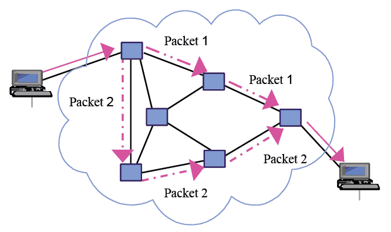

# ***<h1 align="center">Networks</h1>***
##### ***<h1 align="center">Source:AI and computer science textbook second edition IGCSE&O level second edition and computer science textbook AS&A level(Both textbooks by David Watson and Helen Williams)</h1>***

### ***Network definition***
#### **A network is like a group of friends sharing ideas. A computer network is simply two or more devices—such as phones, laptops, or printers—connected together so they can share information and resources.Devices talk to each other using physical cables or wireless signals like Wi-Fi. Networks can be small, like the setup in your home, or huge, connecting devices across different countries. Every time you send a message, share a photo, or browse the web, you are using a network.In the end, networks make communicating and working together much faster. They also save time and resources by letting multiple devices share the same internet connection, printer, or files with ease.**

### **Packets**

#### *In networks, a packet is a small part of a larger piece of information that is sent over the internet. Each packet contains the a header, payload, and a trailer, which includes important details about the data, The header stores where it needs to go and who sent it. The header also helps the receiving device understand how to rearrange the packet back together. The payload is the place where the actual infromation is stored within the packet.This is to tell that all packets have been sent.When we send information over the internet, such as a photo, video, or message, the data is divided into smaller packets. These packets travel through network devices like routers and switches until they reach their destination. Once they arrive, the receiving device puts the packets back together so the information can be viewed or used. This process is similar to building a puzzle, where each piece is sent separately and then joined together to complete the picture.Sending data in packets also makes the internet more efficient because many devices can send and receive information at the same time. This method is called packet switching. Instead of one connection taking up the whole network, packets can travel through available routes, allowing many people to use the internet simultaneously.*

*This picture shows the available paths where the packets will go and they will seperate to different routes since if a router or link fails, packets can automatically reroute around the problem so that the packets won't get lost and never received*

### **Components of the computer network**
#### ***Nodes(devices)***
#### Node: Any device connected to a network capable of sending, receiving, or processing data (e.g., laptops, phones, printers, servers).
#### Key Function: Enables devices to exchange information and share resources over a network.
#### Example: In a home Wi-Fi setup, your phone, laptop, and printer are all individual nodes interacting with one another.
